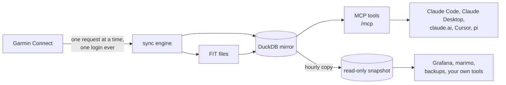

# garmin-mcp

[](https://github.com/justmytwospence/garmin-mcp/actions/workflows/ci.yml)
[](https://justmytwospence.github.io/garmin-mcp/)
[](https://github.com/justmytwospence/garmin-mcp/releases)
[](https://github.com/justmytwospence/garmin-mcp/pkgs/container/garmin-mcp)
[](LICENSE)

An [MCP](https://modelcontextprotocol.io) server for Garmin Connect that answers from a complete local mirror of your account. A paced background sync fills one [DuckDB](https://duckdb.org) file with everything Garmin Connect returns for you (activities and their original FIT files, every day's wellness data, training metrics, devices, gear, workouts, courses) and keeps it fresh; the 160 tools of [Taxuspt/garmin_mcp](https://github.com/Taxuspt/garmin_mcp) answer from it in milliseconds, plus three that expose the mirror as SQL. One `docker compose up`, one login.



## Features

- **Fast and quiet.** Tools read the mirror; Garmin is asked only for data that can still change and is stale for its kind. One request at a time, 1.5 s apart, a 30-minute pause on any 429, and never a login on its own.
- **Complete.** 90 datasets: every activity with laps, splits, zones, weather, gear and sets; every day's heart rate, stress, Body Battery, sleep with its overnight series, respiration, SpO2, HRV, readiness, training status, VO2 max; the profile, devices, gear, zones, records, badges, goals, workouts, calendar, courses. Original FIT files decoded to per-second records. Archived intraday days recovered from the wellness FIT files, with Garmin's reload quota as the fallback.
- **Kept as received.** Every response is stored verbatim with its history, then projected into typed tables with a description and unit on every column. Fields Garmin adds later are reported, never lost.
- **Yours to query.** `garmin_query` runs read-only SQL over everything. A read-only snapshot is published next to the mirror and, optionally, over HTTP for Grafana, notebooks and backups; compose profiles ship all three.
- **Drop-in.** Same tool names, parameters and descriptions as upstream, so existing prompts and client configurations keep working. Every result ends with a provenance line.

## Quickstart

```sh
git clone https://github.com/justmytwospence/garmin-mcp.git && cd garmin-mcp
cp .env.example .env                                 # set MCP_BEARER_TOKEN (openssl rand -hex 32)
docker compose up -d                                 # http://localhost:8000/mcp
docker compose run --rm garmin-mcp garmin-mcp-auth   # once: email, password, MFA code
docker compose restart garmin-mcp                    # picks up the tokens; the backfill starts
```

Then add `http://localhost:8000/mcp` with header `Authorization: Bearer <MCP_BEARER_TOKEN>` to your client (`claude mcp add --transport http garmin http://localhost:8000/mcp --header "Authorization: Bearer ..."`). The last months are mirrored within hours, a few years in about a week; tools work from the first minute.

Optional profiles: `docker compose --profile grafana --profile notebooks --profile backup up -d`, and `--profile oauth` to put OAuth 2.1 with your own OIDC provider in front of the server for claude.ai.

## Documentation

**[justmytwospence.github.io/garmin-mcp](https://justmytwospence.github.io/garmin-mcp/)**: [quickstart](https://justmytwospence.github.io/garmin-mcp/quickstart/), [configuration](https://justmytwospence.github.io/garmin-mcp/configuration/), [authentication](https://justmytwospence.github.io/garmin-mcp/authentication/), [clients](https://justmytwospence.github.io/garmin-mcp/clients/), [how sync works](https://justmytwospence.github.io/garmin-mcp/sync/), [data and schema](https://justmytwospence.github.io/garmin-mcp/data/), [extras](https://justmytwospence.github.io/garmin-mcp/extras/), [operations](https://justmytwospence.github.io/garmin-mcp/operations/), [tools reference](https://justmytwospence.github.io/garmin-mcp/reference/tools/). The same pages are in [`docs/`](docs/).

## Development

```sh
uv sync --group docs
uv run pytest                         # about 4 minutes: mirror on scrubbed payloads, engine against a fake Garmin, server end to end
uv run mkdocs serve                   # the documentation site
uv run python scripts/gen_tools.py    # regenerate docs/reference/tools.md after changing tools
uv run python scripts/gen_schema.py   # regenerate docs/data/schema.md after changing tables
docker build -t garmin-mcp:local .
```

See [CONTRIBUTING.md](CONTRIBUTING.md) for how the code is organised and what a change needs.

## Credits and license

MIT. Tool definitions, descriptions, the workout builders and validators, the FIT analyses, the challenge mappings and the nutrition tools are adapted or vendored from [Taxuspt/garmin_mcp](https://github.com/Taxuspt/garmin_mcp) (MIT). Garmin Connect access through [python-garminconnect](https://github.com/cyberjunky/python-garminconnect) (MIT); FIT decoding through Garmin's [FIT SDK](https://developer.garmin.com/fit/). Garmin's API is unofficial and nothing here is endorsed by or affiliated with Garmin. Use it for your own data.
