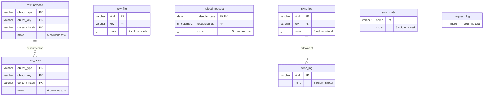

# Garmin MCP Server

An MCP (Model Context Protocol) server for Garmin Connect, backed by a complete local
mirror of the user's Garmin data in [DuckDB](https://duckdb.org/). The tool set follows
[Taxuspt/garmin_mcp](https://github.com/Taxuspt/garmin_mcp) (same tool names, parameters
and descriptions, so existing clients keep working), but tools answer from the mirror
instead of calling Garmin for every question. Python, [python-garminconnect](https://github.com/cyberjunky/python-garminconnect)
and the [MCP Python SDK](https://github.com/modelcontextprotocol/python-sdk).

Garmin Connect has no public API: python-garminconnect speaks the private one the
Connect app uses, which Garmin may change or rate-limit at any time. This server is
meant for one person's own data.

## The mirror

The server keeps everything Garmin Connect returns for the logged-in user in one DuckDB
file and answers tools from it, so most calls cost no Garmin request and return in
milliseconds. A background sync fills and refreshes it, paced to stay well inside what
Garmin tolerates.

- **What is stored:** every activity (summary, detail, laps, typed splits, split
  summaries, weather, time in heart-rate and power zones, gear, strength exercise sets,
  the encoded track) and its **original FIT file**, decoded into typed tables
  (`fit_session`, `fit_lap`, `fit_record` with every per-second sample, `fit_event`,
  `fit_hrv`, device info); every day's wellness data (daily summary, heart rate, stress
  and Body Battery, sleep with all overnight series, respiration, pulse ox, floors, steps
  intervals, intensity minutes, HRV, training readiness, training status, VO2 max and
  acclimation, endurance and hill scores, fitness age, hydration, naps, auto-detected
  events, lifestyle logging, cycling ability, running tolerance) and the daily wellness
  FIT bundles; weigh-ins, blood pressure, resting-HR and calorie series; the profile and
  settings, devices and their settings, sensors, gear and gear stats, heart-rate and
  power zones, personal records, badges and challenges, goals, workouts and the
  calendar, training plans, courses, calendar events, race predictions and lifetime
  totals. 90 datasets in all; `garmin_sync_status` lists them with their coverage.
- **How:** every response is stored verbatim in `raw_payload` (a new row only when it
  changed, so it doubles as edit history) and projected into typed tables with a
  description and unit on every column (`garmin_schema` lists them). Fields Garmin adds
  later stay in the raw JSON and are reported by `garmin_sync_status` until mapped. The
  binary files live under `fit/` next to the database (`raw_file` is the manifest).
- **Sync and pacing:** one request at a time, about 1.5 s apart for background work,
  tool calls first and closer together. The first run loads the profile and lists every
  activity, then backfills newest first: the fast per-range daily summaries, then each
  day's datasets and each activity's detail and FIT file, then the slow snapshots. New
  syncs are detected by polling the last-used device every 15 minutes, which refreshes
  the last three days and lists new activities; a weekly full listing catches edits and
  deletions. A 429 pauses all background work for 30 minutes; 5xx and network errors
  are retried with backoff. An authentication failure stops background sync (the server
  never re-logs in on its own; see Authentication). A complete history of a few years
  takes about a week.
- **Archived intraday data:** Garmin offloads the per-sample series (heart rate, stress,
  sleep series, respiration, pulse ox, floors, HRV readings, Body Battery events) of days
  older than about six months; the day's summaries stay. Garmin can restore a day on
  request (`POST wellness/epoch/request/{date}`, about 30 a day). The engine spends at
  most 25 of those a day on the oldest archived days, re-fetches them a few hours later,
  and shows the quota in `garmin_sync_status` (`reload_quota`); `request_reload` spends
  one on demand.
- **Freshness:** tools serve the stored copy when it is fresh for its kind (today and
  yesterday after 15 minutes, the last week after 6 hours, older days never change;
  recent activities after 15 minutes, old ones only when the listing shows an edit;
  snapshots per dataset, a day to a week), fetch otherwise, and fall back to the stored
  copy, marked stale, when Garmin cannot be asked (backoff, outage, lost login). Every
  result ends with a provenance block saying which it was.
- **Writes** (activity edits, manual activities, deletions, workouts and scheduling,
  weigh-ins, blood pressure, hydration, body composition, gear links, heart-rate zones,
  nutrition, courses) go to Garmin first; the affected objects are then re-fetched into
  the mirror, never guessed. A write result says `write_committed: true`, `false` or
  `"unknown"` (a 5xx or timeout after the request went out), so a retry can be judged.
- **Other readers:** DuckDB allows one writing process, so the server publishes a
  consistent read-only copy to `snapshot/garmin.duckdb` next to the mirror (hourly when
  it changed; every 6 hours during a backfill) and, with `SNAPSHOT_TOKEN` set, serves it
  at `/snapshot.duckdb` with byte-range support:

  ```sql
  INSTALL httpfs; LOAD httpfs;
  CREATE SECRET (TYPE http, EXTRA_HTTP_HEADERS MAP {'Authorization': 'Bearer <SNAPSHOT_TOKEN>'});
  ATTACH 'http://<host>:8000/snapshot.duckdb' AS garmin (READ_ONLY);
  SELECT activity_type, count(*), sum(distance) / 1000 AS km FROM garmin.activity GROUP BY ALL;
  ```

  Back up the snapshot and the `fit/` directory, not the live file.

## Tools

Marking: **mirror** answers from the mirror (fetching on demand when stale), **computed**
is derived from the mirror's typed tables, **write** goes to Garmin then re-fetches,
**passthrough** is fetched from Garmin and cached briefly (data the mirror does not keep).

### The mirror
- **garmin_query** - Read-only DuckDB SQL over the whole mirror (no Garmin requests) (computed)
- **garmin_schema** - Tables and columns, with descriptions and units (computed)
- **garmin_sync_status** - Coverage per dataset, queue, last runs, errors, pacing and backoff, reload quota, login state, unmapped fields (computed)

### Activities
- **get_activities**, **get_activities_by_date**, **get_activities_fordate**, **count_activities** (mirror)
- **get_activity**, **get_activity_splits**, **get_activity_typed_splits**, **get_activity_split_summaries**, **get_activity_weather**, **get_activity_hr_in_timezones**, **get_activity_power_in_timezones**, **get_activity_gear**, **get_activity_exercise_sets**, **get_activity_types** (mirror)
- **set_activity_name**, **set_activity_type**, **set_activity_description**, **set_activity_event_type**, **set_perceived_effort**, **set_activity_feel**, **set_activity_exercise_sets**, **create_manual_activity**, **delete_activity** (write)

### Activity analysis
- **get_activity_fit_data** - Cycling dynamics, Di2 shifts, climbs, grade and HR-drift analysis, power curve from the stored FIT file (computed)
- **get_activity_fit_messages** - Every message of the stored FIT file, paginated (computed)
- **get_power_duration_curve** - Season bests across recent activities' FIT records (computed)
- **download_activity_file** - .fit from the mirror; gpx/tcx/csv exports (passthrough)
- **set_fit_download_dir** - Local configuration

### Health and wellness
- **get_stats**, **get_user_summary**, **get_steps_data**, **get_floors**, **get_heart_rates**, **get_heart_rates_summary**, **get_hydration_data**, **get_sleep_data**, **get_sleep_summary**, **get_stress_data**, **get_stress_summary**, **get_all_day_stress**, **get_respiration_data**, **get_respiration_summary**, **get_spo2_data**, **get_all_day_events**, **get_lifestyle_logging_data**, **get_training_readiness**, **get_morning_training_readiness**, **get_body_battery**, **get_body_battery_events**, **get_daily_steps**, **get_rhr_day**, **get_blood_pressure**, **get_body_composition**, **get_stats_and_body** (mirror)
- **get_stats_range**, **get_sleep_summary_range**, **get_weekly_steps**, **get_weekly_stress**, **get_weekly_intensity_minutes**, **get_recovery_time_remaining**, **get_energy_balance** (computed; energy balance also reads the nutrition log, passthrough)

### Training
- **get_training_status**, **get_training_load_balance**, **get_hrv_data**, **get_acclimation**, **get_hill_score**, **get_endurance_score**, **get_running_tolerance**, **get_cycling_ftp**, **get_training_effect** (mirror)
- **get_hrv_trend**, **get_vo2max_trend**, **get_respiration_trend**, **get_training_load_trend** (computed)
- **get_progress_summary_between_dates**, **get_running_tolerance_trend**, **get_fitnessage_data**, **get_lactate_threshold** (passthrough: Garmin-side reports)
- **request_reload** (write: spends one archive reload)

### Workouts and calendar
- **get_workouts**, **get_workout_by_id**, **get_calendar_events** (mirror)
- **get_scheduled_workouts**, **get_garmin_coach_workouts**, **get_training_plan_workouts** (passthrough: Garmin's GraphQL schedule)
- **download_workout** (passthrough)
- **upload_workout**, **upload_workouts**, **delete_workout**, **delete_workouts**, **schedule_workout**, **schedule_workouts**, **reschedule_workout**, **unschedule_workout**, **unschedule_workouts**, **schedule_week**, **create_run_workout**, **create_run_interval_workout**, **create_walk_run_workout**, **create_z2_walk_workout**, **create_strength_workout** (write)
- Resources `workout://templates/*` and `workout://reference/structure`

### Profile, devices, gear
- **get_full_name**, **get_unit_system**, **get_user_profile**, **get_userprofile_settings**, **get_heart_rate_zones**, **get_devices**, **get_device_last_used**, **get_device_settings**, **get_primary_training_device**, **get_device_alarms**, **get_gear** (mirror)
- **get_device_solar_data** (passthrough)
- **set_heart_rate_zones**, **push_workout_to_device**, **add_gear_to_activity**, **remove_gear_from_activity** (write)

### Weight and data entry
- **get_weigh_ins**, **get_daily_weigh_ins** (mirror)
- **add_weigh_in**, **add_weigh_in_with_timestamps**, **delete_weigh_ins**, **add_body_composition**, **set_blood_pressure**, **add_hydration_data** (write)

### Goals, records, badges, challenges
- **get_goals**, **get_personal_record**, **get_earned_badges**, **get_race_predictions**, **get_adhoc_challenges**, **get_available_badge_challenges**, **get_badge_challenges**, **get_non_completed_badge_challenges**, **get_inprogress_virtual_challenges** (mirror)

### Courses
- **get_courses**, **get_course_details**, **download_course_gpx** (mirror)
- **upload_course**, **delete_course** (write)

### Nutrition and women's health
- **get_nutrition_daily_food_log**, **get_nutrition_summary_between_dates**, **get_nutrition_daily_meals**, **get_nutrition_daily_settings**, **search_foods**, **get_custom_foods**, **get_custom_food_serving_units** (passthrough, cached 10 minutes)
- **set_nutrition_daily_settings**, **create_custom_food**, **update_custom_food**, **delete_custom_food**, **log_custom_food**, **log_food**, **delete_food_log**, **upsert_and_log** (write)
- **get_pregnancy_summary**, **get_menstrual_data_for_date**, **get_menstrual_calendar_data** (passthrough)

Tool selection works as upstream: `GARMIN_TOOL_PROFILE` (`all`, `minimal`, `health`,
`activities`, `workouts`, `training`, `nutrition`, or several comma-separated),
`GARMIN_ENABLED_TOOLS` (allowlist, adds to a profile) and `GARMIN_DISABLED_TOOLS`
(denylist). The mirror tools are part of every profile.

## Setup

### 1. Log in once

Garmin Connect logins need a password and usually an MFA code, so the server never
logs in by itself. Run the auth CLI once; it stores python-garminconnect's tokens
(`garmin_tokens.json`, refreshed in place by the library for months) in `GARMINTOKENS`:

```sh
garmin-mcp-auth            # prompts for email, password and the MFA code
garmin-mcp-auth --check    # verifies the stored tokens
```

In Docker: `docker compose exec garmin-mcp garmin-mcp-auth`. Tokens from a previous
python-garminconnect 0.3.x setup load as they are. If the tokens are rejected later,
background sync stops, `garmin_sync_status` reports `login.state = "failed"`, tools keep
serving the mirror (marked stale), and a new `garmin-mcp-auth` plus a restart fixes it.
`GARMIN_EMAIL`/`GARMIN_PASSWORD` are only a first-login fallback for accounts without
MFA.

### 2. Run it as a service (Docker)

```sh
docker compose up -d
docker compose exec garmin-mcp garmin-mcp-auth
```

The server speaks Streamable HTTP at `http://<host>:8000/mcp` (also at `/`), with a
health check at `/health`:

```json
{ "mcpServers": { "garmin": { "type": "http", "url": "http://localhost:8000/mcp" } } }
```

| Variable | Default | Meaning |
|---|---|---|
| `GARMINTOKENS` | `~/.garminconnect` (`/data/tokens` in the image) | Token directory written by `garmin-mcp-auth` |
| `GARMIN_EMAIL`, `GARMIN_PASSWORD` | (unset) | First-login fallback when no tokens exist and no MFA is needed |
| `GARMIN_IS_CN` | `false` | Use garmin.cn |
| `GARMIN_DB_PATH` | `./state/garmin.duckdb` (`/data/garmin.duckdb` in the image) | The mirror; FIT files go to `fit/` next to it. Mount a volume |
| `GARMIN_SNAPSHOT_DIR` | `snapshot/` next to the mirror | Where read-only snapshots are published |
| `GARMIN_HISTORY_START` | first activity or account creation | Earliest date the mirror backfills (YYYY-MM-DD) |
| `GARMIN_SYNC` | `on` | `off` serves from the mirror and fetches on demand, without background sync or snapshots |
| `MCP_TRANSPORT` | `stdio` (`http` in the image) | `stdio` or `http` |
| `PORT`, `MCP_HOST` | `8000`, `0.0.0.0` | HTTP bind |
| `MCP_ALLOWED_HOSTS` | (any) | Comma-separated hostnames allowed in the `Host` header (set it behind a reverse proxy; DNS-rebinding protection) |
| `MCP_BEARER_TOKEN` | (unset: open) | Require this bearer token on `/mcp` (constant-time compare) |
| `SNAPSHOT_TOKEN` | (unset: not served) | Bearer token for `GET /snapshot.duckdb` |
| `MCP_STATELESS_HTTP` | `false` | Serve each request without a session id |
| `GARMIN_TOOL_PROFILE`, `GARMIN_ENABLED_TOOLS`, `GARMIN_DISABLED_TOOLS` | all tools | Tool selection, as upstream |
| `GARMIN_MCP_CHARACTER_LIMIT` | `60000` | Tool results longer than this are truncated with a note |
| `GARMIN_FIT_DOWNLOAD_DIR`, `GARMIN_FIT_CONFIG` | (unset) | Where `download_activity_file` and `download_course_gpx` save files |
| `DUCKDB_MEMORY_LIMIT`, `DUCKDB_THREADS` | DuckDB defaults (`384MB`, `2` in the image) | Resource caps |
| `LOG_LEVEL` | `info` | Logging |

Images: `ghcr.io/justmytwospence/garmin-mcp`, published for amd64 and arm64 by pushing a
`vX.Y.Z` tag.

### 3. Or run it over stdio (Claude Desktop, Claude Code)

```sh
uv tool install git+https://github.com/justmytwospence/garmin-mcp   # or: uv sync in a checkout
garmin-mcp-auth
```

```json
{
  "mcpServers": {
    "garmin": {
      "command": "garmin-mcp",
      "env": { "GARMIN_DB_PATH": "/path/to/state/garmin.duckdb" }
    }
  }
}
```

The mirror is one file per process: run either the service or the stdio server against a
given `GARMIN_DB_PATH`, not both.

### 4. Account data export (optional)

Garmin's account data export (garmin.com, Manage Your Data) contains the original FIT
files. `garmin-mcp import-export <export.zip>` decodes them into the FIT tables without
any API call, keyed by the activity id in the file name (or matched by start time) and,
for wellness monitoring files, by date; the sync then skips those downloads.

## Development

```sh
uv sync
uv run pytest        # mirror against scrubbed real payloads, sync engine against a fake Garmin, the server end to end
docker build -t garmin-mcp:local .
```

The typed schema is declared once in `src/garmin_mcp/db/tables.py` and
`src/garmin_mcp/fit/tables.py` (columns, comments, and the JSON each is read from); DDL,
projections and the drift check are generated from it. A new column needs a migration in
`src/garmin_mcp/db/schema.py`. Datasets (endpoints, keys, refresh) are in
`src/garmin_mcp/garmin/datasets.py`.

## Credits and license

MIT. Tool definitions, descriptions, the workout builders and validators, the FIT
analyses, the challenge mappings and the nutrition tools are adapted or vendored from
[Taxuspt/garmin_mcp](https://github.com/Taxuspt/garmin_mcp) (MIT). Garmin Connect access
through [python-garminconnect](https://github.com/cyberjunky/python-garminconnect) (MIT).
Garmin's API is unofficial; nothing here is endorsed by Garmin.

## Database schema

Entity-relationship diagrams of the DuckDB mirror. Each table shows its primary-key and join columns plus its total column count; joins are logical (DuckDB foreign keys are not declared). Full column comments: the `garmin_schema` tool or `DESCRIBE` on the snapshot.

### activities

```mermaid
erDiagram
  activity {
    bigint activity_id PK
    bigint device_id FK
    bigint course_id FK
    bigint associated_workout_id FK
    _ more "215 columns total"
  }
  device {
    bigint device_id PK
    _ more "23 columns total"
  }
  gear {
    varchar uuid PK
    _ more "21 columns total"
  }
  course {
    bigint course_id PK
    _ more "20 columns total"
  }
  workout {
    bigint workout_id PK
    bigint training_plan_id FK
    _ more "20 columns total"
  }
  raw_file {
    varchar kind PK
    varchar key PK
    _ more "9 columns total"
  }
  activity_detail_metric {
    bigint activity_id PK,FK
    integer metrics_index PK
    _ more "10 columns total"
  }
  activity_exercise_set {
    bigint activity_id PK,FK
    integer idx PK
    _ more "14 columns total"
  }
  activity_gear {
    bigint activity_id PK,FK
    varchar gear_uuid PK,FK
    _ more "9 columns total"
  }
  activity_lap {
    bigint activity_id PK,FK
    integer lap_index PK
    _ more "97 columns total"
  }
  activity_lap_event {
    bigint activity_id PK,FK
    integer idx PK
    _ more "9 columns total"
  }
  activity_polyline {
    bigint activity_id PK,FK
    _ more "13 columns total"
  }
  activity_split_summary {
    bigint activity_id PK,FK
    varchar split_type PK
    _ more "97 columns total"
  }
  activity_time_in_zone {
    bigint activity_id PK,FK
    varchar kind PK
    integer zone_number PK
    _ more "6 columns total"
  }
  activity_typed_split {
    bigint activity_id PK,FK
    integer idx PK
    _ more "98 columns total"
  }
  activity_weather {
    bigint activity_id PK,FK
    _ more "16 columns total"
  }
  personal_record {
    bigint id PK
    bigint activity_id FK
    _ more "14 columns total"
  }
  body_battery_event {
    date calendar_date PK,FK
    integer idx PK
    bigint activity_id FK
    _ more "18 columns total"
  }
  activity ||--o{ activity_detail_metric : "activity_id"
  activity ||--o{ activity_exercise_set : "activity_id"
  activity ||--o{ activity_gear : "activity_id"
  activity ||--o{ activity_lap : "activity_id"
  activity ||--o{ activity_lap_event : "activity_id"
  activity ||--o{ activity_polyline : "activity_id"
  activity ||--o{ activity_split_summary : "activity_id"
  activity ||--o{ activity_time_in_zone : "activity_id"
  activity ||--o{ activity_typed_split : "activity_id"
  activity ||--o{ activity_weather : "activity_id"
  activity ||--o{ body_battery_event : "activity_id"
  activity ||--o{ personal_record : "activity_id"
  device ||--o{ activity : "device_id"
  gear ||--o{ activity_gear : "gear_uuid"
  course ||--o{ activity : "course_id"
  workout ||--o{ activity : "associated_workout_id"
  activity ||--o{ body_battery_event : "activity_id"
```



### activity FIT

```mermaid
erDiagram
  activity {
    bigint activity_id PK
    bigint device_id FK
    bigint course_id FK
    bigint associated_workout_id FK
    _ more "215 columns total"
  }
  raw_file {
    varchar kind PK
    varchar key PK
    _ more "9 columns total"
  }
  fit_device_info {
    varchar fit_file_id PK,FK
    integer idx PK
    _ more "24 columns total"
  }
  fit_event {
    varchar fit_file_id PK,FK
    integer idx PK
    _ more "13 columns total"
  }
  fit_file {
    varchar fit_file_id PK
    varchar key FK
    _ more "14 columns total"
  }
  fit_hrv {
    varchar fit_file_id PK,FK
    integer idx PK
    integer pos PK
    _ more "5 columns total"
  }
  fit_lap {
    varchar fit_file_id PK,FK
    integer message_index PK
    _ more "124 columns total"
  }
  fit_length {
    varchar fit_file_id PK,FK
    integer message_index PK
    _ more "16 columns total"
  }
  fit_message {
    varchar fit_file_id PK,FK
    varchar mesg PK
    integer idx PK
    _ more "6 columns total"
  }
  fit_record {
    varchar fit_file_id PK,FK
    integer idx PK
    _ more "48 columns total"
  }
  fit_session {
    varchar fit_file_id PK,FK
    integer message_index PK
    _ more "124 columns total"
  }
  fit_split {
    varchar fit_file_id PK,FK
    integer message_index PK
    _ more "35 columns total"
  }
  fit_time_in_zone {
    varchar fit_file_id PK,FK
    integer idx PK
    _ more "17 columns total"
  }
  fit_file ||--o{ fit_device_info : "fit_file_id"
  fit_file ||--o{ fit_event : "fit_file_id"
  fit_file ||--o{ fit_hrv : "fit_file_id"
  fit_file ||--o{ fit_lap : "fit_file_id"
  fit_file ||--o{ fit_length : "fit_file_id"
  fit_file ||--o{ fit_message : "fit_file_id"
  fit_file ||--o{ fit_record : "fit_file_id"
  fit_file ||--o{ fit_session : "fit_file_id"
  fit_file ||--o{ fit_split : "fit_file_id"
  fit_file ||--o{ fit_time_in_zone : "fit_file_id"
  activity ||--o{ fit_file : "activity FIT (kind=activity_fit)"
  raw_file ||--o{ fit_file : "decoded from"
```



### daily wellness, sleep and training

```mermaid
erDiagram
  daily_summary {
    date calendar_date PK
    _ more "95 columns total"
  }
  all_day_event {
    date calendar_date PK,FK
    timestamptz start_timestamp_gmt PK
    _ more "13 columns total"
  }
  body_battery_day {
    date calendar_date PK,FK
    _ more "13 columns total"
  }
  body_battery_event {
    date calendar_date PK,FK
    integer idx PK
    bigint activity_id FK
    _ more "18 columns total"
  }
  cycling_ability {
    date calendar_date PK,FK
    _ more "14 columns total"
  }
  daily_summary_v2 {
    date calendar_date PK,FK
    _ more "43 columns total"
  }
  endurance_score {
    date calendar_date PK,FK
    _ more "5 columns total"
  }
  fitness_age {
    date calendar_date PK,FK
    _ more "7 columns total"
  }
  floors_day {
    date calendar_date PK,FK
    _ more "8 columns total"
  }
  heart_rate_day {
    date calendar_date PK,FK
    _ more "13 columns total"
  }
  hill_score {
    date calendar_date PK,FK
    _ more "12 columns total"
  }
  hrv {
    date calendar_date PK,FK
    _ more "22 columns total"
  }
  hydration {
    date calendar_date PK,FK
    _ more "9 columns total"
  }
  intensity_minutes_day {
    date calendar_date PK,FK
    _ more "18 columns total"
  }
  lifestyle_logging {
    date calendar_date PK,FK
    _ more "4 columns total"
  }
  max_metrics {
    date calendar_date PK,FK
    _ more "16 columns total"
  }
  nap {
    date calendar_date PK,FK
    timestamptz nap_start_timestamp_gmt PK
    _ more "13 columns total"
  }
  race_prediction {
    timestamptz fetched_at PK
    date calendar_date FK
    _ more "6 columns total"
  }
  respiration_day {
    date calendar_date PK,FK
    _ more "25 columns total"
  }
  running_tolerance {
    date calendar_date PK,FK
    _ more "3 columns total"
  }
  sleep {
    date calendar_date PK,FK
    _ more "61 columns total"
  }
  sleep_stats {
    date calendar_date PK,FK
    _ more "22 columns total"
  }
  spo2_day {
    date calendar_date PK,FK
    _ more "27 columns total"
  }
  steps_daily {
    date calendar_date PK,FK
    _ more "5 columns total"
  }
  steps_interval {
    date calendar_date PK,FK
    timestamptz start_gmt PK
    _ more "8 columns total"
  }
  stress_day {
    date calendar_date PK,FK
    _ more "14 columns total"
  }
  training_readiness {
    date calendar_date PK,FK
    timestamptz timestamp PK
    _ more "30 columns total"
  }
  training_status {
    date calendar_date PK,FK
    _ more "17 columns total"
  }
  weigh_in {
    bigint sample_pk PK
    date calendar_date FK
    _ more "17 columns total"
  }
  wellness_metric {
    varchar metric PK
    date calendar_date PK,FK
    _ more "4 columns total"
  }
  heart_rate_sample {
    date calendar_date PK,FK
    timestamptz timestamp_gmt PK
    _ more "4 columns total"
  }
  stress_sample {
    date calendar_date PK,FK
    timestamptz timestamp_gmt PK
    _ more "7 columns total"
  }
  body_battery_sample {
    date calendar_date PK,FK
    timestamptz timestamp_gmt PK
    _ more "4 columns total"
  }
  respiration_sample {
    date calendar_date PK,FK
    timestamptz timestamp_gmt PK
    _ more "4 columns total"
  }
  floors_interval {
    date calendar_date PK,FK
    timestamptz start_time_gmt PK
    _ more "6 columns total"
  }
  hrv_reading {
    date calendar_date PK,FK
    timestamptz reading_time_gmt PK
    _ more "5 columns total"
  }
  sleep_level {
    date calendar_date PK,FK
    timestamptz start_gmt PK
    _ more "5 columns total"
  }
  sleep_movement {
    date calendar_date PK,FK
    timestamptz start_gmt PK
    _ more "5 columns total"
  }
  sleep_sample {
    date calendar_date PK,FK
    varchar series PK
    timestamptz timestamp_gmt PK
    _ more "5 columns total"
  }
  reload_request {
    date calendar_date PK,FK
    timestamptz requested_at PK
    _ more "5 columns total"
  }
  heart_rate_day ||--o{ heart_rate_sample : "calendar_date"
  stress_day ||--o{ stress_sample : "calendar_date"
  body_battery_day ||--o{ body_battery_sample : "calendar_date"
  respiration_day ||--o{ respiration_sample : "calendar_date"
  floors_day ||--o{ floors_interval : "calendar_date"
  hrv ||--o{ hrv_reading : "calendar_date"
  sleep ||--o{ sleep_level : "calendar_date"
  sleep ||--o{ sleep_movement : "calendar_date"
  sleep ||--o{ sleep_sample : "calendar_date"
  daily_summary ||--o{ reload_request : "archive reload"
  daily_summary ||--o{ hrv : "same day"
  daily_summary ||--o{ lifestyle_logging : "same day"
  daily_summary ||--o{ body_battery_event : "same day"
  daily_summary ||--o{ cycling_ability : "same day"
  daily_summary ||--o{ endurance_score : "same day"
  daily_summary ||--o{ training_readiness : "same day"
  daily_summary ||--o{ nap : "same day"
  daily_summary ||--o{ race_prediction : "same day"
  daily_summary ||--o{ steps_daily : "same day"
  daily_summary ||--o{ hill_score : "same day"
  daily_summary ||--o{ weigh_in : "same day"
  daily_summary ||--o{ sleep_stats : "same day"
  daily_summary ||--o{ body_battery_day : "same day"
  daily_summary ||--o{ max_metrics : "same day"
  daily_summary ||--o{ daily_summary_v2 : "same day"
  daily_summary ||--o{ sleep : "same day"
  daily_summary ||--o{ training_status : "same day"
  daily_summary ||--o{ fitness_age : "same day"
  daily_summary ||--o{ respiration_day : "same day"
  daily_summary ||--o{ stress_day : "same day"
  daily_summary ||--o{ wellness_metric : "same day"
  daily_summary ||--o{ heart_rate_day : "same day"
  daily_summary ||--o{ spo2_day : "same day"
  daily_summary ||--o{ intensity_minutes_day : "same day"
  daily_summary ||--o{ hydration : "same day"
  daily_summary ||--o{ floors_day : "same day"
  daily_summary ||--o{ all_day_event : "same day"
  daily_summary ||--o{ steps_interval : "same day"
  daily_summary ||--o{ running_tolerance : "same day"
```



### wellness FIT

```mermaid
erDiagram
  daily_summary {
    date calendar_date PK
    _ more "95 columns total"
  }
  raw_file {
    varchar kind PK
    varchar key PK
    _ more "9 columns total"
  }
  fit_file {
    varchar fit_file_id PK
    varchar key FK
    _ more "14 columns total"
  }
  fit_hrv_status_summary {
    varchar fit_file_id PK,FK
    integer idx PK
    _ more "12 columns total"
  }
  fit_hrv_value {
    varchar fit_file_id PK,FK
    integer idx PK
    _ more "6 columns total"
  }
  fit_monitoring {
    varchar fit_file_id PK,FK
    integer idx PK
    _ more "23 columns total"
  }
  fit_monitoring_hr {
    varchar fit_file_id PK,FK
    integer idx PK
    _ more "7 columns total"
  }
  fit_monitoring_info {
    varchar fit_file_id PK,FK
    integer idx PK
    _ more "10 columns total"
  }
  fit_nap_event {
    varchar fit_file_id PK,FK
    integer idx PK
    _ more "12 columns total"
  }
  fit_respiration_rate {
    varchar fit_file_id PK,FK
    integer idx PK
    _ more "6 columns total"
  }
  fit_sleep_assessment {
    varchar fit_file_id PK,FK
    integer idx PK
    _ more "18 columns total"
  }
  fit_sleep_level {
    varchar fit_file_id PK,FK
    integer idx PK
    _ more "6 columns total"
  }
  fit_spo2 {
    varchar fit_file_id PK,FK
    integer idx PK
    _ more "8 columns total"
  }
  fit_stress_level {
    varchar fit_file_id PK,FK
    integer idx PK
    _ more "6 columns total"
  }
  fit_file ||--o{ fit_hrv_status_summary : "fit_file_id"
  fit_file ||--o{ fit_hrv_value : "fit_file_id"
  fit_file ||--o{ fit_monitoring : "fit_file_id"
  fit_file ||--o{ fit_monitoring_hr : "fit_file_id"
  fit_file ||--o{ fit_monitoring_info : "fit_file_id"
  fit_file ||--o{ fit_nap_event : "fit_file_id"
  fit_file ||--o{ fit_respiration_rate : "fit_file_id"
  fit_file ||--o{ fit_sleep_assessment : "fit_file_id"
  fit_file ||--o{ fit_sleep_level : "fit_file_id"
  fit_file ||--o{ fit_spo2 : "fit_file_id"
  fit_file ||--o{ fit_stress_level : "fit_file_id"
  raw_file ||--o{ fit_file : "decoded from"
  daily_summary ||--o{ fit_file : "wellness FIT (kind=wellness_fit)"
```



### account, devices and planning

```mermaid
erDiagram
  user_profile {
    bigint user_profile_pk PK
    _ more "25 columns total"
  }
  user_settings {
    bigint id PK
    _ more "30 columns total"
  }
  device {
    bigint device_id PK
    _ more "23 columns total"
  }
  device_settings {
    bigint device_id PK,FK
    _ more "13 columns total"
  }
  device_last_used {
    bigint user_device_id PK
    _ more "9 columns total"
  }
  sensor {
    bigint serial_number PK
    varchar sensor_type PK
    _ more "15 columns total"
  }
  heart_rate_zones {
    varchar sport PK
    _ more "13 columns total"
  }
  power_zones {
    varchar sport PK
    _ more "11 columns total"
  }
  gear {
    varchar uuid PK
    _ more "21 columns total"
  }
  goal {
    varchar kind PK
    bigint goal_pk PK
    _ more "14 columns total"
  }
  badge {
    bigint badge_id PK
    _ more "22 columns total"
  }
  challenge {
    varchar kind PK
    varchar uuid PK
    _ more "14 columns total"
  }
  workout {
    bigint workout_id PK
    bigint training_plan_id FK
    _ more "20 columns total"
  }
  training_plan {
    bigint training_plan_id PK
    _ more "8 columns total"
  }
  calendar_item {
    varchar month PK
    integer idx PK
    bigint workout_id FK
    bigint training_plan_id FK
    _ more "16 columns total"
  }
  calendar_event {
    bigint id PK
    _ more "7 columns total"
  }
  course {
    bigint course_id PK
    _ more "20 columns total"
  }
  blood_pressure {
    bigint version PK
    _ more "12 columns total"
  }
  snapshot {
    varchar kind PK
    _ more "3 columns total"
  }
  device ||--o{ device_settings : "device_id"
  workout ||--o{ calendar_item : "workout_id"
  training_plan ||--o{ workout : "training_plan_id"
  training_plan ||--o{ calendar_item : "training_plan_id"
```



### raw store and sync


