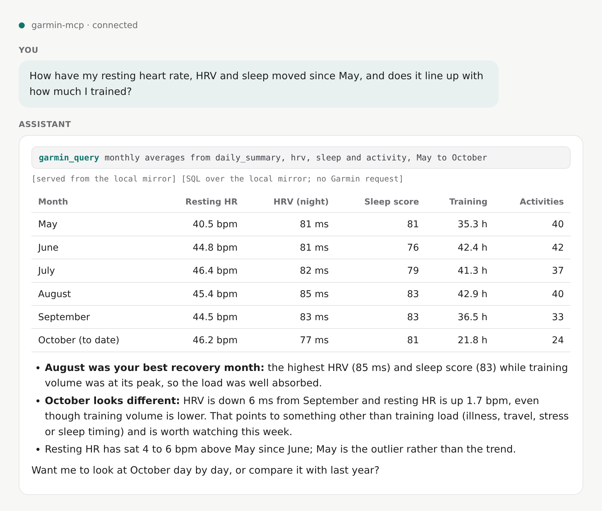
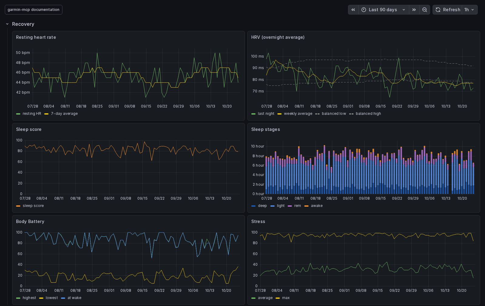
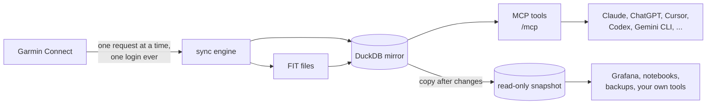

# garmin-mcp

[](https://github.com/justmytwospence/garmin-mcp/actions/workflows/ci.yml)
[](https://justmytwospence.github.io/garmin-mcp/)
[](https://github.com/justmytwospence/garmin-mcp/releases)
[](https://pypi.org/project/garmin-mirror-mcp/)
[](https://github.com/justmytwospence/garmin-mcp/pkgs/container/garmin-mcp)
[](LICENSE.md)

An [MCP](https://modelcontextprotocol.io) server for Garmin Connect that answers from a complete local mirror of your account. A paced background sync fills one [DuckDB](https://duckdb.org) file with everything Garmin Connect returns for you (activities and their original FIT files, every day's wellness data, training metrics, devices, gear, workouts, courses) and keeps it fresh. The <!-- count:tools-upstream -->157<!-- /count --> tools of [Taxuspt/garmin_mcp](https://github.com/Taxuspt/garmin_mcp) answer from it in milliseconds, plus <!-- count:tools-mirror -->3<!-- /count --> that expose the mirror as SQL. One `docker compose up`, one login.

**Documentation: [justmytwospence.github.io/garmin-mcp](https://justmytwospence.github.io/garmin-mcp/)**

<p align="center">
  
  
</p>



## Features

- **Complete.** 90 datasets: every activity with laps, splits, zones, weather, gear and sets; every day's heart rate, stress, Body Battery, sleep with its overnight series, respiration, SpO2, HRV, readiness, training status, VO2 max; the profile, devices, gear, zones, records, badges, goals, workouts, calendar, courses. Original FIT files decoded to per-second records. Archived intraday days recovered from the wellness FIT files.
- **Fast and gentle on Garmin.** Tools read the mirror; Garmin is asked only for data that can still change and is stale for its kind. One request at a time, 1.5 s apart, a 30-minute pause on any 429, and never a login on its own.
- **Kept as received.** Every response is stored verbatim with its history, then projected into typed tables with a description and unit on every column. Fields Garmin adds later are reported, never lost.
- **Yours to query.** `garmin_query` runs bounded, engine-enforced read-only SQL over everything. Local [MCP resources and review prompts](docs/reference/context.md) expose schema, coverage, usage and honest API-budget observations, plus cache-only activity/day context. Read `garmin://usage` for URI examples and prompt names even without template discovery. A read-only snapshot is published next to the mirror and, optionally, over HTTP for Grafana, notebooks and backups; compose profiles ship all three.
- **Drop-in.** Same tool names, parameters and descriptions as upstream, so existing prompts and client configurations keep working. Every result ends with a provenance line.
- **Optional Strava sync.** With [strava-mcp](https://github.com/justmytwospence/strava-mcp) next to it, activity names given on Strava reach Garmin and courses Strava's route sync left behind are cleaned up.
- **Bearer token or OAuth 2.1.** A static token for the clients you configure, or an OAuth profile with your own OpenID Connect provider for claude.ai, ChatGPT and phones.

## Quickstart

### Docker

```sh
git clone https://github.com/justmytwospence/garmin-mcp.git && cd garmin-mcp
cp .env.example .env                                 # set MCP_BEARER_TOKEN (openssl rand -hex 32)
docker compose run --rm garmin-mcp garmin-mcp-auth   # once: email, password, MFA code
docker compose up -d                                 # http://localhost:8000/mcp
```

Then add `http://localhost:8000/mcp` with header `Authorization: Bearer <MCP_BEARER_TOKEN>` to your client, for example `claude mcp add --transport http garmin http://localhost:8000/mcp --header "Authorization: Bearer ..."`. The last months are mirrored within hours, a few years in about a week; tools work from the first minute.

Optional profiles: `docker compose --profile grafana --profile notebooks --profile backup up -d`, and `--profile oauth` to put OAuth 2.1 with your own OIDC provider in front of the server for claude.ai and ChatGPT.

### Without Docker

The package is `garmin-mirror-mcp` on PyPI (published from the next release on); the commands are `garmin-mcp` and `garmin-mcp-auth`.

```sh
uvx --from garmin-mirror-mcp garmin-mcp-auth         # once: tokens go to ~/.garminconnect
uvx --from garmin-mirror-mcp garmin-mcp              # stdio server, for Claude Desktop and similar
MCP_TRANSPORT=http MCP_BEARER_TOKEN=... uvx --from garmin-mirror-mcp garmin-mcp   # or Streamable HTTP
```

`uv tool install garmin-mirror-mcp` puts both commands on your PATH; pin a release with `garmin-mirror-mcp==1.5.0`. The mirror lives in your user data directory (`~/.local/share/garmin-mcp`, `~/Library/Application Support/garmin-mcp`) unless `GARMIN_DB_PATH` says otherwise.

## Things you can ask

- "How has my resting heart rate moved since 2021, by quarter?"
- "Compare my last five long runs: pace, heart rate, cadence and the split where I faded."
- "Which weeks this year had the highest training load, and how did I sleep those weeks?"
- "Show the power duration curve of yesterday's ride against my best 20 minutes this season."
- "List every activity on the shoes I bought in March and the total distance on them."
- "Build a 10 km progression workout for Thursday and put it on my calendar."

## Documentation

[Quickstart](https://justmytwospence.github.io/garmin-mcp/quickstart/), [clients](https://justmytwospence.github.io/garmin-mcp/clients/), [FAQ](https://justmytwospence.github.io/garmin-mcp/faq/), [configuration](https://justmytwospence.github.io/garmin-mcp/configuration/), [authentication](https://justmytwospence.github.io/garmin-mcp/authentication/), [how sync works](https://justmytwospence.github.io/garmin-mcp/sync/), [the mirror and its schema](https://justmytwospence.github.io/garmin-mcp/data/), [extras](https://justmytwospence.github.io/garmin-mcp/extras/), [Strava sync](https://justmytwospence.github.io/garmin-mcp/strava-sync/), [operations](https://justmytwospence.github.io/garmin-mcp/operations/), [troubleshooting](https://justmytwospence.github.io/garmin-mcp/troubleshooting/), [tools reference](https://justmytwospence.github.io/garmin-mcp/reference/tools/), [changelog](CHANGELOG.md). The same pages are in [`docs/`](docs/).

## Works well with strava-mcp

[strava-mcp](https://justmytwospence.github.io/strava-mcp/) is the same idea for Strava: a local DuckDB mirror behind an MCP server. Run both and a client can ask across them; the optional [Strava sync](https://justmytwospence.github.io/garmin-mcp/strava-sync/) reads strava-mcp's export to keep Garmin's activity names and courses in step with Strava.

## Development

```sh
uv sync --group docs
uv run ruff check                     # lint
uv run pytest -q                      # 5 to 9 minutes: mirror on scrubbed payloads, engine against a fake Garmin, server end to end
uv run mkdocs serve                   # the documentation site
uv run python scripts/gen_tools.py    # regenerate docs/reference/tools.md (and the quoted counts) after changing tools
uv run python scripts/gen_schema.py   # regenerate docs/data/schema.md after changing tables
docker build -t garmin-mcp:local .
```

See [CONTRIBUTING.md](CONTRIBUTING.md) for how the code is organised, what a change needs and how releases work.

## Credits

Tool definitions, descriptions, the workout builders and validators, the FIT analyses, the challenge mappings and the nutrition tools are adapted or vendored from [Taxuspt/garmin_mcp](https://github.com/Taxuspt/garmin_mcp) (MIT). Garmin Connect access through [python-garminconnect](https://github.com/cyberjunky/python-garminconnect) (MIT); FIT decoding through Garmin's [FIT SDK](https://developer.garmin.com/fit/). Garmin's API is unofficial and nothing here is affiliated with, endorsed by or supported by Garmin. Use it for your own data.

## License

[PolyForm Noncommercial 1.0.0](LICENSE.md): free for personal use, research, education and noncommercial organizations. Commercial use requires a separate license; contact Spencer Boucher. Versions released before 2026-10-27 under MIT remain available under MIT. The code vendored from Taxuspt/garmin_mcp keeps its MIT license; see [NOTICE](NOTICE).

Outside contributions require agreeing to a contributor license agreement; open an issue before sending a pull request.
