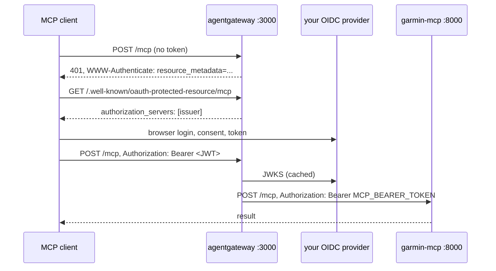

# Authentication

Two different things need authenticating: the server to Garmin (the one-time `garmin-mcp-auth` login, covered in the [quickstart](quickstart.md#2-log-in-once) and [troubleshooting](operations.md#login-problems)), and MCP clients to the server, which this page is about.

The server itself knows one mechanism: a static bearer token on `/mcp`. For anything beyond a trusted network (claude.ai, a phone, sharing a host), put the OAuth profile in front of it.

## Bearer token

With `MCP_BEARER_TOKEN` set, every request to `/mcp` (and `/`) must carry `Authorization: Bearer <token>`; anything else gets `401 {"error": "unauthorized"}`. The comparison is constant-time. `compose.yaml` makes the variable required.

`GET /snapshot.duckdb` has its own token, `SNAPSHOT_TOKEN`, so a dashboard host can read the data without being able to call tools. `/health` is open.

Behind a reverse proxy, also set `MCP_ALLOWED_HOSTS` to the hostname(s) clients use: the SDK then refuses requests whose `Host` header names anything else (DNS-rebinding protection) and only `localhost`/`127.0.0.1` stay implicitly allowed.

Bearer tokens suit clients you configure yourself (Claude Code, Claude Desktop, Cursor, pi, scripts). They do not suit claude.ai or other hosted clients, which expect to discover an OAuth authorization server and run a browser login; for those, read on.

## OAuth 2.1 with your own provider

The `oauth` compose profile runs [agentgateway](https://agentgateway.dev) as an OAuth 2.1 *resource server* in front of `/mcp`:



agentgateway publishes the protected-resource metadata that MCP clients look for, validates the JWT access token against the provider's JWKS (issuer, signature, expiry), checks that it was issued to the registered client, strips it, and forwards the request with `MCP_BEARER_TOKEN`. The server itself stays unchanged and unreachable except through the gateway on your network.

### Setting it up

1. Register a client in your provider (next section). Note the issuer URL, the JWKS URL and the client id. The client must be allowed the authorization code grant with PKCE, scopes `openid profile offline_access`, and the redirect URIs your MCP clients use (claude.ai: `https://claude.ai/api/mcp/auth_callback`; Claude Code and Cursor use `http://localhost:<port>/callback` with a random port, so allow a localhost wildcard where the provider supports it or register the ports it reports).
2. In `.env`:

    ```sh
    OIDC_ISSUER=https://auth.example.com            # exactly as in the provider's discovery document
    OIDC_JWKS_URL=https://auth.example.com/jwks.json
    OIDC_CLIENT_ID=garmin-mcp
    PUBLIC_URL=https://garmin.example.com           # where your reverse proxy exposes port 3000
    ```

3. `docker compose --profile oauth up -d`, and point your reverse proxy (Caddy, Traefik, nginx) with TLS at the `oauth` service's port 3000. The gateway serves plain HTTP; do not expose it without TLS.
4. In the MCP client, use `https://garmin.example.com/mcp` with no token. The client discovers the provider from `https://garmin.example.com/.well-known/oauth-protected-resource/mcp` and opens the login.

The authorization rule in `deploy/oauth/agentgateway.yaml` accepts a token when its `client_id` or `azp` claim equals `OIDC_CLIENT_ID`; providers disagree on which claim carries the client, and ID tokens (which carry neither) are refused. Edit the file to add a group or email check (`jwt.groups`, `jwt.email`) if the provider's users should not all have access. Setting `clientId` makes agentgateway answer dynamic client registration requests itself with that pre-registered client, which is what makes providers without RFC 7591 (DCR) work.

### Provider notes

Each provider publishes keys at a different URL and accepts redirect URIs differently; the rest is standard OIDC.

=== "Authelia"

    Issuer `https://auth.example.com`, JWKS `https://auth.example.com/jwks.json`. In `configuration.yml`, an OIDC client with `public: true`, `authorization_policy` of your choice, `redirect_uris` for your clients, `scopes: [openid, profile, offline_access]`, `grant_types: [authorization_code, refresh_token]` and `pkce_challenge_method: S256`. Authelia's device-code grant issues tokens with an empty `aud`, which is why the rule checks `client_id` rather than audience.

=== "Authentik"

    Issuer `https://auth.example.com/application/o/<slug>/`, JWKS `https://auth.example.com/application/o/<slug>/jwks/`. Create a *Provider* of type OAuth2/OpenID with client type public, the redirect URIs as regular expressions if you need localhost ports, and an *Application* bound to it; the slug is the application's. Authentik puts the client id in `aud` and `azp`.

=== "Keycloak"

    Issuer `https://auth.example.com/realms/<realm>`, JWKS `https://auth.example.com/realms/<realm>/protocol/openid-connect/certs`. A public client with *Standard flow* on, PKCE method `S256` (Advanced settings), *Valid redirect URIs* for your clients, and the `offline_access` scope allowed. Keycloak's access tokens carry the client in `azp`.

=== "Pocket ID"

    Issuer `https://auth.example.com`, JWKS `https://auth.example.com/.well-known/jwks.json`. Add an OIDC client, mark it public (PKCE), and list the callback URLs. Pocket ID issues tokens with the client id in `aud`; its access tokens carry `client_id` as well.

If your provider's access tokens are opaque rather than JWTs (some default to this), switch the client or provider to JWT access tokens; agentgateway validates JWTs only.

### Checking it

```sh
curl -s https://garmin.example.com/.well-known/oauth-protected-resource/mcp
# {"resource":"https://garmin.example.com/mcp","authorization_servers":["https://auth.example.com"],...}
curl -s -o /dev/null -w '%{http_code}\n' -X POST https://garmin.example.com/mcp -H 'content-type: application/json' -d '{}'
# 401
```

## Which one

| | Bearer token | OAuth profile |
|---|---|---|
| Claude Code, Cursor, pi, Claude Desktop (stdio or HTTP) | yes | yes |
| claude.ai, other hosted clients | no | yes |
| Several people, revocation, 2FA | no | through the provider |
| Moving parts | none | agentgateway, an OIDC provider, a TLS proxy |
