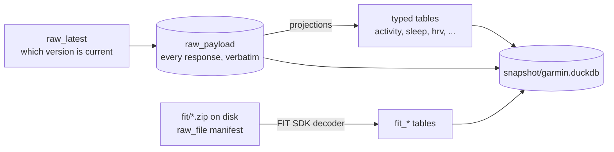

# The mirror

One DuckDB file holds everything: the raw store, the typed tables projected from it, the decoded FIT files, and the sync engine's bookkeeping. The [schema reference](schema.md) lists all <!-- count:tables -->101<!-- /count --> tables (<!-- count:fit-tables -->22<!-- /count --> of them FIT tables) and <!-- count:views -->1<!-- /count --> view with every column's type and description; this page explains how they fit together and how to read them.

## Three layers



**The raw store.** Every response Garmin returns is stored as the JSON text it sent, in `raw_payload`, keyed by dataset name, object key (activity id, calendar date, `self` for singletons) and the SHA-256 of the body. A new row is written only when the content changed, so the table is also the edit history of every object. `raw_latest` records, per object, which version is live and when Garmin was last asked about it, with a status of `ok`, `not_found` (Garmin had nothing, which is a normal answer for a day without a device) or `archived`. The `raw_current` view joins the two.

**Typed tables.** Every dataset has a projection: SQL that rebuilds the typed rows of a set of keys from their current payloads. Landing a payload and rebuilding the whole mirror from `raw_payload` run the same SQL, so the typed layer can always be regenerated. Column names are snake_case of Garmin's keys; every column has a comment with its unit (`garmin_schema` and `DESCRIBE` show them). `activity` merges the list element and the detail of each activity into one row of 215 columns; per-day tables are keyed by `calendar_date`; the `*_sample` tables hold the intraday series (`heart_rate_sample` every two minutes, `stress_sample` every three with Body Battery, `respiration_sample`, `sleep_sample` with six overnight series, ...).

**FIT tables.** The original activity files and the daily wellness bundles are kept on disk under `fit/` (`raw_file` is the manifest with hashes and parser versions) and decoded into `fit_*` tables. `fit_record` has one row per sample of every activity, which is where second-by-second heart rate, power, cadence, speed, altitude, position, temperature and running dynamics live; `fit_monitoring` and friends carry the same for the wellness days. Fields without a column are kept in each row's `extra` JSON; messages without a table are kept whole in `fit_message`.

The fourth group, the [raw store and sync tables](schema.md#raw), is the engine's queue (`sync_job`), its log (`sync_log`), its state (`sync_state`), archive reload requests and the request log.

## FIT tables

Where each series is, and the resolution:

| Series | API dataset (archived after ~6 months) | Wellness or activity FIT (kept) |
|---|---|---|
| Heart rate, all day | `heart_rate_sample`, 2 min | `fit_monitoring` / `fit_monitoring_hr`, 1-2 min |
| Steps | `steps_interval`, 15 min | `fit_monitoring` (cumulative, per interval) |
| Stress and Body Battery | `stress_sample`, 3 min | `fit_stress_level`, 1 min |
| Respiration | `respiration_sample`, 2 min | `fit_respiration_rate` |
| Pulse ox | `spo2_day` (summary only) | `fit_spo2` |
| Sleep stages, score, assessment | `sleep`, `sleep_level`, `sleep_sample` | `fit_sleep_level`, `fit_sleep_assessment` |
| Overnight HRV | `hrv`, `hrv_reading` (5 min) | `fit_hrv_status_summary`, `fit_hrv_value` |
| Naps | `nap` | `fit_nap_event` |
| An activity's samples | `activity_detail_metric` (reduced) | `fit_record`, 1 s |
| Laps, splits, lengths | `activity_lap`, `activity_typed_split` | `fit_lap`, `fit_split`, `fit_length` |

## The snapshot

DuckDB allows one process to write a file, and the server is that process. For everyone else it publishes `snapshot/garmin.duckdb`: after a `CHECKPOINT` under the write lock, the database file is copied and the copy atomically replaces the previous snapshot (hourly when something changed, every six hours during a backfill). The snapshot is a complete, self-contained, read-only DuckDB database; readers open it with `read_only=True` and keep working while the next one is written, because the replacement is a new file.

Locally (the volume mounted, or on the same host):

```sql
ATTACH '/data/snapshot/garmin.duckdb' AS garmin (READ_ONLY);
SELECT activity_type, count(*), round(sum(distance) / 1000) AS km
FROM garmin.activity WHERE deleted_at IS NULL GROUP BY ALL ORDER BY km DESC;
```

Over HTTP, from anywhere that can reach the server, with `SNAPSHOT_TOKEN` set (the route serves byte ranges, so DuckDB reads only the blocks a query needs):

```sql
INSTALL httpfs; LOAD httpfs;
CREATE SECRET garmin (TYPE http, EXTRA_HTTP_HEADERS MAP {'Authorization': 'Bearer <SNAPSHOT_TOKEN>'});
ATTACH 'https://garmin.example.com/snapshot.duckdb' AS garmin (READ_ONLY);
SELECT calendar_date, resting_heart_rate FROM garmin.daily_summary ORDER BY 1 DESC LIMIT 7;
```

From Python:

```python
import duckdb
con = duckdb.connect("/data/snapshot/garmin.duckdb", read_only=True)
con.sql("SELECT calendar_date, sleep_score, avg_overnight_hrv FROM sleep ORDER BY 1 DESC LIMIT 7").show()
```

## Example SQL

Through `garmin_query` (read-only, one statement, 30 s limit, 5000 rows at most) or any client on the snapshot.

Weekly training hours by sport this year:

```sql
SELECT date_trunc('week', start_time_local) AS week, activity_type, round(sum(duration) / 3600, 1) AS hours
FROM activity
WHERE deleted_at IS NULL AND start_time_local >= date_trunc('year', current_date)
GROUP BY ALL ORDER BY week DESC, hours DESC;
```

Resting heart rate, HRV and sleep score side by side, last 30 days:

```sql
SELECT d.calendar_date, d.resting_heart_rate, h.last_night_avg AS hrv, s.sleep_score
FROM daily_summary d
LEFT JOIN hrv h USING (calendar_date)
LEFT JOIN sleep s USING (calendar_date)
WHERE d.calendar_date >= current_date - 30
ORDER BY 1 DESC;
```

Best 20-minute power over the last 90 days, from the FIT records (1 Hz, so 1200 samples):

```sql
SELECT activity_id, max(p20) AS best_20min_w
FROM (
  SELECT activity_id,
         avg(power) OVER (PARTITION BY activity_id ORDER BY timestamp ROWS BETWEEN 1199 PRECEDING AND CURRENT ROW) AS p20
  FROM fit_record
  WHERE power IS NOT NULL AND timestamp >= now() - INTERVAL 90 DAY
)
GROUP BY 1 ORDER BY 2 DESC LIMIT 5;
```

Time in heart-rate zones per month:

```sql
SELECT date_trunc('month', a.start_time_local) AS month, z.zone_number, round(sum(z.secs_in_zone) / 3600, 1) AS hours
FROM activity_time_in_zone z JOIN activity a USING (activity_id)
WHERE z.kind = 'hr' GROUP BY ALL ORDER BY 1 DESC, 2;
```

A field that has no column yet, straight from the raw store:

```sql
SELECT object_key AS calendar_date, body->>'someNewField' AS value
FROM raw_current WHERE object_type = 'user_summary' ORDER BY 1 DESC LIMIT 7;
```

How complete the mirror is:

```sql
SELECT object_type, count(*) FILTER (WHERE status = 'ok') AS ok, count(*) FILTER (WHERE status <> 'ok') AS empty, max(checked_at) AS last_checked
FROM raw_latest GROUP BY 1 ORDER BY 1;
```

## Rebuilding the typed layer

The typed tables are derived. A release that changes a projection (a new column, a corrected unit) ships a migration that adds the column and rebuilds the affected tables from `raw_payload` on the next start; a release that changes the FIT decoder bumps its parser version, and files recorded with an older one are decoded again from disk (`raw_file.parser_version`). Nothing needs to be fetched again.
