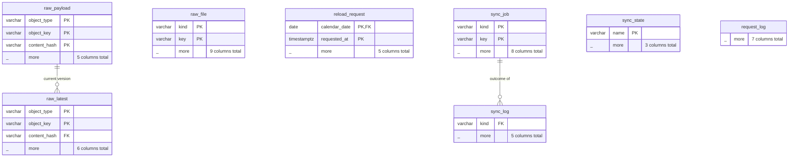

<!-- Generated by scripts/gen_schema.py; do not edit by hand. -->
# Schema reference

100 tables and 1 views, generated from a freshly migrated mirror. Each diagram shows a table's primary-key and join columns plus its column count; joins are logical (DuckDB foreign keys are not declared). Column comments carry the unit; the same text comes back from the `garmin_schema` tool and from `DESCRIBE` on the snapshot.

Units follow Garmin Connect: meters, seconds, meters per second, degrees Celsius, watts, bpm, kcal. Timestamps named `*_gmt` are UTC (`TIMESTAMPTZ`); `*_local` are wall-clock in the user's or the activity's time zone (`TIMESTAMP`). FIT tables use the FIT SDK's units after scale and offset; positions are degrees.

## Groups

- [Activities](#activities): `activity`, `device`, `gear`, `course`, `workout`, `raw_file`, `activity_detail_metric`, `activity_exercise_set`, `activity_gear`, `activity_lap`, `activity_lap_event`, `activity_polyline`, `activity_split_summary`, `activity_time_in_zone`, `activity_typed_split`, `activity_weather`, `personal_record`, `body_battery_event`
- [Activity FIT files](#activity-fit): `activity`, `raw_file`, `fit_device_info`, `fit_event`, `fit_file`, `fit_hrv`, `fit_lap`, `fit_length`, `fit_message`, `fit_record`, `fit_session`, `fit_split`, `fit_time_in_zone`
- [Daily wellness, sleep and training](#daily): `daily_summary`, `all_day_event`, `body_battery_day`, `body_battery_event`, `cycling_ability`, `daily_summary_v2`, `endurance_score`, `fitness_age`, `floors_day`, `heart_rate_day`, `hill_score`, `hrv`, `hydration`, `intensity_minutes_day`, `lifestyle_logging`, `max_metrics`, `nap`, `race_prediction`, `respiration_day`, `running_tolerance`, `sleep`, `sleep_stats`, `spo2_day`, `steps_daily`, `steps_interval`, `stress_day`, `training_readiness`, `training_status`, `weigh_in`, `wellness_metric`, `heart_rate_sample`, `stress_sample`, `body_battery_sample`, `respiration_sample`, `floors_interval`, `hrv_reading`, `sleep_level`, `sleep_movement`, `sleep_sample`, `reload_request`
- [Wellness FIT files](#wellness-fit): `daily_summary`, `raw_file`, `fit_file`, `fit_hrv_status_summary`, `fit_hrv_value`, `fit_monitoring`, `fit_monitoring_hr`, `fit_monitoring_info`, `fit_nap_event`, `fit_respiration_rate`, `fit_sleep_assessment`, `fit_sleep_level`, `fit_spo2`, `fit_stress_level`
- [Account, devices and planning](#account): `user_profile`, `user_settings`, `device`, `device_settings`, `device_last_used`, `sensor`, `heart_rate_zones`, `power_zones`, `gear`, `goal`, `badge`, `challenge`, `workout`, `training_plan`, `calendar_item`, `calendar_event`, `course`, `blood_pressure`, `snapshot`
- [Raw store and sync](#raw): `raw_payload`, `raw_latest`, `raw_file`, `reload_request`, `sync_job`, `sync_log`, `sync_state`, `request_log`

## Activities {: #activities }

One row per activity with its summary and detail merged, plus the per-activity tables (laps, splits, zones, weather, gear, sets, the encoded track) and what links to an activity.

```mermaid
erDiagram
  activity {
    bigint activity_id PK
    bigint device_id FK
    bigint course_id FK
    bigint associated_workout_id FK
    _ more "215 columns total"
  }
  device {
    bigint device_id PK
    _ more "23 columns total"
  }
  gear {
    varchar uuid PK
    _ more "21 columns total"
  }
  course {
    bigint course_id PK
    _ more "20 columns total"
  }
  workout {
    bigint workout_id PK
    bigint training_plan_id FK
    _ more "20 columns total"
  }
  raw_file {
    varchar kind PK
    varchar key PK
    _ more "9 columns total"
  }
  activity_detail_metric {
    bigint activity_id PK,FK
    integer metrics_index PK
    _ more "10 columns total"
  }
  activity_exercise_set {
    bigint activity_id PK,FK
    integer idx PK
    _ more "14 columns total"
  }
  activity_gear {
    bigint activity_id PK,FK
    varchar gear_uuid PK,FK
    _ more "9 columns total"
  }
  activity_lap {
    bigint activity_id PK,FK
    integer lap_index PK
    _ more "97 columns total"
  }
  activity_lap_event {
    bigint activity_id PK,FK
    integer idx PK
    _ more "9 columns total"
  }
  activity_polyline {
    bigint activity_id PK,FK
    _ more "13 columns total"
  }
  activity_split_summary {
    bigint activity_id PK,FK
    varchar split_type PK
    _ more "97 columns total"
  }
  activity_time_in_zone {
    bigint activity_id PK,FK
    varchar kind PK
    integer zone_number PK
    _ more "6 columns total"
  }
  activity_typed_split {
    bigint activity_id PK,FK
    integer idx PK
    _ more "98 columns total"
  }
  activity_weather {
    bigint activity_id PK,FK
    _ more "16 columns total"
  }
  personal_record {
    bigint id PK
    bigint activity_id FK
    _ more "14 columns total"
  }
  body_battery_event {
    date calendar_date PK,FK
    integer idx PK
    bigint activity_id FK
    _ more "18 columns total"
  }
  activity ||--o{ activity_detail_metric : "activity_id"
  activity ||--o{ activity_exercise_set : "activity_id"
  activity ||--o{ activity_gear : "activity_id"
  activity ||--o{ activity_lap : "activity_id"
  activity ||--o{ activity_lap_event : "activity_id"
  activity ||--o{ activity_polyline : "activity_id"
  activity ||--o{ activity_split_summary : "activity_id"
  activity ||--o{ activity_time_in_zone : "activity_id"
  activity ||--o{ activity_typed_split : "activity_id"
  activity ||--o{ activity_weather : "activity_id"
  activity ||--o{ body_battery_event : "activity_id"
  activity ||--o{ personal_record : "activity_id"
  device ||--o{ activity : "device_id"
  gear ||--o{ activity_gear : "gear_uuid"
  course ||--o{ activity : "course_id"
  workout ||--o{ activity : "associated_workout_id"
```



### `activity`

One row per Garmin Connect activity. Summary columns come from the activity list (search) and are overwritten by the activity detail once fetched; detail-only columns are null until then. Sport-specific metrics are null when not recorded. Deleted activities keep deleted_at set.

Primary key: `activity_id`.

??? abstract "215 columns"

    | Column | Type | Description |
    |---|---|---|
    | `activity_id` | bigint | Garmin activity id. |
    | `activity_name` | varchar | Activity title. |
    | `activity_type` | varchar | Activity type key (running, cycling, strength_training, ...). |
    | `activity_type_id` | integer | Activity type id. |
    | `parent_type_id` | integer | Parent activity type id. |
    | `event_type` | varchar | Event type key (uncategorized, race, training, ...). |
    | `start_time_local` | timestamp | Start, local wall clock. |
    | `start_time_gmt` | timestamp with time zone | Start (UTC). |
    | `end_time_gmt` | timestamp with time zone | End (UTC). |
    | `begin_timestamp` | timestamp with time zone | Start as epoch (UTC). |
    | `time_zone_id` | integer | Garmin time zone unit id. |
    | `sport_type_id` | integer | Sport type id. |
    | `device_id` | bigint | Recording device id. |
    | `manufacturer` | varchar | Device manufacturer. |
    | `location_name` | varchar | Location name. |
    | `owner_id` | bigint | Owner user profile id. |
    | `owner_display_name` | varchar | Owner display name. |
    | `owner_full_name` | varchar | Owner full name. |
    | `course_id` | bigint | Course followed, if any. |
    | `lap_count` | integer | Number of laps. |
    | `is_favorite` | boolean | Favorite flag. |
    | `is_pr` | boolean | Contains a personal record. |
    | `is_parent` | boolean | Multisport parent. |
    | `is_manual_activity` | boolean | Entered manually. |
    | `is_auto_calc_calories` | boolean | Calories auto-calculated. |
    | `is_elevation_corrected` | boolean | Elevation corrected by Garmin. |
    | `is_purposeful` | boolean | Purposeful activity flag. |
    | `is_atp_activity` | boolean | Belongs to an adaptive training plan. |
    | `has_polyline` | boolean | Has GPS track. |
    | `has_images` | boolean | Has photos. |
    | `has_video` | boolean | Has video. |
    | `has_splits` | boolean | Has splits. |
    | `has_intensity_intervals` | boolean | Has intensity intervals. |
    | `has_heat_map` | boolean | Has heat map. |
    | `privacy` | varchar | Privacy rule key (private, public, subscribers). |
    | `distance` | double | Distance in meters. |
    | `duration` | double | Timer duration in seconds. |
    | `elapsed_duration` | double | Elapsed duration in seconds. |
    | `moving_duration` | double | Moving duration in seconds. |
    | `elevation_gain` | double | Elevation gain in meters. |
    | `elevation_loss` | double | Elevation loss in meters. |
    | `min_elevation` | double | Lowest elevation in meters. |
    | `max_elevation` | double | Highest elevation in meters. |
    | `avg_elevation` | double | Average elevation in meters. |
    | `average_speed` | double | Average speed in m/s. |
    | `max_speed` | double | Maximum speed in m/s. |
    | `start_latitude` | double | Start latitude in degrees. |
    | `start_longitude` | double | Start longitude in degrees. |
    | `end_latitude` | double | End latitude in degrees. |
    | `end_longitude` | double | End longitude in degrees. |
    | `calories` | double | Calories in kcal. |
    | `bmr_calories` | double | Basal metabolic calories during the activity in kcal. |
    | `average_hr` | double | Average heart rate in bpm. |
    | `max_hr` | double | Maximum heart rate in bpm. |
    | `steps` | integer | Steps. |
    | `aerobic_training_effect` | double | Aerobic training effect (0-5). |
    | `anaerobic_training_effect` | double | Anaerobic training effect (0-5). |
    | `aerobic_training_effect_message` | varchar | Aerobic training effect label key. |
    | `anaerobic_training_effect_message` | varchar | Anaerobic training effect label key. |
    | `training_effect_label` | varchar | Primary benefit label (e.g. AEROBIC_BASE, TEMPO, VO2MAX). |
    | `activity_training_load` | double | Training load (EPOC-based) of the activity. |
    | `vo2max_value` | double | VO2 max estimate attached to the activity in ml/kg/min. |
    | `max_vertical_speed` | double | Maximum vertical speed in m/s. |
    | `water_estimated` | double | Estimated sweat loss in ml. |
    | `min_activity_lap_duration` | double | Shortest lap in seconds. |
    | `moderate_intensity_minutes` | integer | Moderate intensity minutes earned. |
    | `vigorous_intensity_minutes` | integer | Vigorous intensity minutes earned. |
    | `difference_body_battery` | integer | Body Battery change during the activity. |
    | `min_temperature` | double | Minimum temperature in degrees Celsius. |
    | `max_temperature` | double | Maximum temperature in degrees Celsius. |
    | `min_respiration_rate` | double | Minimum respiration rate in breaths/min. |
    | `max_respiration_rate` | double | Maximum respiration rate in breaths/min. |
    | `avg_respiration_rate` | double | Average respiration rate in breaths/min. |
    | `avg_grade_adjusted_speed` | double | Grade-adjusted average speed in m/s (runs). |
    | `training_stress_score` | double | Training Stress Score (power). |
    | `intensity_factor` | double | Intensity factor (power). |
    | `standing_time` | double | Time standing in seconds (cycling dynamics). |
    | `seated_time` | double | Time seated in seconds (cycling dynamics). |
    | `max_standing_power` | double | Max power while standing in watts. |
    | `max_seated_power` | double | Max power while seated in watts. |
    | `begin_potential_stamina` | double | Potential stamina at start (%). |
    | `end_potential_stamina` | double | Potential stamina at end (%). |
    | `min_available_stamina` | double | Lowest available stamina (%). |
    | `gain_solar_activity_time` | double | Solar gain time in seconds (solar devices). |
    | `avg_solar_charge_percent` | double | Average solar charge percent. |
    | `surface_type_unpaved_percentage` | double | Share of distance on unpaved surface (%). |
    | `average_running_cadence` | double | Average running cadence in steps/min. |
    | `max_running_cadence` | double | Maximum running cadence in steps/min. |
    | `average_biking_cadence` | double | Average cycling cadence in rpm. |
    | `max_biking_cadence` | double | Maximum cycling cadence in rpm. |
    | `avg_stride_length` | double | Average stride length in cm. |
    | `avg_vertical_oscillation` | double | Average vertical oscillation in cm. |
    | `avg_ground_contact_time` | double | Average ground contact time in ms. |
    | `avg_vertical_ratio` | double | Average vertical ratio in %. |
    | `avg_ground_contact_balance` | double | Average ground contact balance (% left). |
    | `avg_power` | double | Average power in watts. |
    | `max_power` | double | Maximum power in watts. |
    | `norm_power` | double | Normalized power in watts. |
    | `max_20min_power` | double | Best 20-minute power in watts. |
    | `avg_left_balance` | double | Average left/right balance (% left). |
    | `avg_standing_power` | double | Average power standing in watts. |
    | `avg_seated_power` | double | Average power seated in watts. |
    | `strokes` | double | Total strokes (cycling: pedal strokes; swimming: strokes). |
    | `max_double_cadence` | double | Maximum double cadence (both feet) in steps/min. |
    | `hr_time_in_zone_1` | double | Seconds in HR zone 1. |
    | `hr_time_in_zone_2` | double | Seconds in HR zone 2. |
    | `hr_time_in_zone_3` | double | Seconds in HR zone 3. |
    | `hr_time_in_zone_4` | double | Seconds in HR zone 4. |
    | `hr_time_in_zone_5` | double | Seconds in HR zone 5. |
    | `power_time_in_zone_1` | double | Seconds in power zone 1. |
    | `power_time_in_zone_2` | double | Seconds in power zone 2. |
    | `power_time_in_zone_3` | double | Seconds in power zone 3. |
    | `power_time_in_zone_4` | double | Seconds in power zone 4. |
    | `power_time_in_zone_5` | double | Seconds in power zone 5. |
    | `power_time_in_zone_6` | double | Seconds in power zone 6. |
    | `power_time_in_zone_7` | double | Seconds in power zone 7. |
    | `fastest_split_1000` | double | Fastest 1000 m split in seconds. |
    | `fastest_split_1609` | double | Fastest 1609 m split in seconds. |
    | `fastest_split_5000` | double | Fastest 5000 m split in seconds. |
    | `fastest_split_10000` | double | Fastest 10000 m split in seconds. |
    | `fastest_split_21098` | double | Fastest 21098 m split in seconds. |
    | `fastest_split_40000` | double | Fastest 40000 m split in seconds. |
    | `max_avg_power_1` | integer | Best 1 s average power in watts. |
    | `max_avg_power_2` | integer | Best 2 s average power in watts. |
    | `max_avg_power_5` | integer | Best 5 s average power in watts. |
    | `max_avg_power_10` | integer | Best 10 s average power in watts. |
    | `max_avg_power_20` | integer | Best 20 s average power in watts. |
    | `max_avg_power_30` | integer | Best 30 s average power in watts. |
    | `max_avg_power_60` | integer | Best 60 s average power in watts. |
    | `max_avg_power_120` | integer | Best 120 s average power in watts. |
    | `max_avg_power_300` | integer | Best 300 s average power in watts. |
    | `max_avg_power_600` | integer | Best 600 s average power in watts. |
    | `max_avg_power_1200` | integer | Best 1200 s average power in watts. |
    | `max_avg_power_1800` | integer | Best 1800 s average power in watts. |
    | `max_avg_power_3600` | integer | Best 3600 s average power in watts. |
    | `max_avg_power_7200` | integer | Best 7200 s average power in watts. |
    | `exclude_from_power_curve_reports` | boolean | Excluded from power curve. |
    | `is_deco_dive` | boolean | Decompression dive. |
    | `qualifying_dive` | boolean | Qualifying dive. |
    | `summarized_dive_info` | json | Dive summary (gases). |
    | `user_roles` | json | Owner roles. |
    | `user_pro` | boolean | Owner is Garmin Pro. |
    | `owner_profile_image_url_small` | varchar | Owner avatar (small). |
    | `owner_profile_image_url_medium` | varchar | Owner avatar (medium). |
    | `owner_profile_image_url_large` | varchar | Owner avatar (large). |
    | `activity_uuid` | varchar | Activity UUID. |
    | `parent` | boolean | Alias of isParent. |
    | `pr` | boolean | Alias of isPR. |
    | `favorite` | boolean | Alias of isFavorite. |
    | `atp_activity` | boolean | Alias of isAtpActivity. |
    | `deco_dive` | boolean | Alias of isDecoDive. |
    | `manual_activity` | boolean | Alias of isManualActivity. |
    | `elevation_corrected` | boolean | Alias of isElevationCorrected. |
    | `purposeful` | boolean | Alias of isPurposeful. |
    | `auto_calc_calories` | boolean | Alias of isAutoCalcCalories. |
    | `split_summaries_list` | json | Split summaries as embedded in the list element (usually empty; see activity_split_summary). |
    | `description` | varchar | Description (detail). |
    | `user_profile_id` | bigint | Owner user profile id (detail). |
    | `is_multi_sport_parent` | boolean | Multisport parent (detail). |
    | `access_control_rule` | varchar | Access control rule key (detail). |
    | `time_zone` | varchar | IANA time zone of the activity (detail). |
    | `metadata` | json | metadataDTO of the detail: device, sensors, upload dates, images, child activities, flags. |
    | `upload_date` | timestamp with time zone | When the activity was uploaded (detail). |
    | `last_update_date` | timestamp with time zone | Last edit on Garmin Connect (detail). |
    | `associated_course_id` | bigint | Course associated with the activity (detail). |
    | `associated_workout_id` | bigint | Workout associated with the activity (detail). |
    | `connect_iq_measurements` | json | Connect IQ developer field summary values (detail). |
    | `average_run_cadence` | double | Average running cadence in steps/min. |
    | `max_run_cadence` | double | Maximum running cadence in steps/min. |
    | `average_bike_cadence` | double | Average cycling cadence in rpm. |
    | `max_bike_cadence` | double | Maximum cycling cadence in rpm. |
    | `min_hr` | double | Minimum heart rate in bpm. |
    | `average_moving_speed` | double | Average moving speed in m/s. |
    | `average_temperature` | double | Average temperature in degrees Celsius. |
    | `ground_contact_time` | double | Average ground contact time in ms. |
    | `stride_length` | double | Average stride length in cm. |
    | `vertical_oscillation` | double | Average vertical oscillation in cm. |
    | `vertical_ratio` | double | Average vertical ratio in %. |
    | `training_effect` | double | Aerobic training effect (0-5). |
    | `average_power` | double | Average power in watts. |
    | `max_power_twenty_minutes` | double | Best 20-minute power in watts. |
    | `min_power` | double | Minimum power in watts. |
    | `normalized_power` | double | Normalized power in watts. |
    | `functional_threshold_power` | double | FTP used for the activity in watts. |
    | `total_work` | double | Work in kJ. |
    | `left_balance` | double | Left pedal balance in %. |
    | `right_balance` | double | Right pedal balance in %. |
    | `total_number_of_strokes` | integer | Total strokes. |
    | `average_seated_power` | double | Average power seated in watts. |
    | `average_standing_power` | double | Average power standing in watts. |
    | `max_seated_cadence` | double | Max cadence seated in rpm. |
    | `max_standing_cadence` | double | Max cadence standing in rpm. |
    | `average_seated_cadence` | double | Average cadence seated in rpm. |
    | `average_standing_cadence` | double | Average cadence standing in rpm. |
    | `left_power_phase_start` | double | Cycling dynamics leftPowerPhaseStart (degrees or mm) (detail). |
    | `left_power_phase_end` | double | Cycling dynamics leftPowerPhaseEnd (degrees or mm) (detail). |
    | `left_power_phase_arc_length` | double | Cycling dynamics leftPowerPhaseArcLength (degrees or mm) (detail). |
    | `left_power_phase_arc_center` | double | Cycling dynamics leftPowerPhaseArcCenter (degrees or mm) (detail). |
    | `left_power_phase_peak_start` | double | Cycling dynamics leftPowerPhasePeakStart (degrees or mm) (detail). |
    | `left_power_phase_peak_end` | double | Cycling dynamics leftPowerPhasePeakEnd (degrees or mm) (detail). |
    | `left_power_phase_peak_arc_length` | double | Cycling dynamics leftPowerPhasePeakArcLength (degrees or mm) (detail). |
    | `left_power_phase_peak_arc_center` | double | Cycling dynamics leftPowerPhasePeakArcCenter (degrees or mm) (detail). |
    | `left_platform_center_offset` | double | Cycling dynamics leftPlatformCenterOffset (degrees or mm) (detail). |
    | `right_power_phase_start` | double | Cycling dynamics rightPowerPhaseStart (degrees or mm) (detail). |
    | `right_power_phase_end` | double | Cycling dynamics rightPowerPhaseEnd (degrees or mm) (detail). |
    | `right_power_phase_arc_length` | double | Cycling dynamics rightPowerPhaseArcLength (degrees or mm) (detail). |
    | `right_power_phase_arc_center` | double | Cycling dynamics rightPowerPhaseArcCenter (degrees or mm) (detail). |
    | `right_power_phase_peak_start` | double | Cycling dynamics rightPowerPhasePeakStart (degrees or mm) (detail). |
    | `right_power_phase_peak_end` | double | Cycling dynamics rightPowerPhasePeakEnd (degrees or mm) (detail). |
    | `right_power_phase_peak_arc_length` | double | Cycling dynamics rightPowerPhasePeakArcLength (degrees or mm) (detail). |
    | `right_power_phase_peak_arc_center` | double | Cycling dynamics rightPowerPhasePeakArcCenter (degrees or mm) (detail). |
    | `right_platform_center_offset` | double | Cycling dynamics rightPlatformCenterOffset (degrees or mm) (detail). |
    | `summary_fetched_at` | timestamp with time zone | When the newest list (summary) payload was fetched. |
    | `detail_fetched_at` | timestamp with time zone | When the activity detail was fetched; null if never. |
    | `deleted_at` | timestamp with time zone | When the activity was found deleted on Garmin; null while it exists. |

### `device`

Registered devices (GET device-service/deviceregistration/devices and /historical). Capability flags stay in capabilities JSON; settings in device_settings.

Primary key: `device_id`.

??? abstract "23 columns"

    | Column | Type | Description |
    |---|---|---|
    | `device_id` | bigint | Device id. |
    | `unit_id` | bigint | Unit id (serial). |
    | `product_display_name` | varchar | Product name. |
    | `display_name` | varchar | Display name. |
    | `device_type_pk` | integer | Device type pk. |
    | `device_type_simple_name` | varchar | Simple type name. |
    | `application_key` | varchar | Application key. |
    | `part_number` | varchar | Part number. |
    | `product_sku` | varchar | SKU. |
    | `serial_number` | varchar | Serial number. |
    | `software_version` | varchar | Firmware version. |
    | `image_url` | varchar | Image URL. |
    | `primary_activity_tracker_indicator` | boolean | Primary activity tracker. |
    | `primary_training_device` | boolean | Primary training device. |
    | `device_categories` | json | Categories. |
    | `wellness` | boolean | Wellness device. |
    | `weight_scale` | boolean | Weight scale. |
    | `wifi` | boolean | Has WiFi. |
    | `has_optical_heart_rate` | boolean | Has optical HR. |
    | `device_tags` | json | Tags. |
    | `historical` | boolean | Listed only among historical (no longer registered) devices. |
    | `capabilities` | json | All *Capable flags and other fields of the registration object. |
    | `fetched_at` | timestamp with time zone | When this row's source payload was fetched from Garmin. |

### `gear`

Gear (shoes, bikes, ...) with usage stats (GET gear-service/gear/filterGear and /stats/{uuid}).

Primary key: `uuid`.

??? abstract "21 columns"

    | Column | Type | Description |
    |---|---|---|
    | `uuid` | varchar | Gear uuid. |
    | `gear_pk` | bigint | Gear pk. |
    | `user_profile_pk` | bigint | User profile id. |
    | `gear_make_name` | varchar | Make. |
    | `gear_model_name` | varchar | Model. |
    | `gear_type_name` | varchar | Type. |
    | `gear_status_name` | varchar | active or retired. |
    | `display_name` | varchar | Name. |
    | `custom_make_model` | varchar | Custom make/model. |
    | `image_name_large` | varchar | Image. |
    | `image_name_medium` | varchar | Image. |
    | `image_name_small` | varchar | Image. |
    | `date_begin` | timestamp with time zone | In use since (UTC). |
    | `date_end` | timestamp with time zone | Retired (UTC). |
    | `maximum_meters` | double | Max distance in meters. |
    | `notified` | boolean | Max distance notified. |
    | `create_date` | timestamp with time zone | Created (UTC). |
    | `update_date` | timestamp with time zone | Updated (UTC). |
    | `extra` | json | Other fields. |
    | `stats` | json | Usage stats payload (total distance, activities, ...). |
    | `fetched_at` | timestamp with time zone | When this row's source payload was fetched from Garmin. |

### `course`

Courses owned by the user (GET course-service/course/owner/{displayName}); the detail (course-service/course/{id}) adds geometry as JSON.

Primary key: `course_id`.

??? abstract "20 columns"

    | Column | Type | Description |
    |---|---|---|
    | `course_id` | bigint | Course id. |
    | `course_name` | varchar | Name. |
    | `course_description` | varchar | Description. |
    | `activity_type` | varchar | Activity type key. |
    | `distance_in_meters` | double | Length in meters. |
    | `elevation_gain_in_meters` | double | Elevation gain in meters. |
    | `elevation_loss_in_meters` | double | Elevation loss in meters. |
    | `start_latitude` | double | Start latitude. |
    | `start_longitude` | double | Start longitude. |
    | `speed_in_meters_per_second` | double | Planned speed in m/s. |
    | `created_date` | timestamp with time zone | Created (UTC). |
    | `updated_date` | timestamp with time zone | Updated (UTC). |
    | `favorite` | boolean | Favorite. |
    | `public` | boolean | Public. |
    | `has_pace_band` | boolean | Has pace band. |
    | `has_power_guide` | boolean | Has power guide. |
    | `extra` | json | Other fields of the list element. |
    | `detail` | json | Full course detail (geoPoints, coursePoints, boundingBox); null until fetched. |
    | `detail_fetched_at` | timestamp with time zone | When the detail was fetched. |
    | `fetched_at` | timestamp with time zone | When this row's source payload was fetched from Garmin. |

### `workout`

Workouts (GET workout-service/workouts list; detail from workout-service/workout/{id} fills workout_segments).

Primary key: `workout_id`.

??? abstract "20 columns"

    | Column | Type | Description |
    |---|---|---|
    | `workout_id` | bigint | Workout id. |
    | `owner_id` | bigint | Owner id. |
    | `workout_name` | varchar | Name. |
    | `description` | varchar | Description. |
    | `sport_type` | varchar | Sport type key. |
    | `sub_sport_type` | varchar | Sub sport type key. |
    | `created_date` | timestamp with time zone | Created (UTC). |
    | `updated_date` | timestamp with time zone | Updated (UTC). |
    | `training_plan_id` | bigint | Training plan id. |
    | `estimated_duration_in_secs` | integer | Estimated duration in seconds. |
    | `estimated_distance_in_meters` | double | Estimated distance in meters. |
    | `workout_provider` | varchar | Provider. |
    | `workout_source_id` | varchar | Source id. |
    | `consumer` | varchar | Consumer. |
    | `shared` | boolean | Shared. |
    | `author` | json | Author. |
    | `workout_segments` | json | Segments and steps (detail only). |
    | `detail` | json | Full workout detail payload (null until fetched). |
    | `extra` | json | Other fields of the list element. |
    | `fetched_at` | timestamp with time zone | When this row's source payload was fetched from Garmin. |

### `raw_file`

Manifest of binary files kept on disk under the data directory: original activity FIT zips (kind activity_fit, key activity id) and daily wellness FIT zips (kind wellness_fit, key date). parser_version/parsed_at say which decoder produced the fit_* and monitoring_* rows.

Primary key: `kind`, `key`.

??? abstract "9 columns"

    | Column | Type | Description |
    |---|---|---|
    | `kind` | varchar |  |
    | `key` | varchar |  |
    | `path` | varchar |  |
    | `sha256` | varchar |  |
    | `size` | bigint |  |
    | `fetched_at` | timestamp with time zone |  |
    | `parser_version` | integer |  |
    | `parsed_at` | timestamp with time zone |  |
    | `parse_error` | varchar |  |

### `activity_detail_metric`

Metric descriptors of the activity details chart payload (GET activity/{id}/details): which metric sits at which index of each activityDetailMetrics[].metrics array in raw_current (object_type activity_details). The per-second series themselves come from the original FIT file (fit_record).

Primary key: `activity_id`, `metrics_index`.

??? abstract "10 columns"

    | Column | Type | Description |
    |---|---|---|
    | `activity_id` | bigint | Activity id. |
    | `metrics_index` | integer | Index into the metrics arrays. |
    | `key` | varchar | Metric key (directHeartRate, directSpeed, directElevation, sumDistance, ...). |
    | `unit_key` | varchar | Unit key. |
    | `unit_factor` | double | Unit factor. |
    | `app_id` | varchar | Connect IQ app id (developer fields). |
    | `developer_field_number` | integer | Developer field number. |
    | `measurement_count` | integer | Points in the chart payload. |
    | `details_available` | boolean | Whether Garmin had chart data. |
    | `fetched_at` | timestamp with time zone | When this row's source payload was fetched from Garmin. |

### `activity_exercise_set`

Exercise sets of strength activities (GET activity/{id}/exerciseSets).

Primary key: `activity_id`, `idx`.

??? abstract "14 columns"

    | Column | Type | Description |
    |---|---|---|
    | `activity_id` | bigint | Activity id. |
    | `idx` | integer | Position in the set list. |
    | `set_type` | varchar | ACTIVE or REST. |
    | `category` | varchar | Exercise category of the most likely exercise. |
    | `exercise_name` | varchar | Exercise name of the most likely exercise. |
    | `exercises` | json | Exercise candidates ([{category, name, probability}]). |
    | `repetition_count` | integer | Repetitions. |
    | `weight` | double | Weight in grams. |
    | `duration` | double | Duration in seconds. |
    | `start_time` | timestamp with time zone | Set start (UTC). |
    | `message_index` | integer | FIT message index. |
    | `wkt_step_index` | integer | Workout step index. |
    | `extra` | json | Other fields of the set object. |
    | `fetched_at` | timestamp with time zone | When this row's source payload was fetched from Garmin. |

### `activity_gear`

Gear linked to each activity (GET gear-service/gear/filterGear?activityId=).

Primary key: `activity_id`, `gear_uuid`.

??? abstract "9 columns"

    | Column | Type | Description |
    |---|---|---|
    | `activity_id` | bigint | Activity id. |
    | `gear_uuid` | varchar | Gear uuid (references gear.uuid). |
    | `gear_pk` | bigint | Gear primary key. |
    | `display_name` | varchar | Gear name. |
    | `custom_make_model` | varchar | Make and model. |
    | `gear_type_name` | varchar | Gear type (Shoes, Bike, ...). |
    | `gear_status_name` | varchar | active or retired. |
    | `extra` | json | All other fields of the gear object. |
    | `fetched_at` | timestamp with time zone | When this row's source payload was fetched from Garmin. |

### `activity_lap`

Laps of each activity (GET activity/{id}/splits, lapDTOs). Sport-specific columns are null when not recorded.

Primary key: `activity_id`, `lap_index`.

??? abstract "97 columns"

    | Column | Type | Description |
    |---|---|---|
    | `activity_id` | bigint | Activity id. |
    | `lap_index` | integer | 1-based lap number. |
    | `message_index` | integer | FIT message index. |
    | `start_time_gmt` | timestamp with time zone | Lap start (UTC). |
    | `intensity_type` | varchar | Intensity type (ACTIVE, REST, WARMUP, COOLDOWN, ...). |
    | `start_latitude` | double | Start latitude. |
    | `start_longitude` | double | Start longitude. |
    | `end_latitude` | double | End latitude. |
    | `end_longitude` | double | End longitude. |
    | `distance` | double | Distance in meters. |
    | `duration` | double | Timer duration in seconds. |
    | `moving_duration` | double | Moving duration in seconds. |
    | `elapsed_duration` | double | Elapsed duration in seconds. |
    | `elevation_gain` | double | Elevation gain in meters. |
    | `elevation_loss` | double | Elevation loss in meters. |
    | `max_elevation` | double | Highest elevation in meters. |
    | `min_elevation` | double | Lowest elevation in meters. |
    | `average_speed` | double | Average speed in m/s. |
    | `average_moving_speed` | double | Average moving speed in m/s. |
    | `max_speed` | double | Max speed in m/s. |
    | `calories` | double | Calories in kcal. |
    | `bmr_calories` | double | BMR calories in kcal. |
    | `average_hr` | double | Average heart rate in bpm. |
    | `max_hr` | double | Max heart rate in bpm. |
    | `min_hr` | double | Min heart rate in bpm. |
    | `average_run_cadence` | double | Average run cadence in steps/min. |
    | `max_run_cadence` | double | Max run cadence in steps/min. |
    | `average_bike_cadence` | double | Average bike cadence in rpm. |
    | `max_bike_cadence` | double | Max bike cadence in rpm. |
    | `average_temperature` | double | Average temperature in degrees Celsius. |
    | `max_temperature` | double | Max temperature in degrees Celsius. |
    | `min_temperature` | double | Min temperature in degrees Celsius. |
    | `average_power` | double | Average power in watts. |
    | `max_power` | double | Max power in watts. |
    | `min_power` | double | Min power in watts. |
    | `normalized_power` | double | Normalized power in watts. |
    | `total_work` | double | Work in kJ. |
    | `left_balance` | double | Left balance in %. |
    | `right_balance` | double | Right balance in %. |
    | `total_number_of_strokes` | integer | Strokes. |
    | `standing_time` | double | Standing time in seconds. |
    | `max_seated_power` | double | Max seated power in watts. |
    | `max_standing_power` | double | Max standing power in watts. |
    | `average_seated_power` | double | Average seated power in watts. |
    | `average_standing_power` | double | Average standing power in watts. |
    | `max_seated_cadence` | double | Max seated cadence in rpm. |
    | `max_standing_cadence` | double | Max standing cadence in rpm. |
    | `average_seated_cadence` | double | Average seated cadence in rpm. |
    | `average_standing_cadence` | double | Average standing cadence in rpm. |
    | `ground_contact_time` | double | Ground contact time in ms. |
    | `stride_length` | double | Stride length in cm. |
    | `vertical_oscillation` | double | Vertical oscillation in cm. |
    | `vertical_ratio` | double | Vertical ratio in %. |
    | `avg_step_frequency` | double | Average step frequency in steps/min. |
    | `avg_step_length` | double | Average step length in cm. |
    | `max_vertical_speed` | double | Max vertical speed in m/s. |
    | `avg_vertical_speed` | double | Average vertical speed in m/s. |
    | `avg_elapsed_duration_vertical_speed` | double | Average vertical speed over elapsed time in m/s. |
    | `avg_grade_adjusted_speed` | double | Grade-adjusted speed in m/s. |
    | `max_respiration_rate` | double | Max respiration in breaths/min. |
    | `avg_respiration_rate` | double | Average respiration in breaths/min. |
    | `surface_type_unpaved_percentage` | double | Unpaved share in %. |
    | `total_exercise_reps` | integer | Exercise reps (strength). |
    | `avg_force` | double | Average force in N. |
    | `max_force` | double | Max force in N. |
    | `normalized_force` | double | Normalized force in N. |
    | `start_elevation` | double | Elevation at start in meters. |
    | `max_grade` | double | Max grade in %. |
    | `average_grade` | double | Average grade in %. |
    | `min_cadence` | double | Min cadence. |
    | `climb_pro_difficulty` | varchar | ClimbPro difficulty. |
    | `seated_time` | double | Seated time in seconds. |
    | `standing_count` | integer | Number of stands. |
    | `rider_position` | varchar | Rider position (SEATED, STANDING). |
    | `avg_descent_speed` | double | Average descent speed in m/s. |
    | `parent_index` | integer | Index of the parent split. |
    | `left_power_phase_start` | double | Cycling dynamics leftPowerPhaseStart. |
    | `left_power_phase_end` | double | Cycling dynamics leftPowerPhaseEnd. |
    | `left_power_phase_arc_length` | double | Cycling dynamics leftPowerPhaseArcLength. |
    | `left_power_phase_arc_center` | double | Cycling dynamics leftPowerPhaseArcCenter. |
    | `left_power_phase_peak_start` | double | Cycling dynamics leftPowerPhasePeakStart. |
    | `left_power_phase_peak_end` | double | Cycling dynamics leftPowerPhasePeakEnd. |
    | `left_power_phase_peak_arc_length` | double | Cycling dynamics leftPowerPhasePeakArcLength. |
    | `left_power_phase_peak_arc_center` | double | Cycling dynamics leftPowerPhasePeakArcCenter. |
    | `left_platform_center_offset` | double | Cycling dynamics leftPlatformCenterOffset. |
    | `right_power_phase_start` | double | Cycling dynamics rightPowerPhaseStart. |
    | `right_power_phase_end` | double | Cycling dynamics rightPowerPhaseEnd. |
    | `right_power_phase_arc_length` | double | Cycling dynamics rightPowerPhaseArcLength. |
    | `right_power_phase_arc_center` | double | Cycling dynamics rightPowerPhaseArcCenter. |
    | `right_power_phase_peak_start` | double | Cycling dynamics rightPowerPhasePeakStart. |
    | `right_power_phase_peak_end` | double | Cycling dynamics rightPowerPhasePeakEnd. |
    | `right_power_phase_peak_arc_length` | double | Cycling dynamics rightPowerPhasePeakArcLength. |
    | `right_power_phase_peak_arc_center` | double | Cycling dynamics rightPowerPhasePeakArcCenter. |
    | `right_platform_center_offset` | double | Cycling dynamics rightPlatformCenterOffset. |
    | `length_dtos` | json | Pool lengths (swimming). |
    | `connect_iq_measurement` | json | Connect IQ developer fields of the lap. |
    | `fetched_at` | timestamp with time zone | When this row's source payload was fetched from Garmin. |

### `activity_lap_event`

Timer and section events of each activity (GET activity/{id}/splits, eventDTOs).

Primary key: `activity_id`, `idx`.

??? abstract "9 columns"

    | Column | Type | Description |
    |---|---|---|
    | `activity_id` | bigint | Activity id. |
    | `idx` | integer | Position in the event list. |
    | `start_time_gmt` | timestamp with time zone | Event time (UTC). |
    | `start_time_gmt_double` | double | Event time as epoch ms. |
    | `section_type` | varchar | Section type key (start, stop, lap, ...). |
    | `section_type_id` | integer | Section type id. |
    | `section_type_key` | varchar | Section type key (upper case). |
    | `rider_position` | integer | Rider position for riderPosition events (0 seated, 1 standing). |
    | `fetched_at` | timestamp with time zone | When this row's source payload was fetched from Garmin. |

### `activity_polyline`

Encoded GPS track of each activity (GET activity/polyline/{id}): Google polyline format.

Primary key: `activity_id`.

??? abstract "13 columns"

    | Column | Type | Description |
    |---|---|---|
    | `activity_id` | bigint | Activity id. |
    | `number_of_points` | integer | Number of points. |
    | `encoded_samples` | varchar | Google-encoded polyline (lat/lon). |
    | `encoded_levels` | varchar | Google-encoded levels. |
    | `min_lat` | double | Bounding box min latitude. |
    | `max_lat` | double | Bounding box max latitude. |
    | `min_lon` | double | Bounding box min longitude. |
    | `max_lon` | double | Bounding box max longitude. |
    | `start_lat` | double | Start latitude. |
    | `start_lon` | double | Start longitude. |
    | `end_lat` | double | End latitude. |
    | `end_lon` | double | End longitude. |
    | `fetched_at` | timestamp with time zone | When this row's source payload was fetched from Garmin. |

### `activity_split_summary`

Per split-type summaries of each activity (GET activity/{id}/split_summaries).

Primary key: `activity_id`, `split_type`.

??? abstract "97 columns"

    | Column | Type | Description |
    |---|---|---|
    | `activity_id` | bigint | Activity id. |
    | `split_type` | varchar | Split type summarized. |
    | `no_of_splits` | integer | Number of splits of this type. |
    | `max_elevation_gain` | double | Max elevation gain of a split in meters. |
    | `average_elevation_gain` | double | Average elevation gain in meters. |
    | `max_distance` | integer | Longest split in meters. |
    | `max_distance_with_precision` | double | Longest split in meters (precise). |
    | `start_latitude` | double | Start latitude. |
    | `start_longitude` | double | Start longitude. |
    | `end_latitude` | double | End latitude. |
    | `end_longitude` | double | End longitude. |
    | `distance` | double | Distance in meters. |
    | `duration` | double | Timer duration in seconds. |
    | `moving_duration` | double | Moving duration in seconds. |
    | `elapsed_duration` | double | Elapsed duration in seconds. |
    | `elevation_gain` | double | Elevation gain in meters. |
    | `elevation_loss` | double | Elevation loss in meters. |
    | `max_elevation` | double | Highest elevation in meters. |
    | `min_elevation` | double | Lowest elevation in meters. |
    | `average_speed` | double | Average speed in m/s. |
    | `average_moving_speed` | double | Average moving speed in m/s. |
    | `max_speed` | double | Max speed in m/s. |
    | `calories` | double | Calories in kcal. |
    | `bmr_calories` | double | BMR calories in kcal. |
    | `average_hr` | double | Average heart rate in bpm. |
    | `max_hr` | double | Max heart rate in bpm. |
    | `min_hr` | double | Min heart rate in bpm. |
    | `average_run_cadence` | double | Average run cadence in steps/min. |
    | `max_run_cadence` | double | Max run cadence in steps/min. |
    | `average_bike_cadence` | double | Average bike cadence in rpm. |
    | `max_bike_cadence` | double | Max bike cadence in rpm. |
    | `average_temperature` | double | Average temperature in degrees Celsius. |
    | `max_temperature` | double | Max temperature in degrees Celsius. |
    | `min_temperature` | double | Min temperature in degrees Celsius. |
    | `average_power` | double | Average power in watts. |
    | `max_power` | double | Max power in watts. |
    | `min_power` | double | Min power in watts. |
    | `normalized_power` | double | Normalized power in watts. |
    | `total_work` | double | Work in kJ. |
    | `left_balance` | double | Left balance in %. |
    | `right_balance` | double | Right balance in %. |
    | `total_number_of_strokes` | integer | Strokes. |
    | `standing_time` | double | Standing time in seconds. |
    | `max_seated_power` | double | Max seated power in watts. |
    | `max_standing_power` | double | Max standing power in watts. |
    | `average_seated_power` | double | Average seated power in watts. |
    | `average_standing_power` | double | Average standing power in watts. |
    | `max_seated_cadence` | double | Max seated cadence in rpm. |
    | `max_standing_cadence` | double | Max standing cadence in rpm. |
    | `average_seated_cadence` | double | Average seated cadence in rpm. |
    | `average_standing_cadence` | double | Average standing cadence in rpm. |
    | `ground_contact_time` | double | Ground contact time in ms. |
    | `stride_length` | double | Stride length in cm. |
    | `vertical_oscillation` | double | Vertical oscillation in cm. |
    | `vertical_ratio` | double | Vertical ratio in %. |
    | `avg_step_frequency` | double | Average step frequency in steps/min. |
    | `avg_step_length` | double | Average step length in cm. |
    | `max_vertical_speed` | double | Max vertical speed in m/s. |
    | `avg_vertical_speed` | double | Average vertical speed in m/s. |
    | `avg_elapsed_duration_vertical_speed` | double | Average vertical speed over elapsed time in m/s. |
    | `avg_grade_adjusted_speed` | double | Grade-adjusted speed in m/s. |
    | `max_respiration_rate` | double | Max respiration in breaths/min. |
    | `avg_respiration_rate` | double | Average respiration in breaths/min. |
    | `surface_type_unpaved_percentage` | double | Unpaved share in %. |
    | `total_exercise_reps` | integer | Exercise reps (strength). |
    | `avg_force` | double | Average force in N. |
    | `max_force` | double | Max force in N. |
    | `normalized_force` | double | Normalized force in N. |
    | `start_elevation` | double | Elevation at start in meters. |
    | `max_grade` | double | Max grade in %. |
    | `average_grade` | double | Average grade in %. |
    | `min_cadence` | double | Min cadence. |
    | `climb_pro_difficulty` | varchar | ClimbPro difficulty. |
    | `seated_time` | double | Seated time in seconds. |
    | `standing_count` | integer | Number of stands. |
    | `rider_position` | varchar | Rider position (SEATED, STANDING). |
    | `avg_descent_speed` | double | Average descent speed in m/s. |
    | `parent_index` | integer | Index of the parent split. |
    | `left_power_phase_start` | double | Cycling dynamics leftPowerPhaseStart. |
    | `left_power_phase_end` | double | Cycling dynamics leftPowerPhaseEnd. |
    | `left_power_phase_arc_length` | double | Cycling dynamics leftPowerPhaseArcLength. |
    | `left_power_phase_arc_center` | double | Cycling dynamics leftPowerPhaseArcCenter. |
    | `left_power_phase_peak_start` | double | Cycling dynamics leftPowerPhasePeakStart. |
    | `left_power_phase_peak_end` | double | Cycling dynamics leftPowerPhasePeakEnd. |
    | `left_power_phase_peak_arc_length` | double | Cycling dynamics leftPowerPhasePeakArcLength. |
    | `left_power_phase_peak_arc_center` | double | Cycling dynamics leftPowerPhasePeakArcCenter. |
    | `left_platform_center_offset` | double | Cycling dynamics leftPlatformCenterOffset. |
    | `right_power_phase_start` | double | Cycling dynamics rightPowerPhaseStart. |
    | `right_power_phase_end` | double | Cycling dynamics rightPowerPhaseEnd. |
    | `right_power_phase_arc_length` | double | Cycling dynamics rightPowerPhaseArcLength. |
    | `right_power_phase_arc_center` | double | Cycling dynamics rightPowerPhaseArcCenter. |
    | `right_power_phase_peak_start` | double | Cycling dynamics rightPowerPhasePeakStart. |
    | `right_power_phase_peak_end` | double | Cycling dynamics rightPowerPhasePeakEnd. |
    | `right_power_phase_peak_arc_length` | double | Cycling dynamics rightPowerPhasePeakArcLength. |
    | `right_power_phase_peak_arc_center` | double | Cycling dynamics rightPowerPhasePeakArcCenter. |
    | `right_platform_center_offset` | double | Cycling dynamics rightPlatformCenterOffset. |
    | `fetched_at` | timestamp with time zone | When this row's source payload was fetched from Garmin. |

### `activity_time_in_zone`

Time in heart-rate and power zones per activity (GET activity/{id}/hrTimeInZones and /powerTimeInZones).

Primary key: `activity_id`, `kind`, `zone_number`.

??? abstract "6 columns"

    | Column | Type | Description |
    |---|---|---|
    | `activity_id` | bigint | Activity id. |
    | `kind` | varchar | hr or power. |
    | `zone_number` | integer | Zone number (1-based). |
    | `secs_in_zone` | double | Seconds in the zone. |
    | `zone_low_boundary` | integer | Lower boundary (bpm or watts). |
    | `fetched_at` | timestamp with time zone | When this row's source payload was fetched from Garmin. |

### `activity_typed_split`

Typed splits (intervals, climbs, run/walk, ...) of each activity (GET activity/{id}/typedsplits).

Primary key: `activity_id`, `idx`.

??? abstract "98 columns"

    | Column | Type | Description |
    |---|---|---|
    | `activity_id` | bigint | Activity id. |
    | `idx` | integer | Position in the split list. |
    | `type` | varchar | Split type (INTERVAL_ACTIVE, INTERVAL_RECOVERY, CLIMB_ACTIVE, RWD_RUN, RWD_WALK, ...). |
    | `message_index` | integer | FIT message index. |
    | `start_time_local` | timestamp | Start, local wall clock. |
    | `start_time_gmt` | timestamp with time zone | Start (UTC). |
    | `end_time_gmt` | timestamp with time zone | End (UTC). |
    | `lap_indexes` | integer[] | Laps covered by the split. |
    | `start_latitude` | double | Start latitude. |
    | `start_longitude` | double | Start longitude. |
    | `end_latitude` | double | End latitude. |
    | `end_longitude` | double | End longitude. |
    | `distance` | double | Distance in meters. |
    | `duration` | double | Timer duration in seconds. |
    | `moving_duration` | double | Moving duration in seconds. |
    | `elapsed_duration` | double | Elapsed duration in seconds. |
    | `elevation_gain` | double | Elevation gain in meters. |
    | `elevation_loss` | double | Elevation loss in meters. |
    | `max_elevation` | double | Highest elevation in meters. |
    | `min_elevation` | double | Lowest elevation in meters. |
    | `average_speed` | double | Average speed in m/s. |
    | `average_moving_speed` | double | Average moving speed in m/s. |
    | `max_speed` | double | Max speed in m/s. |
    | `calories` | double | Calories in kcal. |
    | `bmr_calories` | double | BMR calories in kcal. |
    | `average_hr` | double | Average heart rate in bpm. |
    | `max_hr` | double | Max heart rate in bpm. |
    | `min_hr` | double | Min heart rate in bpm. |
    | `average_run_cadence` | double | Average run cadence in steps/min. |
    | `max_run_cadence` | double | Max run cadence in steps/min. |
    | `average_bike_cadence` | double | Average bike cadence in rpm. |
    | `max_bike_cadence` | double | Max bike cadence in rpm. |
    | `average_temperature` | double | Average temperature in degrees Celsius. |
    | `max_temperature` | double | Max temperature in degrees Celsius. |
    | `min_temperature` | double | Min temperature in degrees Celsius. |
    | `average_power` | double | Average power in watts. |
    | `max_power` | double | Max power in watts. |
    | `min_power` | double | Min power in watts. |
    | `normalized_power` | double | Normalized power in watts. |
    | `total_work` | double | Work in kJ. |
    | `left_balance` | double | Left balance in %. |
    | `right_balance` | double | Right balance in %. |
    | `total_number_of_strokes` | integer | Strokes. |
    | `standing_time` | double | Standing time in seconds. |
    | `max_seated_power` | double | Max seated power in watts. |
    | `max_standing_power` | double | Max standing power in watts. |
    | `average_seated_power` | double | Average seated power in watts. |
    | `average_standing_power` | double | Average standing power in watts. |
    | `max_seated_cadence` | double | Max seated cadence in rpm. |
    | `max_standing_cadence` | double | Max standing cadence in rpm. |
    | `average_seated_cadence` | double | Average seated cadence in rpm. |
    | `average_standing_cadence` | double | Average standing cadence in rpm. |
    | `ground_contact_time` | double | Ground contact time in ms. |
    | `stride_length` | double | Stride length in cm. |
    | `vertical_oscillation` | double | Vertical oscillation in cm. |
    | `vertical_ratio` | double | Vertical ratio in %. |
    | `avg_step_frequency` | double | Average step frequency in steps/min. |
    | `avg_step_length` | double | Average step length in cm. |
    | `max_vertical_speed` | double | Max vertical speed in m/s. |
    | `avg_vertical_speed` | double | Average vertical speed in m/s. |
    | `avg_elapsed_duration_vertical_speed` | double | Average vertical speed over elapsed time in m/s. |
    | `avg_grade_adjusted_speed` | double | Grade-adjusted speed in m/s. |
    | `max_respiration_rate` | double | Max respiration in breaths/min. |
    | `avg_respiration_rate` | double | Average respiration in breaths/min. |
    | `surface_type_unpaved_percentage` | double | Unpaved share in %. |
    | `total_exercise_reps` | integer | Exercise reps (strength). |
    | `avg_force` | double | Average force in N. |
    | `max_force` | double | Max force in N. |
    | `normalized_force` | double | Normalized force in N. |
    | `start_elevation` | double | Elevation at start in meters. |
    | `max_grade` | double | Max grade in %. |
    | `average_grade` | double | Average grade in %. |
    | `min_cadence` | double | Min cadence. |
    | `climb_pro_difficulty` | varchar | ClimbPro difficulty. |
    | `seated_time` | double | Seated time in seconds. |
    | `standing_count` | integer | Number of stands. |
    | `rider_position` | varchar | Rider position (SEATED, STANDING). |
    | `avg_descent_speed` | double | Average descent speed in m/s. |
    | `parent_index` | integer | Index of the parent split. |
    | `left_power_phase_start` | double | Cycling dynamics leftPowerPhaseStart. |
    | `left_power_phase_end` | double | Cycling dynamics leftPowerPhaseEnd. |
    | `left_power_phase_arc_length` | double | Cycling dynamics leftPowerPhaseArcLength. |
    | `left_power_phase_arc_center` | double | Cycling dynamics leftPowerPhaseArcCenter. |
    | `left_power_phase_peak_start` | double | Cycling dynamics leftPowerPhasePeakStart. |
    | `left_power_phase_peak_end` | double | Cycling dynamics leftPowerPhasePeakEnd. |
    | `left_power_phase_peak_arc_length` | double | Cycling dynamics leftPowerPhasePeakArcLength. |
    | `left_power_phase_peak_arc_center` | double | Cycling dynamics leftPowerPhasePeakArcCenter. |
    | `left_platform_center_offset` | double | Cycling dynamics leftPlatformCenterOffset. |
    | `right_power_phase_start` | double | Cycling dynamics rightPowerPhaseStart. |
    | `right_power_phase_end` | double | Cycling dynamics rightPowerPhaseEnd. |
    | `right_power_phase_arc_length` | double | Cycling dynamics rightPowerPhaseArcLength. |
    | `right_power_phase_arc_center` | double | Cycling dynamics rightPowerPhaseArcCenter. |
    | `right_power_phase_peak_start` | double | Cycling dynamics rightPowerPhasePeakStart. |
    | `right_power_phase_peak_end` | double | Cycling dynamics rightPowerPhasePeakEnd. |
    | `right_power_phase_peak_arc_length` | double | Cycling dynamics rightPowerPhasePeakArcLength. |
    | `right_power_phase_peak_arc_center` | double | Cycling dynamics rightPowerPhasePeakArcCenter. |
    | `right_platform_center_offset` | double | Cycling dynamics rightPlatformCenterOffset. |
    | `fetched_at` | timestamp with time zone | When this row's source payload was fetched from Garmin. |

### `activity_weather`

Weather at the activity start (GET activity/{id}/weather).

Primary key: `activity_id`.

??? abstract "16 columns"

    | Column | Type | Description |
    |---|---|---|
    | `activity_id` | bigint | Activity id. |
    | `issue_date` | timestamp with time zone | Weather observation time (UTC). |
    | `temp` | integer | Temperature in degrees Fahrenheit (Garmin returns F here). |
    | `apparent_temp` | integer | Apparent temperature in degrees Fahrenheit. |
    | `dew_point` | integer | Dew point in degrees Fahrenheit. |
    | `relative_humidity` | integer | Relative humidity in %. |
    | `wind_direction` | integer | Wind direction in degrees. |
    | `wind_direction_compass_point` | varchar | Wind direction compass point. |
    | `wind_speed` | integer | Wind speed in mph. |
    | `wind_gust` | integer | Wind gust in mph. |
    | `latitude` | double | Station latitude. |
    | `longitude` | double | Station longitude. |
    | `weather_station_id` | varchar | Weather station id. |
    | `weather_station_name` | varchar | Weather station name. |
    | `weather_type` | varchar | Weather description. |
    | `fetched_at` | timestamp with time zone | When this row's source payload was fetched from Garmin. |

### `personal_record`

Personal records (GET personalrecord-service/personalrecord/prs, includeHistory). typeId: 1 1K, 2 1mi, 3 5K, 4 10K, 7 longest run, 8 longest ride, 9 total ascent, 10 max avg power 20 min, 12 most steps day, 13 most steps week, 14 most steps month, 15 longest goal streak ...

Primary key: `id`.

??? abstract "14 columns"

    | Column | Type | Description |
    |---|---|---|
    | `id` | bigint | Record id. |
    | `type_id` | integer | Record type id. |
    | `status` | varchar | ACCEPTED or HISTORICAL. |
    | `activity_id` | bigint | Activity that set it. |
    | `activity_name` | varchar | Activity name. |
    | `activity_type` | varchar | Activity type. |
    | `activity_start_date_time_gmt` | timestamp with time zone | Activity start (UTC). |
    | `activity_start_date_time_local_formatted` | timestamp | Activity start, local. |
    | `value` | double | Record value (seconds for times, meters for distances, steps, ...). |
    | `pr_start_time_gmt` | timestamp with time zone | Record start within the activity (UTC). |
    | `pr_type_label_key` | varchar | Label key. |
    | `pool_length_unit` | varchar | Pool length unit (swims). |
    | `extra` | json | Other fields. |
    | `fetched_at` | timestamp with time zone | When this row's source payload was fetched from Garmin. |

### `body_battery_event`

Body Battery events of the day (GET wellness/bodyBattery/events/{date}): sleep, activities, naps, with their stress/Body Battery traces as JSON.

Primary key: `calendar_date`, `idx`.

??? abstract "18 columns"

    | Column | Type | Description |
    |---|---|---|
    | `calendar_date` | date | Calendar day (Garmin's day in the user's time zone). |
    | `idx` | integer | Position in the event list. |
    | `event_type` | varchar | SLEEP, ACTIVITY, NAP, RECOVERY_CHECK ... |
    | `event_start_time_gmt` | timestamp with time zone | Event start (UTC). |
    | `timezone_offset` | integer | Offset from UTC in ms. |
    | `duration_in_milliseconds` | bigint | Duration in ms. |
    | `body_battery_impact` | integer | Body Battery change caused by the event. |
    | `feedback_type` | varchar | Feedback type. |
    | `short_feedback` | varchar | Short feedback key. |
    | `activity_name` | varchar | Activity name (activity events). |
    | `activity_type` | varchar | Activity type (activity events). |
    | `activity_id` | bigint | Activity id (activity events). |
    | `average_stress` | double | Average stress during the event. |
    | `stress_value_descriptors` | json | Descriptors of stressValuesArray. |
    | `stress_values` | json | [[timestamp, stressLevel], ...] during the event. |
    | `body_battery_value_descriptors` | json | Descriptors of bodyBatteryValuesArray. |
    | `body_battery_values` | json | [[timestamp, status, level, version], ...] during the event. |
    | `fetched_at` | timestamp with time zone | When this row's source payload was fetched from Garmin. |

## Activity FIT files {: #activity-fit }

The original FIT file of each activity, decoded: session, laps, lengths, splits, every record (one row per sample), events, HRV intervals, device info, and messages without a typed table.

```mermaid
erDiagram
  activity {
    bigint activity_id PK
    bigint device_id FK
    bigint course_id FK
    bigint associated_workout_id FK
    _ more "215 columns total"
  }
  raw_file {
    varchar kind PK
    varchar key PK
    _ more "9 columns total"
  }
  fit_device_info {
    varchar fit_file_id PK,FK
    integer idx PK
    _ more "24 columns total"
  }
  fit_event {
    varchar fit_file_id PK,FK
    integer idx PK
    _ more "13 columns total"
  }
  fit_file {
    varchar fit_file_id PK
    varchar key FK
    _ more "14 columns total"
  }
  fit_hrv {
    varchar fit_file_id PK,FK
    integer idx PK
    integer pos PK
    _ more "5 columns total"
  }
  fit_lap {
    varchar fit_file_id PK,FK
    integer message_index PK
    _ more "124 columns total"
  }
  fit_length {
    varchar fit_file_id PK,FK
    integer message_index PK
    _ more "16 columns total"
  }
  fit_message {
    varchar fit_file_id PK,FK
    varchar mesg PK
    integer idx PK
    _ more "6 columns total"
  }
  fit_record {
    varchar fit_file_id PK,FK
    integer idx PK
    _ more "48 columns total"
  }
  fit_session {
    varchar fit_file_id PK,FK
    integer message_index PK
    _ more "124 columns total"
  }
  fit_split {
    varchar fit_file_id PK,FK
    integer message_index PK
    _ more "35 columns total"
  }
  fit_time_in_zone {
    varchar fit_file_id PK,FK
    integer idx PK
    _ more "17 columns total"
  }
  fit_file ||--o{ fit_device_info : "fit_file_id"
  fit_file ||--o{ fit_event : "fit_file_id"
  fit_file ||--o{ fit_hrv : "fit_file_id"
  fit_file ||--o{ fit_lap : "fit_file_id"
  fit_file ||--o{ fit_length : "fit_file_id"
  fit_file ||--o{ fit_message : "fit_file_id"
  fit_file ||--o{ fit_record : "fit_file_id"
  fit_file ||--o{ fit_session : "fit_file_id"
  fit_file ||--o{ fit_split : "fit_file_id"
  fit_file ||--o{ fit_time_in_zone : "fit_file_id"
  activity ||--o{ fit_file : "activity FIT (kind=activity_fit)"
  raw_file ||--o{ fit_file : "decoded from"
```



### `fit_device_info`

Device info messages (watch, sensors, their firmware and battery) of every FIT file.

Primary key: `fit_file_id`, `idx`.

??? abstract "24 columns"

    | Column | Type | Description |
    |---|---|---|
    | `activity_id` | bigint | Garmin activity id (null for wellness files). |
    | `fit_file_id` | varchar | References fit_file.fit_file_id. |
    | `calendar_date` | date | Day (wellness files). |
    | `idx` | integer | Position of the message within its file. |
    | `timestamp` | timestamp with time zone | Time (UTC). |
    | `device_index` | varchar | Device index (creator = the recording device). |
    | `device_type` | varchar | Device type. |
    | `antplus_device_type` | varchar | ANT+ device type. |
    | `local_device_type` | varchar | Local device type. |
    | `manufacturer` | varchar | Manufacturer. |
    | `product` | integer | Product id. |
    | `garmin_product` | varchar | Garmin product. |
    | `product_name` | varchar | Product name. |
    | `serial_number` | bigint | Serial number. |
    | `software_version` | double | Software version. |
    | `hardware_version` | integer | Hardware version. |
    | `battery_status` | varchar | Battery status. |
    | `battery_voltage` | double | Battery voltage in V. |
    | `battery_level` | integer | Battery level in %. |
    | `cum_operating_time` | bigint | Cumulative operating time in seconds. |
    | `source_type` | varchar | Source type. |
    | `ant_network` | varchar | ANT network. |
    | `ant_device_number` | integer | ANT device number. |
    | `extra` | json | Fields of the message not mapped to a column (unknown field numbers, developer fields, rarely used fields). |

### `fit_event`

Event messages of activity and wellness FIT files (timer start/stop, laps, recovery HR, auto-detected events ...).

Primary key: `fit_file_id`, `idx`.

??? abstract "13 columns"

    | Column | Type | Description |
    |---|---|---|
    | `activity_id` | bigint | Garmin activity id (null for wellness files). |
    | `fit_file_id` | varchar | References fit_file.fit_file_id. |
    | `calendar_date` | date | Day (wellness files). |
    | `idx` | integer | Position of the message within its file. |
    | `timestamp` | timestamp with time zone | Event time (UTC). |
    | `event` | varchar | Event (timer, lap, recovery_hr, rider_position_change, ... or a number when unknown). |
    | `event_type` | varchar | Event type (start, stop_all, marker ...). |
    | `event_group` | integer | Event group. |
    | `data` | bigint | Event data. |
    | `data16` | integer | 16-bit event data. |
    | `timer_trigger` | varchar | Timer trigger (manual, auto). |
    | `rider_position` | varchar | Rider position (seated, standing). |
    | `extra` | json | Fields of the message not mapped to a column (unknown field numbers, developer fields, rarely used fields). |

### `fit_file`

Every FIT file decoded from the stored zips (raw_file): one activity file per activity; several wellness, metrics, sleep, HRV and nap files per day.

Primary key: `fit_file_id`.

??? abstract "14 columns"

    | Column | Type | Description |
    |---|---|---|
    | `fit_file_id` | varchar | kind/key/file name. |
    | `kind` | varchar | activity_fit or wellness_fit. |
    | `key` | varchar | Activity id or calendar date. |
    | `file_name` | varchar | File name inside the zip. |
    | `type` | varchar | FIT file type (activity, monitoring_b, sleep, hrv_status, metrics, nap ...). |
    | `time_created` | timestamp with time zone | File creation time (UTC). |
    | `manufacturer` | varchar | Manufacturer. |
    | `product` | integer | Product id. |
    | `garmin_product` | varchar | Garmin product name. |
    | `serial_number` | bigint | Device serial. |
    | `number` | integer | File number. |
    | `message_counts` | json | Message name -> count for the file. |
    | `parser_version` | integer | Decoder version that produced the rows. |
    | `parsed_at` | timestamp with time zone | When decoded. |

### `fit_hrv`

Beat-to-beat RR intervals from activity FIT hrv messages (each message carries up to 5 intervals; one row per interval).

Primary key: `fit_file_id`, `idx`, `pos`.

??? abstract "5 columns"

    | Column | Type | Description |
    |---|---|---|
    | `activity_id` | bigint | Garmin activity id (null for wellness files). |
    | `fit_file_id` | varchar | References fit_file.fit_file_id. |
    | `idx` | integer | Position of the message within its file. |
    | `pos` | integer | Position within the message (0-4). |
    | `rr_interval` | double | RR interval in seconds. |

### `fit_lap`

Lap messages of activity FIT files.

Primary key: `fit_file_id`, `message_index`.

??? abstract "124 columns"

    | Column | Type | Description |
    |---|---|---|
    | `activity_id` | bigint | Garmin activity id (null for wellness files). |
    | `fit_file_id` | varchar | References fit_file.fit_file_id. |
    | `message_index` | integer | Lap index. Position among messages of its type when the file has none. |
    | `timestamp` | timestamp with time zone | End time (UTC). |
    | `start_time` | timestamp with time zone | Start time (UTC). |
    | `start_position_lat` | double | Start latitude in degrees. |
    | `start_position_long` | double | Start longitude in degrees. |
    | `end_position_lat` | double | End latitude in degrees. |
    | `end_position_long` | double | End longitude in degrees. |
    | `sport` | varchar | Sport. |
    | `sub_sport` | varchar | Sub sport. |
    | `event` | varchar | Event. |
    | `event_type` | varchar | Event type. |
    | `total_elapsed_time` | double | Elapsed time in seconds. |
    | `total_timer_time` | double | Timer time in seconds. |
    | `total_moving_time` | double | Moving time in seconds. |
    | `total_distance` | double | Distance in meters. |
    | `total_cycles` | integer | Cycles (strides, strokes, revolutions). |
    | `total_strides` | integer | Strides. |
    | `total_strokes` | integer | Strokes. |
    | `total_calories` | integer | Calories in kcal. |
    | `total_fat_calories` | integer | Fat calories in kcal. |
    | `avg_speed` | double | Average speed in m/s (enhanced). |
    | `max_speed` | double | Max speed in m/s (enhanced). |
    | `avg_heart_rate` | integer | Average HR in bpm. |
    | `max_heart_rate` | integer | Max HR in bpm. |
    | `min_heart_rate` | integer | Min HR in bpm. |
    | `avg_cadence` | integer | Average cadence (rpm or strides/min). |
    | `max_cadence` | integer | Max cadence. |
    | `avg_running_cadence` | integer | Average running cadence in strides/min. |
    | `max_running_cadence` | integer | Max running cadence in strides/min. |
    | `avg_fractional_cadence` | double | Fractional part of average cadence. |
    | `max_fractional_cadence` | double | Fractional part of max cadence. |
    | `avg_power` | integer | Average power in watts. |
    | `max_power` | integer | Max power in watts. |
    | `normalized_power` | integer | Normalized power in watts. |
    | `total_work` | bigint | Work in J. |
    | `avg_temperature` | integer | Average temperature in degrees Celsius. |
    | `max_temperature` | integer | Max temperature in degrees Celsius. |
    | `min_temperature` | integer | Min temperature in degrees Celsius. |
    | `total_ascent` | integer | Ascent in meters. |
    | `total_descent` | integer | Descent in meters. |
    | `avg_altitude` | double | Average altitude in meters (enhanced). |
    | `max_altitude` | double | Max altitude in meters (enhanced). |
    | `min_altitude` | double | Min altitude in meters (enhanced). |
    | `avg_grade` | double | Average grade in %. |
    | `avg_pos_grade` | double | Average positive grade in %. |
    | `avg_neg_grade` | double | Average negative grade in %. |
    | `max_pos_grade` | double | Max positive grade in %. |
    | `max_neg_grade` | double | Max negative grade in %. |
    | `avg_pos_vertical_speed` | double | Average positive vertical speed in m/s. |
    | `avg_neg_vertical_speed` | double | Average negative vertical speed in m/s. |
    | `max_pos_vertical_speed` | double | Max positive vertical speed in m/s. |
    | `max_neg_vertical_speed` | double | Max negative vertical speed in m/s. |
    | `avg_vam` | double | Average ascent speed in m/s. |
    | `avg_vertical_oscillation` | double | Average vertical oscillation in mm. |
    | `avg_stance_time` | double | Average ground contact time in ms. |
    | `avg_stance_time_percent` | double | Average stance time in %. |
    | `avg_stance_time_balance` | double | Average stance time balance in %. |
    | `avg_step_length` | double | Average step length in mm. |
    | `avg_vertical_ratio` | double | Average vertical ratio in %. |
    | `avg_grade_adjusted_speed` | double | Grade-adjusted average speed in m/s. |
    | `avg_flow` | double | Flow score. |
    | `avg_grit` | double | Grit score. |
    | `total_grit` | double | Total grit. |
    | `total_flow` | double | Total flow. |
    | `jump_count` | integer | Jumps. |
    | `avg_left_torque_effectiveness` | double | Left torque effectiveness in %. |
    | `avg_right_torque_effectiveness` | double | Right torque effectiveness in %. |
    | `avg_left_pedal_smoothness` | double | Left pedal smoothness in %. |
    | `avg_right_pedal_smoothness` | double | Right pedal smoothness in %. |
    | `avg_combined_pedal_smoothness` | double | Combined pedal smoothness in %. |
    | `left_right_balance` | double | Left/right balance (raw FIT encoding). |
    | `avg_left_pco` | integer | Average left platform center offset in mm. |
    | `avg_right_pco` | integer | Average right platform center offset in mm. |
    | `avg_left_power_phase` | double[] | Average left power phase angles in degrees. |
    | `avg_left_power_phase_peak` | double[] | Average left peak power phase in degrees. |
    | `avg_right_power_phase` | double[] | Average right power phase angles in degrees. |
    | `avg_right_power_phase_peak` | double[] | Average right peak power phase in degrees. |
    | `avg_power_position` | integer[] | Average power seated/standing in watts. |
    | `max_power_position` | integer[] | Max power seated/standing in watts. |
    | `avg_cadence_position` | integer[] | Average cadence seated/standing. |
    | `max_cadence_position` | integer[] | Max cadence seated/standing. |
    | `time_standing` | double | Time standing in seconds. |
    | `stand_count` | integer | Number of stands. |
    | `avg_respiration_rate` | double | Average respiration in breaths/min (enhanced). |
    | `max_respiration_rate` | double | Max respiration in breaths/min (enhanced). |
    | `min_respiration_rate` | double | Min respiration in breaths/min (enhanced). |
    | `total_training_effect` | double | Aerobic training effect. |
    | `total_anaerobic_training_effect` | double | Anaerobic training effect. |
    | `training_stress_score` | double | TSS. |
    | `intensity_factor` | double | Intensity factor. |
    | `threshold_power` | integer | Threshold power in watts. |
    | `pool_length` | double | Pool length in meters. |
    | `pool_length_unit` | varchar | Pool length unit. |
    | `num_lengths` | integer | Lengths (swimming). |
    | `num_active_lengths` | integer | Active lengths. |
    | `avg_stroke_distance` | double | Average stroke distance in meters. |
    | `avg_stroke_count` | double | Average strokes per length. |
    | `swim_stroke` | varchar | Swim stroke. |
    | `avg_swolf` | integer | Average SWOLF. |
    | `first_lap_index` | integer | First lap index (session). |
    | `num_laps` | integer | Laps (session). |
    | `lap_trigger` | varchar | Lap trigger (lap). |
    | `intensity` | varchar | Intensity (lap). |
    | `wkt_step_index` | integer | Workout step index (lap). |
    | `sport_profile_name` | varchar | Sport profile name (session). |
    | `trigger` | varchar | Session trigger. |
    | `nec_lat` | double | Bounding box NE latitude (semicircles). |
    | `nec_long` | double | Bounding box NE longitude (semicircles). |
    | `swc_lat` | double | Bounding box SW latitude (semicircles). |
    | `swc_long` | double | Bounding box SW longitude (semicircles). |
    | `sport_index` | integer | Sport index (multisport). |
    | `metabolic_calories` | integer | Metabolic calories. |
    | `enhanced_avg_speed` | double | Enhanced average speed in m/s. |
    | `enhanced_max_speed` | double | Enhanced max speed in m/s. |
    | `enhanced_avg_altitude` | double | Enhanced average altitude in m. |
    | `enhanced_max_altitude` | double | Enhanced max altitude in m. |
    | `enhanced_min_altitude` | double | Enhanced min altitude in m. |
    | `enhanced_avg_respiration_rate` | double | Enhanced average respiration. |
    | `enhanced_max_respiration_rate` | double | Enhanced max respiration. |
    | `enhanced_min_respiration_rate` | double | Enhanced min respiration. |
    | `developer_fields` | json | Developer (Connect IQ) fields keyed by field number. |
    | `extra` | json | Fields of the message not mapped to a column (unknown field numbers, developer fields, rarely used fields). |

### `fit_length`

Length messages of swimming FIT files (one per pool length).

Primary key: `fit_file_id`, `message_index`.

??? abstract "16 columns"

    | Column | Type | Description |
    |---|---|---|
    | `activity_id` | bigint | Garmin activity id (null for wellness files). |
    | `fit_file_id` | varchar | References fit_file.fit_file_id. |
    | `message_index` | integer | Length index. Position among messages of its type when the file has none. |
    | `timestamp` | timestamp with time zone | End (UTC). |
    | `start_time` | timestamp with time zone | Start (UTC). |
    | `total_elapsed_time` | double | Elapsed seconds. |
    | `total_timer_time` | double | Timer seconds. |
    | `total_strokes` | integer | Strokes. |
    | `avg_speed` | double | Average speed in m/s. |
    | `swim_stroke` | varchar | Stroke. |
    | `avg_swimming_cadence` | integer | Strokes per minute. |
    | `length_type` | varchar | active or idle. |
    | `total_calories` | integer | Calories. |
    | `event` | varchar | Event. |
    | `event_type` | varchar | Event type. |
    | `extra` | json | Fields of the message not mapped to a column (unknown field numbers, developer fields, rarely used fields). |

### `fit_message`

Every decoded FIT message that has no typed table above (file_id, file_creator, activity, sport, zones_target, user_profile, device_settings, training_file, climb_pro, battery, gps_metadata, unknown message numbers ...), stored whole as JSON so nothing is lost.

Primary key: `fit_file_id`, `mesg`, `idx`.

??? abstract "6 columns"

    | Column | Type | Description |
    |---|---|---|
    | `activity_id` | bigint | Garmin activity id (null for wellness files). |
    | `fit_file_id` | varchar | References fit_file.fit_file_id. |
    | `calendar_date` | date | Day (wellness files). |
    | `mesg` | varchar | Message name (e.g. sport_mesgs) or number for unknown messages. |
    | `idx` | integer | Position of the message within its file. |
    | `fields` | json | All fields of the message. |

### `fit_record`

Per-second (or per-sample) records of activity FIT files: the full-resolution time series. Positions in degrees; unknown fields in extra.

Primary key: `fit_file_id`, `idx`.

??? abstract "48 columns"

    | Column | Type | Description |
    |---|---|---|
    | `activity_id` | bigint | Garmin activity id (null for wellness files). |
    | `fit_file_id` | varchar | References fit_file.fit_file_id. |
    | `idx` | integer | Position of the message within its file. |
    | `timestamp` | timestamp with time zone | Sample time (UTC). |
    | `position_lat` | double | Latitude in degrees. |
    | `position_long` | double | Longitude in degrees. |
    | `distance` | double | Cumulative distance in meters. |
    | `speed` | double | Speed in m/s (enhanced_speed, else speed). |
    | `altitude` | double | Altitude in meters (enhanced_altitude, else altitude). |
    | `heart_rate` | integer | Heart rate in bpm. |
    | `cadence` | integer | Cadence (rpm; running: strides/min of one foot). |
    | `fractional_cadence` | double | Fractional cadence. |
    | `power` | integer | Power in watts. |
    | `accumulated_power` | bigint | Accumulated power in watts. |
    | `temperature` | integer | Temperature in degrees Celsius. |
    | `respiration_rate` | double | Respiration in breaths/min. |
    | `grade` | double | Grade in %. |
    | `calories` | integer | Calories. |
    | `vertical_oscillation` | double | Vertical oscillation in mm. |
    | `stance_time` | double | Ground contact time in ms. |
    | `stance_time_percent` | double | Stance time in %. |
    | `stance_time_balance` | double | Stance time balance in %. |
    | `step_length` | double | Step length in mm. |
    | `vertical_ratio` | double | Vertical ratio in %. |
    | `activity_type` | varchar | Activity type of the sample. |
    | `left_right_balance` | integer | Left/right balance (raw FIT encoding: value & 0x7F is right %). |
    | `left_torque_effectiveness` | double | Left torque effectiveness in %. |
    | `right_torque_effectiveness` | double | Right torque effectiveness in %. |
    | `left_pedal_smoothness` | double | Left pedal smoothness in %. |
    | `right_pedal_smoothness` | double | Right pedal smoothness in %. |
    | `combined_pedal_smoothness` | double | Combined pedal smoothness in %. |
    | `left_pco` | integer | Left platform center offset in mm. |
    | `right_pco` | integer | Right platform center offset in mm. |
    | `left_power_phase` | double[] | Left power phase angles in degrees. |
    | `left_power_phase_peak` | double[] | Left peak power phase in degrees. |
    | `right_power_phase` | double[] | Right power phase angles in degrees. |
    | `right_power_phase_peak` | double[] | Right peak power phase in degrees. |
    | `cycle_length16` | double | Cycle length in meters. |
    | `gps_accuracy` | integer | GPS accuracy in meters. |
    | `battery_soc` | double | Battery state of charge in %. |
    | `core_temperature` | double | Core temperature in degrees Celsius. |
    | `stroke_type` | varchar | Stroke type (swimming). |
    | `absolute_pressure` | integer | Absolute pressure in Pa. |
    | `depth` | double | Depth in meters (diving). |
    | `flow` | double | Flow. |
    | `grit` | double | Grit. |
    | `developer_fields` | json | Developer (Connect IQ) fields keyed by field number. |
    | `extra` | json | Fields of the message not mapped to a column (unknown field numbers, developer fields, rarely used fields). |

### `fit_session`

Session messages of activity FIT files: one per sport session (multisport activities have several).

Primary key: `fit_file_id`, `message_index`.

??? abstract "124 columns"

    | Column | Type | Description |
    |---|---|---|
    | `activity_id` | bigint | Garmin activity id (null for wellness files). |
    | `fit_file_id` | varchar | References fit_file.fit_file_id. |
    | `message_index` | integer | Session index. Position among messages of its type when the file has none. |
    | `timestamp` | timestamp with time zone | End time (UTC). |
    | `start_time` | timestamp with time zone | Start time (UTC). |
    | `start_position_lat` | double | Start latitude in degrees. |
    | `start_position_long` | double | Start longitude in degrees. |
    | `end_position_lat` | double | End latitude in degrees. |
    | `end_position_long` | double | End longitude in degrees. |
    | `sport` | varchar | Sport. |
    | `sub_sport` | varchar | Sub sport. |
    | `event` | varchar | Event. |
    | `event_type` | varchar | Event type. |
    | `total_elapsed_time` | double | Elapsed time in seconds. |
    | `total_timer_time` | double | Timer time in seconds. |
    | `total_moving_time` | double | Moving time in seconds. |
    | `total_distance` | double | Distance in meters. |
    | `total_cycles` | integer | Cycles (strides, strokes, revolutions). |
    | `total_strides` | integer | Strides. |
    | `total_strokes` | integer | Strokes. |
    | `total_calories` | integer | Calories in kcal. |
    | `total_fat_calories` | integer | Fat calories in kcal. |
    | `avg_speed` | double | Average speed in m/s (enhanced). |
    | `max_speed` | double | Max speed in m/s (enhanced). |
    | `avg_heart_rate` | integer | Average HR in bpm. |
    | `max_heart_rate` | integer | Max HR in bpm. |
    | `min_heart_rate` | integer | Min HR in bpm. |
    | `avg_cadence` | integer | Average cadence (rpm or strides/min). |
    | `max_cadence` | integer | Max cadence. |
    | `avg_running_cadence` | integer | Average running cadence in strides/min. |
    | `max_running_cadence` | integer | Max running cadence in strides/min. |
    | `avg_fractional_cadence` | double | Fractional part of average cadence. |
    | `max_fractional_cadence` | double | Fractional part of max cadence. |
    | `avg_power` | integer | Average power in watts. |
    | `max_power` | integer | Max power in watts. |
    | `normalized_power` | integer | Normalized power in watts. |
    | `total_work` | bigint | Work in J. |
    | `avg_temperature` | integer | Average temperature in degrees Celsius. |
    | `max_temperature` | integer | Max temperature in degrees Celsius. |
    | `min_temperature` | integer | Min temperature in degrees Celsius. |
    | `total_ascent` | integer | Ascent in meters. |
    | `total_descent` | integer | Descent in meters. |
    | `avg_altitude` | double | Average altitude in meters (enhanced). |
    | `max_altitude` | double | Max altitude in meters (enhanced). |
    | `min_altitude` | double | Min altitude in meters (enhanced). |
    | `avg_grade` | double | Average grade in %. |
    | `avg_pos_grade` | double | Average positive grade in %. |
    | `avg_neg_grade` | double | Average negative grade in %. |
    | `max_pos_grade` | double | Max positive grade in %. |
    | `max_neg_grade` | double | Max negative grade in %. |
    | `avg_pos_vertical_speed` | double | Average positive vertical speed in m/s. |
    | `avg_neg_vertical_speed` | double | Average negative vertical speed in m/s. |
    | `max_pos_vertical_speed` | double | Max positive vertical speed in m/s. |
    | `max_neg_vertical_speed` | double | Max negative vertical speed in m/s. |
    | `avg_vam` | double | Average ascent speed in m/s. |
    | `avg_vertical_oscillation` | double | Average vertical oscillation in mm. |
    | `avg_stance_time` | double | Average ground contact time in ms. |
    | `avg_stance_time_percent` | double | Average stance time in %. |
    | `avg_stance_time_balance` | double | Average stance time balance in %. |
    | `avg_step_length` | double | Average step length in mm. |
    | `avg_vertical_ratio` | double | Average vertical ratio in %. |
    | `avg_grade_adjusted_speed` | double | Grade-adjusted average speed in m/s. |
    | `avg_flow` | double | Flow score. |
    | `avg_grit` | double | Grit score. |
    | `total_grit` | double | Total grit. |
    | `total_flow` | double | Total flow. |
    | `jump_count` | integer | Jumps. |
    | `avg_left_torque_effectiveness` | double | Left torque effectiveness in %. |
    | `avg_right_torque_effectiveness` | double | Right torque effectiveness in %. |
    | `avg_left_pedal_smoothness` | double | Left pedal smoothness in %. |
    | `avg_right_pedal_smoothness` | double | Right pedal smoothness in %. |
    | `avg_combined_pedal_smoothness` | double | Combined pedal smoothness in %. |
    | `left_right_balance` | double | Left/right balance (raw FIT encoding). |
    | `avg_left_pco` | integer | Average left platform center offset in mm. |
    | `avg_right_pco` | integer | Average right platform center offset in mm. |
    | `avg_left_power_phase` | double[] | Average left power phase angles in degrees. |
    | `avg_left_power_phase_peak` | double[] | Average left peak power phase in degrees. |
    | `avg_right_power_phase` | double[] | Average right power phase angles in degrees. |
    | `avg_right_power_phase_peak` | double[] | Average right peak power phase in degrees. |
    | `avg_power_position` | integer[] | Average power seated/standing in watts. |
    | `max_power_position` | integer[] | Max power seated/standing in watts. |
    | `avg_cadence_position` | integer[] | Average cadence seated/standing. |
    | `max_cadence_position` | integer[] | Max cadence seated/standing. |
    | `time_standing` | double | Time standing in seconds. |
    | `stand_count` | integer | Number of stands. |
    | `avg_respiration_rate` | double | Average respiration in breaths/min (enhanced). |
    | `max_respiration_rate` | double | Max respiration in breaths/min (enhanced). |
    | `min_respiration_rate` | double | Min respiration in breaths/min (enhanced). |
    | `total_training_effect` | double | Aerobic training effect. |
    | `total_anaerobic_training_effect` | double | Anaerobic training effect. |
    | `training_stress_score` | double | TSS. |
    | `intensity_factor` | double | Intensity factor. |
    | `threshold_power` | integer | Threshold power in watts. |
    | `pool_length` | double | Pool length in meters. |
    | `pool_length_unit` | varchar | Pool length unit. |
    | `num_lengths` | integer | Lengths (swimming). |
    | `num_active_lengths` | integer | Active lengths. |
    | `avg_stroke_distance` | double | Average stroke distance in meters. |
    | `avg_stroke_count` | double | Average strokes per length. |
    | `swim_stroke` | varchar | Swim stroke. |
    | `avg_swolf` | integer | Average SWOLF. |
    | `first_lap_index` | integer | First lap index (session). |
    | `num_laps` | integer | Laps (session). |
    | `lap_trigger` | varchar | Lap trigger (lap). |
    | `intensity` | varchar | Intensity (lap). |
    | `wkt_step_index` | integer | Workout step index (lap). |
    | `sport_profile_name` | varchar | Sport profile name (session). |
    | `trigger` | varchar | Session trigger. |
    | `nec_lat` | double | Bounding box NE latitude (semicircles). |
    | `nec_long` | double | Bounding box NE longitude (semicircles). |
    | `swc_lat` | double | Bounding box SW latitude (semicircles). |
    | `swc_long` | double | Bounding box SW longitude (semicircles). |
    | `sport_index` | integer | Sport index (multisport). |
    | `metabolic_calories` | integer | Metabolic calories. |
    | `enhanced_avg_speed` | double | Enhanced average speed in m/s. |
    | `enhanced_max_speed` | double | Enhanced max speed in m/s. |
    | `enhanced_avg_altitude` | double | Enhanced average altitude in m. |
    | `enhanced_max_altitude` | double | Enhanced max altitude in m. |
    | `enhanced_min_altitude` | double | Enhanced min altitude in m. |
    | `enhanced_avg_respiration_rate` | double | Enhanced average respiration. |
    | `enhanced_max_respiration_rate` | double | Enhanced max respiration. |
    | `enhanced_min_respiration_rate` | double | Enhanced min respiration. |
    | `developer_fields` | json | Developer (Connect IQ) fields keyed by field number. |
    | `extra` | json | Fields of the message not mapped to a column (unknown field numbers, developer fields, rarely used fields). |

### `fit_split`

Split messages of activity FIT files (intervals, climbs, run/walk/idle, ...).

Primary key: `fit_file_id`, `message_index`.

??? abstract "35 columns"

    | Column | Type | Description |
    |---|---|---|
    | `activity_id` | bigint | Garmin activity id (null for wellness files). |
    | `fit_file_id` | varchar | References fit_file.fit_file_id. |
    | `message_index` | integer | Split index. Position among messages of its type when the file has none. |
    | `split_type` | varchar | Split type. |
    | `timestamp` | timestamp with time zone | End time (UTC). |
    | `start_time` | timestamp with time zone | Start time (UTC). |
    | `end_time` | timestamp with time zone | End time (UTC). |
    | `total_elapsed_time` | double | Elapsed seconds. |
    | `total_timer_time` | double | Timer seconds. |
    | `total_moving_time` | double | Moving seconds. |
    | `total_distance` | double | Distance in meters. |
    | `avg_speed` | double | Average speed in m/s. |
    | `max_speed` | double | Max speed in m/s. |
    | `avg_heart_rate` | integer | Average HR. |
    | `max_heart_rate` | integer | Max HR. |
    | `avg_cadence` | integer | Average cadence. |
    | `max_cadence` | integer | Max cadence. |
    | `avg_power` | integer | Average power in watts. |
    | `max_power` | integer | Max power in watts. |
    | `total_ascent` | integer | Ascent in meters. |
    | `total_descent` | integer | Descent in meters. |
    | `total_calories` | integer | Calories. |
    | `start_elevation` | double | Start elevation in meters. |
    | `avg_vert_speed` | double | Average vertical speed in m/s. |
    | `avg_grade` | double | Average grade in %. |
    | `max_grade` | double | Max grade in %. |
    | `start_position_lat` | double | Start latitude. |
    | `start_position_long` | double | Start longitude. |
    | `end_position_lat` | double | End latitude. |
    | `end_position_long` | double | End longitude. |
    | `first_lap_index` | integer | First lap index. |
    | `num_laps` | integer | Laps covered. |
    | `sport` | varchar | Sport. |
    | `sub_sport` | varchar | Sub sport. |
    | `extra` | json | Fields of the message not mapped to a column (unknown field numbers, developer fields, rarely used fields). |

### `fit_time_in_zone`

Time-in-zone messages of activity FIT files (per session/lap: HR and power zone boundaries and time in each).

Primary key: `fit_file_id`, `idx`.

??? abstract "17 columns"

    | Column | Type | Description |
    |---|---|---|
    | `activity_id` | bigint | Garmin activity id (null for wellness files). |
    | `fit_file_id` | varchar | References fit_file.fit_file_id. |
    | `idx` | integer | Position of the message within its file. |
    | `timestamp` | timestamp with time zone | Time (UTC). |
    | `reference_mesg` | varchar | session or lap. |
    | `reference_index` | integer | Index of the referenced message. |
    | `time_in_hr_zone` | double[] | Seconds per HR zone. |
    | `time_in_power_zone` | double[] | Seconds per power zone. |
    | `hr_zone_high_boundary` | integer[] | HR zone upper bounds in bpm. |
    | `power_zone_high_boundary` | integer[] | Power zone upper bounds in watts. |
    | `hr_calc_type` | varchar | HR zone calculation type. |
    | `pwr_calc_type` | varchar | Power zone calculation type. |
    | `max_heart_rate` | integer | Max HR used. |
    | `resting_heart_rate` | integer | Resting HR used. |
    | `threshold_heart_rate` | integer | Threshold HR used. |
    | `functional_threshold_power` | integer | FTP used. |
    | `extra` | json | Fields of the message not mapped to a column (unknown field numbers, developer fields, rarely used fields). |

## Daily wellness, sleep and training {: #daily }

Everything keyed by calendar day. The *_day tables summarise one intraday dataset and the *_sample tables hold its series; the other tables are one row per day.

```mermaid
erDiagram
  daily_summary {
    date calendar_date PK
    _ more "95 columns total"
  }
  all_day_event {
    date calendar_date PK,FK
    timestamptz start_timestamp_gmt PK
    _ more "13 columns total"
  }
  body_battery_day {
    date calendar_date PK,FK
    _ more "13 columns total"
  }
  body_battery_event {
    date calendar_date PK,FK
    integer idx PK
    bigint activity_id FK
    _ more "18 columns total"
  }
  cycling_ability {
    date calendar_date PK,FK
    _ more "14 columns total"
  }
  daily_summary_v2 {
    date calendar_date PK,FK
    _ more "43 columns total"
  }
  endurance_score {
    date calendar_date PK,FK
    _ more "5 columns total"
  }
  fitness_age {
    date calendar_date PK,FK
    _ more "7 columns total"
  }
  floors_day {
    date calendar_date PK,FK
    _ more "8 columns total"
  }
  heart_rate_day {
    date calendar_date PK,FK
    _ more "13 columns total"
  }
  hill_score {
    date calendar_date PK,FK
    _ more "12 columns total"
  }
  hrv {
    date calendar_date PK,FK
    _ more "22 columns total"
  }
  hydration {
    date calendar_date PK,FK
    _ more "9 columns total"
  }
  intensity_minutes_day {
    date calendar_date PK,FK
    _ more "18 columns total"
  }
  lifestyle_logging {
    date calendar_date PK,FK
    _ more "4 columns total"
  }
  max_metrics {
    date calendar_date PK,FK
    _ more "16 columns total"
  }
  nap {
    date calendar_date PK,FK
    timestamptz nap_start_timestamp_gmt PK
    _ more "13 columns total"
  }
  race_prediction {
    timestamptz fetched_at PK
    date calendar_date FK
    _ more "6 columns total"
  }
  respiration_day {
    date calendar_date PK,FK
    _ more "25 columns total"
  }
  running_tolerance {
    date calendar_date PK,FK
    _ more "3 columns total"
  }
  sleep {
    date calendar_date PK,FK
    _ more "61 columns total"
  }
  sleep_stats {
    date calendar_date PK,FK
    _ more "22 columns total"
  }
  spo2_day {
    date calendar_date PK,FK
    _ more "27 columns total"
  }
  steps_daily {
    date calendar_date PK,FK
    _ more "5 columns total"
  }
  steps_interval {
    date calendar_date PK,FK
    timestamptz start_gmt PK
    _ more "8 columns total"
  }
  stress_day {
    date calendar_date PK,FK
    _ more "14 columns total"
  }
  training_readiness {
    date calendar_date PK,FK
    timestamptz timestamp PK
    _ more "30 columns total"
  }
  training_status {
    date calendar_date PK,FK
    _ more "17 columns total"
  }
  weigh_in {
    bigint sample_pk PK
    date calendar_date FK
    _ more "17 columns total"
  }
  wellness_metric {
    varchar metric PK
    date calendar_date PK,FK
    _ more "4 columns total"
  }
  heart_rate_sample {
    date calendar_date PK,FK
    timestamptz timestamp_gmt PK
    _ more "4 columns total"
  }
  stress_sample {
    date calendar_date PK,FK
    timestamptz timestamp_gmt PK
    _ more "7 columns total"
  }
  body_battery_sample {
    date calendar_date PK,FK
    timestamptz timestamp_gmt PK
    _ more "4 columns total"
  }
  respiration_sample {
    date calendar_date PK,FK
    timestamptz timestamp_gmt PK
    _ more "4 columns total"
  }
  floors_interval {
    date calendar_date PK,FK
    timestamptz start_time_gmt PK
    _ more "6 columns total"
  }
  hrv_reading {
    date calendar_date PK,FK
    timestamptz reading_time_gmt PK
    _ more "5 columns total"
  }
  sleep_level {
    date calendar_date PK,FK
    timestamptz start_gmt PK
    _ more "5 columns total"
  }
  sleep_movement {
    date calendar_date PK,FK
    timestamptz start_gmt PK
    _ more "5 columns total"
  }
  sleep_sample {
    date calendar_date PK,FK
    varchar series PK
    timestamptz timestamp_gmt PK
    _ more "5 columns total"
  }
  reload_request {
    date calendar_date PK,FK
    timestamptz requested_at PK
    _ more "5 columns total"
  }
  heart_rate_day ||--o{ heart_rate_sample : "calendar_date"
  stress_day ||--o{ stress_sample : "calendar_date"
  body_battery_day ||--o{ body_battery_sample : "calendar_date"
  respiration_day ||--o{ respiration_sample : "calendar_date"
  floors_day ||--o{ floors_interval : "calendar_date"
  hrv ||--o{ hrv_reading : "calendar_date"
  sleep ||--o{ sleep_level : "calendar_date"
  sleep ||--o{ sleep_movement : "calendar_date"
  sleep ||--o{ sleep_sample : "calendar_date"
  daily_summary ||--o{ reload_request : "archive reload"
  daily_summary ||--o{ all_day_event : "same day"
  daily_summary ||--o{ body_battery_day : "same day"
  daily_summary ||--o{ body_battery_event : "same day"
  daily_summary ||--o{ cycling_ability : "same day"
  daily_summary ||--o{ daily_summary_v2 : "same day"
  daily_summary ||--o{ endurance_score : "same day"
  daily_summary ||--o{ fitness_age : "same day"
  daily_summary ||--o{ floors_day : "same day"
  daily_summary ||--o{ heart_rate_day : "same day"
  daily_summary ||--o{ hill_score : "same day"
  daily_summary ||--o{ hrv : "same day"
  daily_summary ||--o{ hydration : "same day"
  daily_summary ||--o{ intensity_minutes_day : "same day"
  daily_summary ||--o{ lifestyle_logging : "same day"
  daily_summary ||--o{ max_metrics : "same day"
  daily_summary ||--o{ nap : "same day"
  daily_summary ||--o{ race_prediction : "same day"
  daily_summary ||--o{ respiration_day : "same day"
  daily_summary ||--o{ running_tolerance : "same day"
  daily_summary ||--o{ sleep : "same day"
  daily_summary ||--o{ sleep_stats : "same day"
  daily_summary ||--o{ spo2_day : "same day"
  daily_summary ||--o{ steps_daily : "same day"
  daily_summary ||--o{ steps_interval : "same day"
  daily_summary ||--o{ stress_day : "same day"
  daily_summary ||--o{ training_readiness : "same day"
  daily_summary ||--o{ training_status : "same day"
  daily_summary ||--o{ weigh_in : "same day"
  daily_summary ||--o{ wellness_metric : "same day"
```



### `daily_summary`

One row per day: the Garmin daily user summary (steps, calories, heart rate, stress, Body Battery, floors, intensity minutes, respiration, SpO2). Source: usersummary-service daily.

Primary key: `calendar_date`.

??? abstract "95 columns"

    | Column | Type | Description |
    |---|---|---|
    | `calendar_date` | date | Calendar day. |
    | `user_profile_id` | bigint | User profile id. |
    | `user_daily_summary_id` | bigint | Daily summary id. |
    | `uuid` | varchar | Summary uuid. |
    | `source` | varchar | Source (GARMIN). |
    | `rule` | varchar | Privacy rule key. |
    | `total_kilocalories` | double | Total calories in kcal. |
    | `active_kilocalories` | double | Active calories in kcal. |
    | `bmr_kilocalories` | double | BMR calories in kcal. |
    | `wellness_kilocalories` | double | Wellness calories in kcal. |
    | `burned_kilocalories` | double | Burned calories in kcal. |
    | `consumed_kilocalories` | double | Consumed calories in kcal. |
    | `remaining_kilocalories` | double | Remaining calories in kcal. |
    | `wellness_active_kilocalories` | double | Wellness active calories in kcal. |
    | `net_remaining_kilocalories` | double | Net remaining calories in kcal. |
    | `net_calorie_goal` | integer | Net calorie goal in kcal. |
    | `resting_calories_from_activity` | double | Resting calories during activities in kcal. |
    | `total_steps` | integer | Steps. |
    | `daily_step_goal` | integer | Step goal. |
    | `total_distance_meters` | integer | Distance in meters. |
    | `wellness_distance_meters` | integer | Wellness (non-activity) distance in meters. |
    | `wellness_start_time_gmt` | timestamp with time zone | Day start (UTC). |
    | `wellness_start_time_local` | timestamp | Day start, local. |
    | `wellness_end_time_gmt` | timestamp with time zone | Day end (UTC). |
    | `wellness_end_time_local` | timestamp | Day end, local. |
    | `duration_in_milliseconds` | bigint | Day duration in ms. |
    | `wellness_description` | varchar | Description. |
    | `highly_active_seconds` | integer | Highly active seconds. |
    | `active_seconds` | integer | Active seconds. |
    | `sedentary_seconds` | integer | Sedentary seconds. |
    | `sleeping_seconds` | integer | Sleeping seconds. |
    | `includes_wellness_data` | boolean | Has wellness data. |
    | `includes_activity_data` | boolean | Has activity data. |
    | `includes_calorie_consumed_data` | boolean | Has food log data. |
    | `privacy_protected` | boolean | Privacy protected. |
    | `moderate_intensity_minutes` | integer | Moderate intensity minutes. |
    | `vigorous_intensity_minutes` | integer | Vigorous intensity minutes. |
    | `intensity_minutes_goal` | integer | Weekly intensity minutes goal. |
    | `floors_ascended_in_meters` | double | Ascent in meters. |
    | `floors_descended_in_meters` | double | Descent in meters. |
    | `floors_ascended` | double | Floors climbed. |
    | `floors_descended` | double | Floors descended. |
    | `user_floors_ascended_goal` | integer | Floors goal. |
    | `min_heart_rate` | integer | Min heart rate in bpm. |
    | `max_heart_rate` | integer | Max heart rate in bpm. |
    | `resting_heart_rate` | integer | Resting heart rate in bpm. |
    | `last_seven_days_avg_resting_heart_rate` | integer | 7-day average resting HR in bpm. |
    | `min_avg_heart_rate` | integer | Lowest 2-minute average HR in bpm. |
    | `max_avg_heart_rate` | integer | Highest 2-minute average HR in bpm. |
    | `abnormal_heart_rate_alerts_count` | integer | Abnormal HR alerts. |
    | `average_stress_level` | integer | Average stress (0-100). |
    | `max_stress_level` | integer | Max stress (0-100). |
    | `stress_duration` | integer | Stress duration in seconds. |
    | `rest_stress_duration` | integer | Rest duration in seconds. |
    | `activity_stress_duration` | integer | Activity stress duration in seconds. |
    | `uncategorized_stress_duration` | integer | Uncategorized stress duration in seconds. |
    | `total_stress_duration` | integer | Total measured duration in seconds. |
    | `low_stress_duration` | integer | Low stress duration in seconds. |
    | `medium_stress_duration` | integer | Medium stress duration in seconds. |
    | `high_stress_duration` | integer | High stress duration in seconds. |
    | `stress_percentage` | double | Stress share in %. |
    | `rest_stress_percentage` | double | Rest share in %. |
    | `activity_stress_percentage` | double | Activity share in %. |
    | `uncategorized_stress_percentage` | double | Uncategorized share in %. |
    | `low_stress_percentage` | double | Low stress share in %. |
    | `medium_stress_percentage` | double | Medium stress share in %. |
    | `high_stress_percentage` | double | High stress share in %. |
    | `stress_qualifier` | varchar | Stress qualifier (BALANCED, STRESSFUL, ...). |
    | `measurable_awake_duration` | integer | Measurable awake seconds. |
    | `measurable_asleep_duration` | integer | Measurable asleep seconds. |
    | `last_sync_timestamp_gmt` | timestamp with time zone | Last device sync (UTC). |
    | `body_battery_charged_value` | integer | Body Battery charged. |
    | `body_battery_drained_value` | integer | Body Battery drained. |
    | `body_battery_highest_value` | integer | Body Battery high. |
    | `body_battery_lowest_value` | integer | Body Battery low. |
    | `body_battery_most_recent_value` | integer | Body Battery latest. |
    | `body_battery_during_sleep` | integer | Body Battery gained during sleep. |
    | `body_battery_at_wake_time` | integer | Body Battery at wake. |
    | `body_battery_version` | double | Body Battery algorithm version. |
    | `body_battery_dynamic_feedback_event` | json | Current Body Battery feedback event. |
    | `end_of_day_body_battery_dynamic_feedback_event` | json | End-of-day Body Battery feedback event. |
    | `body_battery_activity_event_list` | json | Body Battery events (sleep, activities, naps) with impact. |
    | `average_spo2` | double | Average SpO2 in %. |
    | `lowest_spo2` | integer | Lowest SpO2 in %. |
    | `latest_spo2` | integer | Latest SpO2 in %. |
    | `latest_spo2_reading_time_gmt` | timestamp with time zone | Latest SpO2 reading (UTC). |
    | `latest_spo2_reading_time_local` | timestamp | Latest SpO2 reading, local. |
    | `average_monitoring_environment_altitude` | double | Average altitude in meters. |
    | `avg_waking_respiration_value` | double | Average waking respiration in breaths/min. |
    | `highest_respiration_value` | double | Highest respiration in breaths/min. |
    | `lowest_respiration_value` | double | Lowest respiration in breaths/min. |
    | `latest_respiration_value` | double | Latest respiration in breaths/min. |
    | `latest_respiration_time_gmt` | timestamp with time zone | Latest respiration reading (UTC). |
    | `respiration_algorithm_version` | integer | Respiration algorithm version. |
    | `fetched_at` | timestamp with time zone | When this row's source payload was fetched from Garmin. |

### `all_day_event`

Auto-detected and recorded activity events of the day (GET wellness/dailyEvents).

Primary key: `calendar_date`, `start_timestamp_gmt`.

??? abstract "13 columns"

    | Column | Type | Description |
    |---|---|---|
    | `calendar_date` | date | Calendar day. |
    | `user_profile_pk` | bigint | User profile id. |
    | `device_id` | bigint | Device id. |
    | `start_timestamp_gmt` | timestamp with time zone | Start (UTC). |
    | `end_timestamp_gmt` | timestamp with time zone | End (UTC). |
    | `start_timestamp_local` | timestamp | Start, local. |
    | `end_timestamp_local` | timestamp | End, local. |
    | `duration` | integer | Duration in minutes. |
    | `activity_type` | varchar | Activity type. |
    | `activity_sub_type` | varchar | Activity subtype. |
    | `moderate_intensity_minutes` | integer | Moderate minutes. |
    | `vigorous_intensity_minutes` | integer | Vigorous minutes. |
    | `fetched_at` | timestamp with time zone | When this row's source payload was fetched from Garmin. |

### `body_battery_day`

Daily Body Battery (GET wellness/bodyBattery/reports/daily, range endpoint): charged/drained and the per-day feedback events; samples in body_battery_sample.

Primary key: `calendar_date`.

??? abstract "13 columns"

    | Column | Type | Description |
    |---|---|---|
    | `calendar_date` | date | Calendar day. |
    | `charged` | integer | Charged during the day. |
    | `drained` | integer | Drained during the day. |
    | `start_timestamp_gmt` | timestamp with time zone | Day start (UTC). |
    | `end_timestamp_gmt` | timestamp with time zone | Day end (UTC). |
    | `start_timestamp_local` | timestamp | Day start, local. |
    | `end_timestamp_local` | timestamp | Day end, local. |
    | `body_battery_value_descriptors` | json | Column descriptors of the samples. |
    | `body_battery_dynamic_feedback_event` | json | Current feedback event. |
    | `end_of_day_body_battery_dynamic_feedback_event` | json | End-of-day feedback event. |
    | `body_battery_activity_event` | json | Events (sleep, activity, nap, recovery) with Body Battery impact. |
    | `sample_count` | integer | Number of samples. |
    | `fetched_at` | timestamp with time zone | When this row's source payload was fetched from Garmin. |

### `cycling_ability`

Cycling ability profile per day (GET metrics/cycling-ability/latest).

Primary key: `calendar_date`.

??? abstract "14 columns"

    | Column | Type | Description |
    |---|---|---|
    | `calendar_date` | date | Calendar day. |
    | `user_profile_pk` | bigint | User profile id. |
    | `device_id` | bigint | Device id. |
    | `timestamp` | timestamp with time zone | Computed at (UTC). |
    | `primary_training_device` | boolean | From primary device. |
    | `aerobic_endurance` | integer | Aerobic endurance score. |
    | `aerobic_capacity` | integer | Aerobic capacity score. |
    | `anaerobic_capacity` | integer | Anaerobic capacity score. |
    | `profile_type` | varchar | Rider profile type. |
    | `profile_type_feedback` | varchar | Profile feedback. |
    | `aerobic_endurance_feedback` | varchar | Feedback. |
    | `aerobic_capacity_feedback` | varchar | Feedback. |
    | `anaerobic_capacity_feedback` | varchar | Feedback. |
    | `fetched_at` | timestamp with time zone | When this row's source payload was fetched from Garmin. |

### `daily_summary_v2`

One row per day from the range endpoint usersummary-service/v2/dailysummaries (up to a year per call): compact movement, calories, heart rate, stress, Body Battery and respiration figures.

Primary key: `calendar_date`.

??? abstract "43 columns"

    | Column | Type | Description |
    |---|---|---|
    | `calendar_date` | date | Calendar day. |
    | `uuid` | varchar | Summary uuid. |
    | `user_profile_pk` | bigint | User profile id. |
    | `source` | varchar | Source. |
    | `includes_wellness_data` | boolean | Has wellness data. |
    | `includes_activity_data` | boolean | Has activity data. |
    | `start_timestamp_gmt` | timestamp with time zone | Day start (UTC). |
    | `end_timestamp_gmt` | timestamp with time zone | Day end (UTC). |
    | `start_timestamp_local` | timestamp | Day start, local. |
    | `end_timestamp_local` | timestamp | Day end, local. |
    | `steps` | integer | Steps. |
    | `step_goal` | integer | Step goal. |
    | `floors_ascended` | double | Floors climbed. |
    | `floors_descended` | double | Floors descended. |
    | `movement` | json | Movement block (steps, pushes, floors with goals). |
    | `calories_resting` | integer | Resting calories in kcal. |
    | `calories_active` | integer | Active calories in kcal. |
    | `calories_total` | integer | Total calories in kcal. |
    | `calories_consumed_goal` | integer | Consumed calorie goal in kcal. |
    | `hr_min` | integer | Min heart rate in bpm. |
    | `hr_max` | integer | Max heart rate in bpm. |
    | `hr_resting` | integer | Resting heart rate in bpm. |
    | `intensity_minutes_goal` | integer | Weekly goal. |
    | `intensity_minutes_moderate` | integer | Moderate minutes. |
    | `intensity_minutes_vigorous` | integer | Vigorous minutes. |
    | `stress_avg` | integer | Average stress. |
    | `stress_max` | integer | Max stress. |
    | `stress_qualifier` | varchar | Stress qualifier. |
    | `stress` | json | Stress block (proportions and durations in ms). |
    | `body_battery_min` | integer | Body Battery low. |
    | `body_battery_max` | integer | Body Battery high. |
    | `body_battery_charged` | integer | Charged. |
    | `body_battery_drained` | integer | Drained. |
    | `body_battery_latest` | integer | Latest. |
    | `body_battery` | json | Body Battery block (feedback events, activity events). |
    | `hydration` | json | Hydration block. |
    | `respiration_avg` | integer | Average respiration in breaths/min. |
    | `respiration_min` | integer | Min respiration. |
    | `respiration_max` | integer | Max respiration. |
    | `respiration` | json | Respiration block. |
    | `pulse_ox` | json | Pulse ox block. |
    | `jet_lag` | json | Jet lag block. |
    | `fetched_at` | timestamp with time zone | When this row's source payload was fetched from Garmin. |

### `endurance_score`

Endurance score per day (GET metrics/endurancescore/stats range, groupMap).

Primary key: `calendar_date`.

??? abstract "5 columns"

    | Column | Type | Description |
    |---|---|---|
    | `calendar_date` | date | Calendar day (Garmin's day in the user's time zone). |
    | `group_average` | integer | Average endurance score of the day. |
    | `group_max` | integer | Max endurance score of the day. |
    | `contributors` | json | Contribution by activity type/group in %. |
    | `fetched_at` | timestamp with time zone | When this row's source payload was fetched from Garmin. |

### `fitness_age`

Fitness age per day (GET fitnessage-service/stats/daily range).

Primary key: `calendar_date`.

??? abstract "7 columns"

    | Column | Type | Description |
    |---|---|---|
    | `calendar_date` | date | Calendar day. |
    | `fitness_age` | double | Fitness age in years. |
    | `achievable_fitness_age` | double | Achievable fitness age. |
    | `vigorous_days_avg` | double | Average vigorous days per week. |
    | `rhr` | integer | Resting HR used in bpm. |
    | `bmi` | double | BMI used. |
    | `fetched_at` | timestamp with time zone | When this row's source payload was fetched from Garmin. |

### `floors_day`

Floors climbed per 15-minute interval (GET wellness/floorsChartData/daily); the intervals are in floors_interval.

Primary key: `calendar_date`.

??? abstract "8 columns"

    | Column | Type | Description |
    |---|---|---|
    | `calendar_date` | date | Calendar day (Garmin's day in the user's time zone). |
    | `start_timestamp_gmt` | timestamp with time zone | Day start (UTC). |
    | `end_timestamp_gmt` | timestamp with time zone | Day end (UTC). |
    | `start_timestamp_local` | timestamp | Day start, local. |
    | `end_timestamp_local` | timestamp | Day end, local. |
    | `floors_value_descriptors` | json | Descriptors of the intervals. |
    | `interval_count` | integer | Number of intervals (0 when archived). |
    | `fetched_at` | timestamp with time zone | When this row's source payload was fetched from Garmin. |

### `heart_rate_day`

Daily heart-rate summary (GET wellness/dailyHeartRate). Intraday samples are in heart_rate_sample.

Primary key: `calendar_date`.

??? abstract "13 columns"

    | Column | Type | Description |
    |---|---|---|
    | `calendar_date` | date | Calendar day. |
    | `user_profile_pk` | bigint | User profile id. |
    | `start_timestamp_gmt` | timestamp with time zone | Day start (UTC). |
    | `end_timestamp_gmt` | timestamp with time zone | Day end (UTC). |
    | `start_timestamp_local` | timestamp | Day start, local. |
    | `end_timestamp_local` | timestamp | Day end, local. |
    | `max_heart_rate` | integer | Max HR in bpm. |
    | `min_heart_rate` | integer | Min HR in bpm. |
    | `resting_heart_rate` | integer | Resting HR in bpm. |
    | `last_seven_days_avg_resting_heart_rate` | integer | 7-day average resting HR in bpm. |
    | `sample_count` | integer | Number of intraday samples (0 when archived). |
    | `heart_rate_value_descriptors` | json | Column descriptors of the samples. |
    | `fetched_at` | timestamp with time zone | When this row's source payload was fetched from Garmin. |

### `hill_score`

Hill score per day (GET metrics/hillscore/stats range).

Primary key: `calendar_date`.

??? abstract "12 columns"

    | Column | Type | Description |
    |---|---|---|
    | `calendar_date` | date | Calendar day. |
    | `user_profile_pk` | bigint | User profile id. |
    | `device_id` | bigint | Device id. |
    | `strength_score` | integer | Hill strength. |
    | `endurance_score` | integer | Hill endurance. |
    | `overall_score` | integer | Overall hill score. |
    | `hill_score_classification_id` | integer | Classification id. |
    | `hill_score_feedback_phrase_id` | integer | Feedback phrase id. |
    | `vo2max` | double | VO2 max used. |
    | `vo2max_precise` | double | VO2 max precise. |
    | `primary_training_device` | boolean | From the primary training device. |
    | `fetched_at` | timestamp with time zone | When this row's source payload was fetched from Garmin. |

### `hrv`

Nightly HRV status (GET hrv-service/hrv/{date}; the range endpoint fills the summary for days without readings). Readings are in hrv_reading.

Primary key: `calendar_date`.

??? abstract "22 columns"

    | Column | Type | Description |
    |---|---|---|
    | `calendar_date` | date | Calendar day (Garmin's day in the user's time zone). |
    | `weekly_avg` | integer | 7-day average HRV in ms. |
    | `last_night_avg` | integer | Last night average HRV in ms. |
    | `last_night_5min_high` | integer | Highest 5-minute HRV in ms. |
    | `baseline_low_upper` | integer | Baseline low upper bound in ms. |
    | `baseline_balanced_low` | integer | Baseline balanced lower bound in ms. |
    | `baseline_balanced_upper` | integer | Baseline balanced upper bound in ms. |
    | `baseline_marker_value` | double | Baseline marker. |
    | `status` | varchar | BALANCED, UNBALANCED, LOW, POOR, NONE. |
    | `feedback_phrase` | varchar | Feedback key. |
    | `create_timestamp` | timestamp with time zone | Created (UTC). |
    | `user_profile_pk` | bigint | User profile id. |
    | `start_timestamp_gmt` | timestamp with time zone | Measurement window start (UTC). |
    | `end_timestamp_gmt` | timestamp with time zone | Measurement window end (UTC). |
    | `start_timestamp_local` | timestamp | Window start, local. |
    | `end_timestamp_local` | timestamp | Window end, local. |
    | `sleep_start_timestamp_gmt` | timestamp with time zone | Sleep start (UTC). |
    | `sleep_end_timestamp_gmt` | timestamp with time zone | Sleep end (UTC). |
    | `sleep_start_timestamp_local` | timestamp | Sleep start, local. |
    | `sleep_end_timestamp_local` | timestamp | Sleep end, local. |
    | `reading_count` | integer | Number of 5-minute readings (0 when archived). |
    | `fetched_at` | timestamp with time zone | When this row's source payload was fetched from Garmin. |

### `hydration`

Hydration log per day (GET usersummary/hydration/daily/{date}).

Primary key: `calendar_date`.

??? abstract "9 columns"

    | Column | Type | Description |
    |---|---|---|
    | `calendar_date` | date | Calendar day. |
    | `user_id` | bigint | User id. |
    | `value_in_ml` | double | Intake in ml. |
    | `goal_in_ml` | double | Goal in ml. |
    | `daily_average_in_ml` | double | Daily average in ml. |
    | `last_entry_timestamp_local` | timestamp | Last entry, local. |
    | `sweat_loss_in_ml` | double | Estimated sweat loss in ml. |
    | `activity_intake_in_ml` | double | Intake logged during activities in ml. |
    | `fetched_at` | timestamp with time zone | When this row's source payload was fetched from Garmin. |

### `intensity_minutes_day`

Intensity minutes per day and the running weekly totals (GET wellness/daily/im); hourly values stay as JSON.

Primary key: `calendar_date`.

??? abstract "18 columns"

    | Column | Type | Description |
    |---|---|---|
    | `calendar_date` | date | Calendar day. |
    | `user_profile_pk` | bigint | User profile id. |
    | `start_timestamp_gmt` | timestamp with time zone | Day start (UTC). |
    | `end_timestamp_gmt` | timestamp with time zone | Day end (UTC). |
    | `start_timestamp_local` | timestamp | Day start, local. |
    | `end_timestamp_local` | timestamp | Day end, local. |
    | `weekly_moderate` | integer | Week-to-date moderate minutes. |
    | `weekly_vigorous` | integer | Week-to-date vigorous minutes (counted double). |
    | `weekly_total` | integer | Week-to-date total. |
    | `week_goal` | integer | Weekly goal. |
    | `day_of_goal_met` | varchar | Day the weekly goal was met. |
    | `start_day_minutes` | integer | Minutes at day start. |
    | `end_day_minutes` | integer | Minutes at day end. |
    | `moderate_minutes` | integer | Moderate minutes of the day. |
    | `vigorous_minutes` | integer | Vigorous minutes of the day. |
    | `im_value_descriptors` | json | Descriptors of imValuesArray. |
    | `im_values` | json | [[timestamp, minutes], ...] per hour. |
    | `fetched_at` | timestamp with time zone | When this row's source payload was fetched from Garmin. |

### `lifestyle_logging`

Lifestyle logging (daily logs and completion stats) per day.

Primary key: `calendar_date`.

??? abstract "4 columns"

    | Column | Type | Description |
    |---|---|---|
    | `calendar_date` | date | Calendar day. |
    | `daily_logs_report` | json | Logged lifestyle items. |
    | `completion_stats` | json | Completion statistics. |
    | `fetched_at` | timestamp with time zone | When this row's source payload was fetched from Garmin. |

### `max_metrics`

VO2 max and heat/altitude acclimation per day (GET metrics/maxmet/daily/{start}/{end}); only days with a new estimate have a row.

Primary key: `calendar_date`.

??? abstract "16 columns"

    | Column | Type | Description |
    |---|---|---|
    | `calendar_date` | date | Calendar day (Garmin's day in the user's time zone). |
    | `user_id` | bigint | User id. |
    | `vo2max_precise` | double | Running VO2 max (precise) in ml/kg/min. |
    | `vo2max` | double | Running VO2 max. |
    | `fitness_age` | double | Fitness age. |
    | `fitness_age_description` | varchar | Fitness age description. |
    | `max_met_category` | integer | Max MET category. |
    | `vo2max_cycling_precise` | double | Cycling VO2 max (precise). |
    | `vo2max_cycling` | double | Cycling VO2 max. |
    | `heat_acclimation_percentage` | integer | Heat acclimation in %. |
    | `altitude_acclimation` | integer | Altitude acclimation in meters. |
    | `current_altitude` | integer | Current altitude in meters. |
    | `heat_trend` | varchar | Heat trend. |
    | `altitude_trend` | varchar | Altitude trend. |
    | `heat_altitude_acclimation` | json | Full acclimation block. |
    | `fetched_at` | timestamp with time zone | When this row's source payload was fetched from Garmin. |

### `nap`

Naps per day (GET sleep-service/sleep/naps/{date}).

Primary key: `calendar_date`, `nap_start_timestamp_gmt`.

??? abstract "13 columns"

    | Column | Type | Description |
    |---|---|---|
    | `calendar_date` | date | Calendar day. |
    | `user_profile_pk` | bigint | User profile id. |
    | `device_id` | bigint | Device id. |
    | `nap_time_sec` | integer | Nap duration in seconds. |
    | `nap_start_timestamp_gmt` | timestamp with time zone | Nap start (UTC). |
    | `nap_end_timestamp_gmt` | timestamp with time zone | Nap end (UTC). |
    | `nap_feedback` | varchar | Feedback key. |
    | `nap_source` | integer | Source (0 device). |
    | `nap_start_time_offset` | integer | Offset from UTC in minutes at start. |
    | `nap_end_time_offset` | integer | Offset from UTC in minutes at end. |
    | `create_timestamp_gmt` | timestamp with time zone | Created (UTC). |
    | `update_timestamp_gmt` | timestamp with time zone | Updated (UTC). |
    | `fetched_at` | timestamp with time zone | When this row's source payload was fetched from Garmin. |

### `race_prediction`

History of race time predictions (GET metrics/racepredictions/latest): a row per version seen.

Primary key: `fetched_at`.

??? abstract "6 columns"

    | Column | Type | Description |
    |---|---|---|
    | `fetched_at` | timestamp with time zone | When this row's source payload was fetched from Garmin. |
    | `calendar_date` | date | Date of the prediction. |
    | `time_5k` | integer | Predicted 5K in seconds. |
    | `time_10k` | integer | Predicted 10K in seconds. |
    | `time_half_marathon` | integer | Predicted half marathon in seconds. |
    | `time_marathon` | integer | Predicted marathon in seconds. |

### `respiration_day`

Daily respiration summary (GET wellness/daily/respiration); samples in respiration_sample.

Primary key: `calendar_date`.

??? abstract "25 columns"

    | Column | Type | Description |
    |---|---|---|
    | `calendar_date` | date | Calendar day. |
    | `user_profile_pk` | bigint | User profile id. |
    | `start_timestamp_gmt` | timestamp with time zone | Day start (UTC). |
    | `end_timestamp_gmt` | timestamp with time zone | Day end (UTC). |
    | `start_timestamp_local` | timestamp | Day start, local. |
    | `end_timestamp_local` | timestamp | Day end, local. |
    | `sleep_start_timestamp_gmt` | timestamp with time zone | Sleep start (UTC). |
    | `sleep_end_timestamp_gmt` | timestamp with time zone | Sleep end (UTC). |
    | `sleep_start_timestamp_local` | timestamp | Sleep start, local. |
    | `sleep_end_timestamp_local` | timestamp | Sleep end, local. |
    | `tomorrow_sleep_start_timestamp_gmt` | timestamp with time zone | Next sleep start (UTC). |
    | `tomorrow_sleep_end_timestamp_gmt` | timestamp with time zone | Next sleep end (UTC). |
    | `tomorrow_sleep_start_timestamp_local` | timestamp | Next sleep start, local. |
    | `tomorrow_sleep_end_timestamp_local` | timestamp | Next sleep end, local. |
    | `lowest_respiration_value` | double | Lowest respiration in breaths/min. |
    | `highest_respiration_value` | double | Highest respiration in breaths/min. |
    | `avg_waking_respiration_value` | double | Average waking respiration. |
    | `avg_sleep_respiration_value` | double | Average sleep respiration. |
    | `avg_tomorrow_sleep_respiration_value` | double | Average next-sleep respiration. |
    | `respiration_version` | integer | Algorithm version. |
    | `sample_count` | integer | Number of samples (0 when archived). |
    | `respiration_value_descriptors` | json | Descriptors of the samples. |
    | `respiration_averages_value_descriptors` | json | Descriptors of the hourly averages. |
    | `respiration_averages_values` | json | Hourly averages [[timestamp, avg, high, low], ...]. |
    | `fetched_at` | timestamp with time zone | When this row's source payload was fetched from Garmin. |

### `running_tolerance`

Running tolerance per day (GET metrics/runningtolerance/stats); raw rows as JSON because the shape varies by device.

Primary key: `calendar_date`.

??? abstract "3 columns"

    | Column | Type | Description |
    |---|---|---|
    | `calendar_date` | date | Calendar day (Garmin's day in the user's time zone). |
    | `body` | json | Payload for the day. |
    | `fetched_at` | timestamp with time zone | When this row's source payload was fetched from Garmin. |

### `sleep`

Sleep per night (GET wellness/dailySleepData, dailySleepDTO): stages, scores, sleep need; the intraday series are in sleep_level, sleep_movement, sleep_sample.

Primary key: `calendar_date`.

??? abstract "61 columns"

    | Column | Type | Description |
    |---|---|---|
    | `calendar_date` | date | Calendar day the sleep is attributed to (wake-up day). |
    | `sleep_id` | bigint | Sleep record id. |
    | `user_profile_pk` | bigint | User profile id. |
    | `sleep_time_seconds` | integer | Total sleep in seconds. |
    | `nap_time_seconds` | integer | Nap time in seconds. |
    | `sleep_window_confirmed` | boolean | Window confirmed. |
    | `sleep_window_confirmation_type` | varchar | How the window was confirmed (ENHANCED_CONFIRMED_FINAL, ...). |
    | `sleep_start_timestamp_gmt` | timestamp with time zone | Sleep start (UTC). |
    | `sleep_end_timestamp_gmt` | timestamp with time zone | Sleep end (UTC). |
    | `sleep_start_timestamp_local` | timestamp | Sleep start, local. |
    | `sleep_end_timestamp_local` | timestamp | Sleep end, local. |
    | `auto_sleep_start_timestamp_gmt` | timestamp with time zone | Auto-detected start (UTC). |
    | `auto_sleep_end_timestamp_gmt` | timestamp with time zone | Auto-detected end (UTC). |
    | `sleep_quality_type_pk` | integer | Quality type pk. |
    | `sleep_result_type_pk` | integer | Result type pk. |
    | `unmeasurable_sleep_seconds` | integer | Unmeasurable seconds. |
    | `deep_sleep_seconds` | integer | Deep sleep in seconds. |
    | `light_sleep_seconds` | integer | Light sleep in seconds. |
    | `rem_sleep_seconds` | integer | REM sleep in seconds. |
    | `awake_sleep_seconds` | integer | Awake in seconds. |
    | `device_rem_capable` | boolean | Device detects REM. |
    | `retro` | boolean | Retroactively computed. |
    | `sleep_from_device` | boolean | From device (vs manual). |
    | `average_spo2_value` | double | Average SpO2 during sleep in %. |
    | `lowest_spo2_value` | integer | Lowest SpO2 in %. |
    | `highest_spo2_value` | integer | Highest SpO2 in %. |
    | `average_spo2_hr_sleep` | double | Average HR during SpO2 sleep measurement. |
    | `average_respiration_value` | double | Average respiration in breaths/min. |
    | `lowest_respiration_value` | double | Lowest respiration. |
    | `highest_respiration_value` | double | Highest respiration. |
    | `awake_count` | integer | Awakenings. |
    | `avg_sleep_stress` | double | Average stress during sleep. |
    | `age_group` | varchar | Age group used for scoring. |
    | `avg_heart_rate` | double | Average HR during sleep in bpm. |
    | `sleep_score_feedback` | varchar | Score feedback key. |
    | `sleep_score_insight` | varchar | Score insight key. |
    | `sleep_score_personalized_insight` | varchar | Personalized insight key. |
    | `sleep_score` | integer | Overall sleep score (0-100). |
    | `sleep_score_qualifier` | varchar | Overall qualifier (POOR, FAIR, GOOD, EXCELLENT). |
    | `sleep_scores` | json | All score components with qualifiers and optimal ranges. |
    | `sleep_version` | integer | Algorithm version. |
    | `sleep_need_baseline` | integer | Sleep need baseline in minutes. |
    | `sleep_need_actual` | integer | Sleep need in minutes. |
    | `sleep_need_feedback` | varchar | Sleep need feedback. |
    | `sleep_need` | json | Sleep need block. |
    | `next_sleep_need` | json | Next sleep need block. |
    | `daily_naps` | json | Naps of the day (dailyNapDTOS). |
    | `breathing_disruption_severity` | varchar | Breathing disruption severity. |
    | `rem_sleep_data` | boolean | Payload has REM data. |
    | `restless_moments_count` | integer | Restless moments. |
    | `avg_overnight_hrv` | double | Average overnight HRV in ms. |
    | `hrv_status` | varchar | HRV status (BALANCED, UNBALANCED, LOW, POOR). |
    | `body_battery_change` | integer | Body Battery change overnight. |
    | `resting_heart_rate` | integer | Resting HR in bpm. |
    | `skin_temp_data_exists` | boolean | Skin temperature recorded. |
    | `respiration_version` | integer | Respiration algorithm version. |
    | `spo2_sleep_summary` | json | wellnessSpO2SleepSummaryDTO (average, lowest, HR). |
    | `respiration_averages` | json | wellnessEpochRespirationAveragesList. |
    | `breathing_disruption_data` | json | breathingDisruptionData events. |
    | `level_count` | integer | Sleep level segments (0 when archived). |
    | `fetched_at` | timestamp with time zone | When this row's source payload was fetched from Garmin. |

### `sleep_stats`

Compact sleep statistics per day from the range endpoint sleep-service/stats/sleep/daily (fills days whose full sleep payload is not fetched yet).

Primary key: `calendar_date`.

??? abstract "22 columns"

    | Column | Type | Description |
    |---|---|---|
    | `calendar_date` | date | Calendar day. |
    | `sleep_score` | integer | Sleep score. |
    | `sleep_score_quality` | varchar | Score qualifier. |
    | `total_sleep_seconds` | integer | Total sleep in seconds. |
    | `deep_seconds` | integer | Deep in seconds. |
    | `light_seconds` | integer | Light in seconds. |
    | `rem_seconds` | integer | REM in seconds. |
    | `awake_seconds` | integer | Awake in seconds. |
    | `sleep_need` | integer | Sleep need in minutes. |
    | `resting_heart_rate` | integer | Resting HR in bpm. |
    | `avg_heart_rate` | double | Average HR in bpm. |
    | `respiration` | double | Average respiration. |
    | `spo2` | double | Average SpO2. |
    | `body_battery_change` | integer | Body Battery change. |
    | `hrv_status` | varchar | HRV status. |
    | `avg_overnight_hrv` | double | Average overnight HRV in ms. |
    | `hrv_7d_average` | double | 7-day HRV average. |
    | `skin_temp_c` | double | Skin temperature deviation in C. |
    | `sleep_start_gmt` | timestamp with time zone | Sleep start (UTC). |
    | `sleep_end_gmt` | timestamp with time zone | Sleep end (UTC). |
    | `values` | json | All values. |
    | `fetched_at` | timestamp with time zone | When this row's source payload was fetched from Garmin. |

### `spo2_day`

Daily pulse ox summary (GET wellness/daily/spo2); single readings and hourly averages stay as JSON columns.

Primary key: `calendar_date`.

??? abstract "27 columns"

    | Column | Type | Description |
    |---|---|---|
    | `calendar_date` | date | Calendar day. |
    | `user_profile_pk` | bigint | User profile id. |
    | `start_timestamp_gmt` | timestamp with time zone | Day start (UTC). |
    | `end_timestamp_gmt` | timestamp with time zone | Day end (UTC). |
    | `start_timestamp_local` | timestamp | Day start, local. |
    | `end_timestamp_local` | timestamp | Day end, local. |
    | `sleep_start_timestamp_gmt` | timestamp with time zone | Sleep start (UTC). |
    | `sleep_end_timestamp_gmt` | timestamp with time zone | Sleep end (UTC). |
    | `sleep_start_timestamp_local` | timestamp | Sleep start, local. |
    | `sleep_end_timestamp_local` | timestamp | Sleep end, local. |
    | `tomorrow_sleep_start_timestamp_gmt` | timestamp with time zone | Next sleep start (UTC). |
    | `tomorrow_sleep_end_timestamp_gmt` | timestamp with time zone | Next sleep end (UTC). |
    | `tomorrow_sleep_start_timestamp_local` | timestamp | Next sleep start, local. |
    | `tomorrow_sleep_end_timestamp_local` | timestamp | Next sleep end, local. |
    | `average_spo2` | double | Average SpO2 in %. |
    | `lowest_spo2` | integer | Lowest SpO2 in %. |
    | `last_seven_days_avg_spo2` | double | 7-day average SpO2. |
    | `latest_spo2` | integer | Latest SpO2 in %. |
    | `latest_spo2_timestamp_gmt` | timestamp with time zone | Latest reading (UTC). |
    | `latest_spo2_timestamp_local` | timestamp | Latest reading, local. |
    | `avg_sleep_spo2` | double | Average sleep SpO2. |
    | `avg_tomorrow_sleep_spo2` | double | Average next-sleep SpO2. |
    | `spo2_value_descriptors` | json | Descriptors of the single values. |
    | `spo2_single_values` | json | Spot-check readings. |
    | `continuous_readings` | json | Continuous readings. |
    | `spo2_hourly_averages` | json | Hourly averages. |
    | `fetched_at` | timestamp with time zone | When this row's source payload was fetched from Garmin. |

### `steps_daily`

Steps, distance and goal per day (GET usersummary-service/stats/steps/daily range).

Primary key: `calendar_date`.

??? abstract "5 columns"

    | Column | Type | Description |
    |---|---|---|
    | `calendar_date` | date | Calendar day. |
    | `total_steps` | integer | Steps. |
    | `total_distance` | integer | Distance in meters. |
    | `step_goal` | integer | Step goal. |
    | `fetched_at` | timestamp with time zone | When this row's source payload was fetched from Garmin. |

### `steps_interval`

15-minute step intervals per day (GET wellness/dailySummaryChart). Still available for days whose other intraday data is archived.

Primary key: `calendar_date`, `start_gmt`.

??? abstract "8 columns"

    | Column | Type | Description |
    |---|---|---|
    | `calendar_date` | date | Calendar day (Garmin's day in the user's time zone). |
    | `start_gmt` | timestamp with time zone | Interval start (UTC). |
    | `end_gmt` | timestamp with time zone | Interval end (UTC). |
    | `steps` | integer | Steps in the interval. |
    | `pushes` | integer | Wheelchair pushes. |
    | `primary_activity_level` | varchar | sedentary, active, highlyActive, sleeping, generic. |
    | `activity_level_constant` | boolean | Level constant across the interval. |
    | `fetched_at` | timestamp with time zone | When this row's source payload was fetched from Garmin. |

### `stress_day`

Daily stress summary (GET wellness/dailyStress). Intraday samples are in stress_sample (stress and Body Battery every 3 minutes).

Primary key: `calendar_date`.

??? abstract "14 columns"

    | Column | Type | Description |
    |---|---|---|
    | `calendar_date` | date | Calendar day. |
    | `user_profile_pk` | bigint | User profile id. |
    | `start_timestamp_gmt` | timestamp with time zone | Day start (UTC). |
    | `end_timestamp_gmt` | timestamp with time zone | Day end (UTC). |
    | `start_timestamp_local` | timestamp | Day start, local. |
    | `end_timestamp_local` | timestamp | Day end, local. |
    | `max_stress_level` | integer | Max stress (0-100). |
    | `avg_stress_level` | integer | Average stress (0-100). |
    | `stress_chart_value_offset` | integer | Chart offset. |
    | `stress_chart_y_axis_origin` | integer | Chart origin. |
    | `sample_count` | integer | Number of intraday samples (0 when archived). |
    | `stress_value_descriptors` | json | Column descriptors of the stress samples. |
    | `body_battery_value_descriptors` | json | Column descriptors of the Body Battery samples. |
    | `fetched_at` | timestamp with time zone | When this row's source payload was fetched from Garmin. |

### `training_readiness`

Training readiness scores (GET metrics/trainingreadiness; several per day as it updates).

Primary key: `calendar_date`, `timestamp`.

??? abstract "30 columns"

    | Column | Type | Description |
    |---|---|---|
    | `calendar_date` | date | Calendar day. |
    | `timestamp` | timestamp with time zone | Computed at (UTC). |
    | `timestamp_local` | timestamp | Computed at, local. |
    | `user_profile_pk` | bigint | User profile id. |
    | `device_id` | bigint | Device id. |
    | `level` | varchar | LOW, MODERATE, HIGH, PRIME ... |
    | `feedback_long` | varchar | Long feedback key. |
    | `feedback_short` | varchar | Short feedback key. |
    | `score` | integer | Readiness score (0-100). |
    | `sleep_score` | integer | Sleep score input. |
    | `sleep_score_factor_percent` | integer | Sleep factor %. |
    | `sleep_score_factor_feedback` | varchar | Sleep factor feedback. |
    | `recovery_time` | integer | Recovery time remaining in minutes. |
    | `recovery_time_factor_percent` | integer | Recovery factor %. |
    | `recovery_time_factor_feedback` | varchar | Recovery factor feedback. |
    | `acwr_factor_percent` | integer | Acute/chronic load factor %. |
    | `acwr_factor_feedback` | varchar | ACWR feedback. |
    | `acute_load` | integer | Acute load. |
    | `stress_history_factor_percent` | integer | Stress history factor %. |
    | `stress_history_factor_feedback` | varchar | Stress history feedback. |
    | `hrv_factor_percent` | integer | HRV factor %. |
    | `hrv_factor_feedback` | varchar | HRV feedback. |
    | `hrv_weekly_average` | integer | 7-day HRV average in ms. |
    | `sleep_history_factor_percent` | integer | Sleep history factor %. |
    | `sleep_history_factor_feedback` | varchar | Sleep history feedback. |
    | `valid_sleep` | boolean | Sleep input valid. |
    | `input_context` | varchar | Input context (e.g. AFTER_SLEEP, AFTER_ACTIVITY). |
    | `primary_activity_tracker` | boolean | From the primary tracker. |
    | `recovery_time_change_phrase` | varchar | Recovery time change phrase. |
    | `fetched_at` | timestamp with time zone | When this row's source payload was fetched from Garmin. |

### `training_status`

Daily aggregated training status (GET metrics/trainingstatus/aggregated/{date}): VO2 max, load balance and training status of the primary device, plus heat/altitude acclimation.

Primary key: `calendar_date`.

??? abstract "17 columns"

    | Column | Type | Description |
    |---|---|---|
    | `calendar_date` | date | Calendar day (Garmin's day in the user's time zone). |
    | `user_id` | bigint | User id. |
    | `vo2max_date` | date | Date of the VO2 max estimate. |
    | `vo2max_precise` | double | Running VO2 max (precise) in ml/kg/min. |
    | `vo2max` | double | Running VO2 max in ml/kg/min. |
    | `vo2max_cycling_precise` | double | Cycling VO2 max (precise). |
    | `vo2max_cycling` | double | Cycling VO2 max. |
    | `fitness_age` | double | Fitness age. |
    | `most_recent_vo2max` | json | Full mostRecentVO2Max block (generic, cycling, heatAltitudeAcclimation). |
    | `load_balance` | json | Training load balance of the primary device (monthly aerobic low/high and anaerobic loads with targets). |
    | `status_data` | json | Training status of the primary device (status, fitness trend, acute load, feedback). |
    | `training_status_code` | integer | Training status code (1 productive, 2 maintaining, 3 recovery, 4 unproductive, 5 detraining, 6 peaking, 7 overreaching, 8 no status, 9 strained, 10 paused ...). |
    | `training_status_feedback_phrase` | varchar | Feedback phrase key. |
    | `acute_training_load` | json | acuteTrainingLoadDTO (ACWR, daily and chronic loads). |
    | `recorded_devices` | json | Devices contributing. |
    | `heat_altitude_acclimation` | json | heatAltitudeAcclimationDTO. |
    | `fetched_at` | timestamp with time zone | When this row's source payload was fetched from Garmin. |

### `weigh_in`

Weight and body composition measurements (GET weight-service/weight/range, dailyWeightSummaries[].allWeightMetrics).

Primary key: `sample_pk`.

??? abstract "17 columns"

    | Column | Type | Description |
    |---|---|---|
    | `sample_pk` | bigint | Sample id. |
    | `calendar_date` | date | Calendar day. |
    | `date` | timestamp with time zone | Measurement time (UTC epoch ms as sent). |
    | `timestamp_gmt` | timestamp with time zone | Measurement time (UTC). |
    | `weight` | double | Weight in grams. |
    | `bmi` | double | BMI. |
    | `body_fat` | double | Body fat in %. |
    | `body_water` | double | Body water in %. |
    | `bone_mass` | double | Bone mass in grams. |
    | `muscle_mass` | double | Muscle mass in grams. |
    | `physique_rating` | double | Physique rating. |
    | `visceral_fat` | double | Visceral fat rating. |
    | `metabolic_age` | double | Metabolic age. |
    | `source_type` | varchar | Source (MANUAL, INDEX_SCALE, ...). |
    | `weight_delta` | double | Change from previous in grams. |
    | `extra` | json | Other fields. |
    | `fetched_at` | timestamp with time zone | When this row's source payload was fetched from Garmin. |

### `wellness_metric`

Daily wellness metrics from userstats-service in long form (metric key such as WELLNESS_RESTING_HEART_RATE, WELLNESS_BMR_CALORIES, WELLNESS_ACTIVE_CALORIES).

Primary key: `metric`, `calendar_date`.

??? abstract "4 columns"

    | Column | Type | Description |
    |---|---|---|
    | `metric` | varchar | Metric key. |
    | `calendar_date` | date | Calendar day. |
    | `value` | double | Value (bpm or kcal). |
    | `fetched_at` | timestamp with time zone | When this row's source payload was fetched from Garmin. |

### `heart_rate_sample`

Intraday heart rate, one row per 2-minute sample (GET wellness/dailyHeartRate, heartRateValues). Null heart rate means no reading.

Primary key: `calendar_date`, `timestamp_gmt`.

??? abstract "4 columns"

    | Column | Type | Description |
    |---|---|---|
    | `calendar_date` | date | Calendar day (Garmin's day in the user's time zone). |
    | `timestamp_gmt` | timestamp with time zone | Sample time (UTC). |
    | `heart_rate` | integer | Heart rate in bpm. |
    | `fetched_at` | timestamp with time zone | When this row's source payload was fetched from Garmin. |

### `stress_sample`

Intraday stress and Body Battery, one row per 3-minute sample (GET wellness/dailyStress). stress_level -1 = no reading, -2 = activity.

Primary key: `calendar_date`, `timestamp_gmt`.

??? abstract "7 columns"

    | Column | Type | Description |
    |---|---|---|
    | `calendar_date` | date | Calendar day (Garmin's day in the user's time zone). |
    | `timestamp_gmt` | timestamp with time zone | Sample time (UTC). |
    | `stress_level` | integer | Stress level (0-100; negative = unmeasurable/activity). |
    | `body_battery_status` | varchar | MEASURED, ESTIMATED or null. |
    | `body_battery_level` | integer | Body Battery (0-100). |
    | `body_battery_version` | double | Body Battery algorithm version. |
    | `fetched_at` | timestamp with time zone | When this row's source payload was fetched from Garmin. |

### `body_battery_sample`

Body Battery level over the day from the reports/daily endpoint (coarser than stress_sample; kept for archived days).

Primary key: `calendar_date`, `timestamp_gmt`.

??? abstract "4 columns"

    | Column | Type | Description |
    |---|---|---|
    | `calendar_date` | date | Calendar day (Garmin's day in the user's time zone). |
    | `timestamp_gmt` | timestamp with time zone | Sample time (UTC). |
    | `body_battery_level` | integer | Body Battery (0-100). |
    | `fetched_at` | timestamp with time zone | When this row's source payload was fetched from Garmin. |

### `respiration_sample`

Intraday respiration rate, one row per 2-minute sample (GET wellness/daily/respiration). Negative values mean no reading.

Primary key: `calendar_date`, `timestamp_gmt`.

??? abstract "4 columns"

    | Column | Type | Description |
    |---|---|---|
    | `calendar_date` | date | Calendar day (Garmin's day in the user's time zone). |
    | `timestamp_gmt` | timestamp with time zone | Sample time (UTC). |
    | `respiration` | double | Breaths per minute. |
    | `fetched_at` | timestamp with time zone | When this row's source payload was fetched from Garmin. |

### `floors_interval`

Floors ascended/descended per 15-minute interval.

Primary key: `calendar_date`, `start_time_gmt`.

??? abstract "6 columns"

    | Column | Type | Description |
    |---|---|---|
    | `calendar_date` | date | Calendar day (Garmin's day in the user's time zone). |
    | `start_time_gmt` | timestamp with time zone | Interval start (UTC). |
    | `end_time_gmt` | timestamp with time zone | Interval end (UTC). |
    | `floors_ascended` | integer | Floors ascended. |
    | `floors_descended` | integer | Floors descended. |
    | `fetched_at` | timestamp with time zone | When this row's source payload was fetched from Garmin. |

### `hrv_reading`

5-minute overnight HRV readings (hrvReadings).

Primary key: `calendar_date`, `reading_time_gmt`.

??? abstract "5 columns"

    | Column | Type | Description |
    |---|---|---|
    | `calendar_date` | date | Calendar day (Garmin's day in the user's time zone). |
    | `reading_time_gmt` | timestamp with time zone | Reading time (UTC). |
    | `reading_time_local` | timestamp | Reading time, local. |
    | `hrv_value` | integer | HRV (RMSSD) in ms. |
    | `fetched_at` | timestamp with time zone | When this row's source payload was fetched from Garmin. |

### `sleep_level`

Sleep stage segments per night (sleepLevels): activityLevel 0 deep, 1 light, 2 REM, 3 awake.

Primary key: `calendar_date`, `start_gmt`.

??? abstract "5 columns"

    | Column | Type | Description |
    |---|---|---|
    | `calendar_date` | date | Calendar day (Garmin's day in the user's time zone). |
    | `start_gmt` | timestamp with time zone | Segment start (UTC). |
    | `end_gmt` | timestamp with time zone | Segment end (UTC). |
    | `activity_level` | double | Stage: 0 deep, 1 light, 2 REM, 3 awake. |
    | `fetched_at` | timestamp with time zone | When this row's source payload was fetched from Garmin. |

### `sleep_movement`

Movement level per minute during sleep (sleepMovement).

Primary key: `calendar_date`, `start_gmt`.

??? abstract "5 columns"

    | Column | Type | Description |
    |---|---|---|
    | `calendar_date` | date | Calendar day (Garmin's day in the user's time zone). |
    | `start_gmt` | timestamp with time zone | Minute start (UTC). |
    | `end_gmt` | timestamp with time zone | Minute end (UTC). |
    | `activity_level` | double | Movement level. |
    | `fetched_at` | timestamp with time zone | When this row's source payload was fetched from Garmin. |

### `sleep_sample`

Overnight time series of the sleep payload in long form: heart_rate (sleepHeartRate), stress (sleepStress), body_battery (sleepBodyBattery), hrv (hrvData, ms), respiration (wellnessEpochRespirationDataDTOList, breaths/min), restless (sleepRestlessMoments).

Primary key: `calendar_date`, `series`, `timestamp_gmt`.

??? abstract "5 columns"

    | Column | Type | Description |
    |---|---|---|
    | `calendar_date` | date | Calendar day (Garmin's day in the user's time zone). |
    | `series` | varchar | heart_rate, stress, body_battery, hrv, respiration or restless. |
    | `timestamp_gmt` | timestamp with time zone | Sample time (UTC). |
    | `value` | double | Value in the series' unit. |
    | `fetched_at` | timestamp with time zone | When this row's source payload was fetched from Garmin. |

### `reload_request`

Archive reload requests sent to Garmin for days whose intraday data was offloaded (POST wellness/epoch/request/{date}). Garmin allows about 30 per 24 hours; the engine uses at most 25. status is what Garmin answered (COMPLETE, PENDING, DENIED, ...); refetched_at is when the intraday datasets were fetched again.

Primary key: `calendar_date`, `requested_at`.

??? abstract "5 columns"

    | Column | Type | Description |
    |---|---|---|
    | `calendar_date` | date |  |
    | `requested_at` | timestamp with time zone |  |
    | `status` | varchar |  |
    | `response` | json |  |
    | `refetched_at` | timestamp with time zone |  |

## Wellness FIT files {: #wellness-fit }

The daily wellness bundles Garmin's devices upload, decoded: monitoring (steps, heart rate), stress, respiration, SpO2, sleep stages and assessment, HRV status and values, naps.

```mermaid
erDiagram
  daily_summary {
    date calendar_date PK
    _ more "95 columns total"
  }
  raw_file {
    varchar kind PK
    varchar key PK
    _ more "9 columns total"
  }
  fit_file {
    varchar fit_file_id PK
    varchar key FK
    _ more "14 columns total"
  }
  fit_hrv_status_summary {
    varchar fit_file_id PK,FK
    integer idx PK
    _ more "12 columns total"
  }
  fit_hrv_value {
    varchar fit_file_id PK,FK
    integer idx PK
    _ more "6 columns total"
  }
  fit_monitoring {
    varchar fit_file_id PK,FK
    integer idx PK
    _ more "23 columns total"
  }
  fit_monitoring_hr {
    varchar fit_file_id PK,FK
    integer idx PK
    _ more "7 columns total"
  }
  fit_monitoring_info {
    varchar fit_file_id PK,FK
    integer idx PK
    _ more "10 columns total"
  }
  fit_nap_event {
    varchar fit_file_id PK,FK
    integer idx PK
    _ more "12 columns total"
  }
  fit_respiration_rate {
    varchar fit_file_id PK,FK
    integer idx PK
    _ more "6 columns total"
  }
  fit_sleep_assessment {
    varchar fit_file_id PK,FK
    integer idx PK
    _ more "18 columns total"
  }
  fit_sleep_level {
    varchar fit_file_id PK,FK
    integer idx PK
    _ more "6 columns total"
  }
  fit_spo2 {
    varchar fit_file_id PK,FK
    integer idx PK
    _ more "8 columns total"
  }
  fit_stress_level {
    varchar fit_file_id PK,FK
    integer idx PK
    _ more "6 columns total"
  }
  fit_file ||--o{ fit_hrv_status_summary : "fit_file_id"
  fit_file ||--o{ fit_hrv_value : "fit_file_id"
  fit_file ||--o{ fit_monitoring : "fit_file_id"
  fit_file ||--o{ fit_monitoring_hr : "fit_file_id"
  fit_file ||--o{ fit_monitoring_info : "fit_file_id"
  fit_file ||--o{ fit_nap_event : "fit_file_id"
  fit_file ||--o{ fit_respiration_rate : "fit_file_id"
  fit_file ||--o{ fit_sleep_assessment : "fit_file_id"
  fit_file ||--o{ fit_sleep_level : "fit_file_id"
  fit_file ||--o{ fit_spo2 : "fit_file_id"
  fit_file ||--o{ fit_stress_level : "fit_file_id"
  raw_file ||--o{ fit_file : "decoded from"
  daily_summary ||--o{ fit_file : "wellness FIT (kind=wellness_fit)"
```



### `fit_hrv_status_summary`

hrv_status_summary messages of HRV status FIT files.

Primary key: `fit_file_id`, `idx`.

??? abstract "12 columns"

    | Column | Type | Description |
    |---|---|---|
    | `calendar_date` | date | Day of the wellness file the message came from. |
    | `fit_file_id` | varchar | References fit_file.fit_file_id. |
    | `idx` | integer | Position of the message within its file. |
    | `timestamp` | timestamp with time zone | Time (UTC). |
    | `weekly_average` | double | Weekly average in ms. |
    | `last_night_average` | double | Last night average in ms. |
    | `last_night_5_min_high` | double | Last night 5-minute high in ms. |
    | `baseline_low_upper` | double | Baseline low upper in ms. |
    | `baseline_balanced_lower` | double | Baseline balanced lower in ms. |
    | `baseline_balanced_upper` | double | Baseline balanced upper in ms. |
    | `status` | varchar | Status. |
    | `extra` | json | Fields of the message not mapped to a column (unknown field numbers, developer fields, rarely used fields). |

### `fit_hrv_value`

hrv_value messages of HRV status FIT files: 5-minute overnight HRV (ms).

Primary key: `fit_file_id`, `idx`.

??? abstract "6 columns"

    | Column | Type | Description |
    |---|---|---|
    | `calendar_date` | date | Day of the wellness file the message came from. |
    | `fit_file_id` | varchar | References fit_file.fit_file_id. |
    | `idx` | integer | Position of the message within its file. |
    | `timestamp` | timestamp with time zone | Time (UTC). |
    | `value` | double | HRV in ms. |
    | `extra` | json | Fields of the message not mapped to a column (unknown field numbers, developer fields, rarely used fields). |

### `fit_monitoring`

Monitoring messages of wellness FIT files: steps, distance, calories, heart rate and intensity over the day (several files per day; rows are cumulative within their file).

Primary key: `fit_file_id`, `idx`.

??? abstract "23 columns"

    | Column | Type | Description |
    |---|---|---|
    | `calendar_date` | date | Day of the wellness file the message came from. |
    | `fit_file_id` | varchar | References fit_file.fit_file_id. |
    | `idx` | integer | Position of the message within its file. |
    | `timestamp` | timestamp with time zone | Time (UTC); null for timestamp_16-only rows (resolved by the decoder into timestamp when possible). |
    | `timestamp_16` | integer | 16-bit timestamp. |
    | `activity_type` | varchar | Activity type (walking, running, generic ...). |
    | `intensity` | integer | Intensity. |
    | `current_activity_type_intensity` | integer | Current activity type intensity. |
    | `steps` | integer | Cumulative steps for the activity type. |
    | `cycles` | double | Cumulative cycles. |
    | `distance` | double | Cumulative distance in meters. |
    | `active_time` | double | Cumulative active time in seconds. |
    | `active_calories` | integer | Cumulative active calories. |
    | `calories` | integer | Cumulative calories. |
    | `duration_min` | integer | Minutes since day start. |
    | `duration` | integer | Duration in seconds. |
    | `heart_rate` | integer | Heart rate in bpm. |
    | `moderate_activity_minutes` | integer | Moderate activity minutes. |
    | `vigorous_activity_minutes` | integer | Vigorous activity minutes. |
    | `ascent` | double | Ascent in meters. |
    | `descent` | double | Descent in meters. |
    | `local_timestamp` | timestamp | Local time. |
    | `extra` | json | Fields of the message not mapped to a column (unknown field numbers, developer fields, rarely used fields). |

### `fit_monitoring_hr`

monitoring_hr_data messages: resting heart rate figures of the day.

Primary key: `fit_file_id`, `idx`.

??? abstract "7 columns"

    | Column | Type | Description |
    |---|---|---|
    | `calendar_date` | date | Day of the wellness file the message came from. |
    | `fit_file_id` | varchar | References fit_file.fit_file_id. |
    | `idx` | integer | Position of the message within its file. |
    | `timestamp` | timestamp with time zone | Time (UTC). |
    | `resting_heart_rate` | integer | Resting HR in bpm. |
    | `current_day_resting_heart_rate` | integer | Current day resting HR in bpm. |
    | `extra` | json | Fields of the message not mapped to a column (unknown field numbers, developer fields, rarely used fields). |

### `fit_monitoring_info`

Monitoring info messages of wellness FIT files (day start, resting metabolic rate, cycle conversion factors).

Primary key: `fit_file_id`, `idx`.

??? abstract "10 columns"

    | Column | Type | Description |
    |---|---|---|
    | `calendar_date` | date | Day of the wellness file the message came from. |
    | `fit_file_id` | varchar | References fit_file.fit_file_id. |
    | `idx` | integer | Position of the message within its file. |
    | `timestamp` | timestamp with time zone | Time (UTC). |
    | `local_timestamp` | timestamp | Local time. |
    | `activity_type` | json | Activity types covered. |
    | `cycles_to_distance` | json | Cycles to distance factors. |
    | `cycles_to_calories` | json | Cycles to calories factors. |
    | `resting_metabolic_rate` | integer | Resting metabolic rate in kcal/day. |
    | `extra` | json | Fields of the message not mapped to a column (unknown field numbers, developer fields, rarely used fields). |

### `fit_nap_event`

nap_event messages of nap FIT files.

Primary key: `fit_file_id`, `idx`.

??? abstract "12 columns"

    | Column | Type | Description |
    |---|---|---|
    | `calendar_date` | date | Day of the wellness file the message came from. |
    | `fit_file_id` | varchar | References fit_file.fit_file_id. |
    | `idx` | integer | Position of the message within its file. |
    | `timestamp` | timestamp with time zone | Time (UTC). |
    | `start_time` | timestamp with time zone | Nap start (UTC). |
    | `end_time` | timestamp with time zone | Nap end (UTC). |
    | `start_timezone_offset` | integer | Offset at start. |
    | `end_timezone_offset` | integer | Offset at end. |
    | `feedback` | varchar | Feedback. |
    | `source` | varchar | Source. |
    | `update_timestamp` | timestamp with time zone | Updated (UTC). |
    | `extra` | json | Fields of the message not mapped to a column (unknown field numbers, developer fields, rarely used fields). |

### `fit_respiration_rate`

respiration_rate messages of wellness FIT files (breaths per minute).

Primary key: `fit_file_id`, `idx`.

??? abstract "6 columns"

    | Column | Type | Description |
    |---|---|---|
    | `calendar_date` | date | Day of the wellness file the message came from. |
    | `fit_file_id` | varchar | References fit_file.fit_file_id. |
    | `idx` | integer | Position of the message within its file. |
    | `timestamp` | timestamp with time zone | Time (UTC). |
    | `respiration_rate` | double | Breaths per minute (negative when unmeasurable). |
    | `extra` | json | Fields of the message not mapped to a column (unknown field numbers, developer fields, rarely used fields). |

### `fit_sleep_assessment`

sleep_assessment messages of sleep FIT files (score components).

Primary key: `fit_file_id`, `idx`.

??? abstract "18 columns"

    | Column | Type | Description |
    |---|---|---|
    | `calendar_date` | date | Day of the wellness file the message came from. |
    | `fit_file_id` | varchar | References fit_file.fit_file_id. |
    | `idx` | integer | Position of the message within its file. |
    | `overall_sleep_score` | integer | Overall score. |
    | `sleep_quality_score` | integer | Quality score. |
    | `sleep_recovery_score` | integer | Recovery score. |
    | `sleep_duration_score` | integer | Duration score. |
    | `deep_sleep_score` | integer | Deep score. |
    | `light_sleep_score` | integer | Light score. |
    | `rem_sleep_score` | integer | REM score. |
    | `awake_time_score` | integer | Awake time score. |
    | `awakenings_count` | integer | Awakenings. |
    | `awakenings_count_score` | integer | Awakenings score. |
    | `combined_awake_score` | integer | Combined awake score. |
    | `interruptions_score` | integer | Interruptions score. |
    | `sleep_restlessness_score` | integer | Restlessness score. |
    | `average_stress_during_sleep` | double | Average stress during sleep. |
    | `extra` | json | Fields of the message not mapped to a column (unknown field numbers, developer fields, rarely used fields). |

### `fit_sleep_level`

sleep_level messages of sleep FIT files (stage changes).

Primary key: `fit_file_id`, `idx`.

??? abstract "6 columns"

    | Column | Type | Description |
    |---|---|---|
    | `calendar_date` | date | Day of the wellness file the message came from. |
    | `fit_file_id` | varchar | References fit_file.fit_file_id. |
    | `idx` | integer | Position of the message within its file. |
    | `timestamp` | timestamp with time zone | Time (UTC). |
    | `sleep_level` | varchar | awake, light, deep, rem ... |
    | `extra` | json | Fields of the message not mapped to a column (unknown field numbers, developer fields, rarely used fields). |

### `fit_spo2`

spo2_data messages of wellness FIT files (pulse ox readings).

Primary key: `fit_file_id`, `idx`.

??? abstract "8 columns"

    | Column | Type | Description |
    |---|---|---|
    | `calendar_date` | date | Day of the wellness file the message came from. |
    | `fit_file_id` | varchar | References fit_file.fit_file_id. |
    | `idx` | integer | Position of the message within its file. |
    | `timestamp` | timestamp with time zone | Time (UTC). |
    | `reading_spo2` | integer | SpO2 in %. |
    | `reading_confidence` | integer | Confidence. |
    | `mode` | varchar | Mode (continuous, spot_check ...). |
    | `extra` | json | Fields of the message not mapped to a column (unknown field numbers, developer fields, rarely used fields). |

### `fit_stress_level`

stress_level messages of wellness FIT files: stress every minute (negative = unmeasurable).

Primary key: `fit_file_id`, `idx`.

??? abstract "6 columns"

    | Column | Type | Description |
    |---|---|---|
    | `calendar_date` | date | Day of the wellness file the message came from. |
    | `fit_file_id` | varchar | References fit_file.fit_file_id. |
    | `idx` | integer | Position of the message within its file. |
    | `stress_level_time` | timestamp with time zone | Time (UTC). |
    | `stress_level_value` | integer | Stress (0-100; negative when unmeasurable). |
    | `extra` | json | Fields of the message not mapped to a column (unknown field numbers, developer fields, rarely used fields). |

## Account, devices and planning {: #account }

The profile and settings, devices, sensors, gear, zones, goals, badges, challenges, workouts, training plans, the calendar, courses, blood pressure, and the snapshot payloads kept whole.

```mermaid
erDiagram
  user_profile {
    bigint user_profile_pk PK
    _ more "25 columns total"
  }
  user_settings {
    bigint id PK
    _ more "30 columns total"
  }
  device {
    bigint device_id PK
    _ more "23 columns total"
  }
  device_settings {
    bigint device_id PK,FK
    _ more "13 columns total"
  }
  device_last_used {
    bigint user_device_id PK
    _ more "9 columns total"
  }
  sensor {
    bigint serial_number PK
    varchar sensor_type PK
    _ more "15 columns total"
  }
  heart_rate_zones {
    varchar sport PK
    _ more "13 columns total"
  }
  power_zones {
    varchar sport PK
    _ more "11 columns total"
  }
  gear {
    varchar uuid PK
    _ more "21 columns total"
  }
  goal {
    varchar kind PK
    bigint goal_pk PK
    _ more "14 columns total"
  }
  badge {
    bigint badge_id PK
    _ more "22 columns total"
  }
  challenge {
    varchar kind PK
    varchar uuid PK
    _ more "14 columns total"
  }
  workout {
    bigint workout_id PK
    bigint training_plan_id FK
    _ more "20 columns total"
  }
  training_plan {
    bigint training_plan_id PK
    _ more "8 columns total"
  }
  calendar_item {
    varchar month PK
    integer idx PK
    bigint workout_id FK
    bigint training_plan_id FK
    _ more "16 columns total"
  }
  calendar_event {
    bigint id PK
    _ more "7 columns total"
  }
  course {
    bigint course_id PK
    _ more "20 columns total"
  }
  blood_pressure {
    bigint version PK
    _ more "12 columns total"
  }
  snapshot {
    varchar kind PK
    _ more "3 columns total"
  }
  device ||--o{ device_settings : "device_id"
  workout ||--o{ calendar_item : "workout_id"
  training_plan ||--o{ workout : "training_plan_id"
  training_plan ||--o{ calendar_item : "training_plan_id"
```



### `user_profile`

The user's profile: display name, locale, units, time zone (merged from userprofile settings, userProfileBase and personal-information).

Primary key: `user_profile_pk`.

??? abstract "25 columns"

    | Column | Type | Description |
    |---|---|---|
    | `user_profile_pk` | bigint | User profile id. |
    | `display_name` | varchar | Display name (the uuid-like id used in URLs). |
    | `user_name` | varchar | User name. |
    | `first_name` | varchar | First name. |
    | `last_name` | varchar | Last name. |
    | `email_address` | varchar | Email. |
    | `birth_date` | date | Birth date. |
    | `gender` | varchar | Gender. |
    | `create_date` | timestamp with time zone | Account created (UTC). |
    | `country_code` | varchar | Country code. |
    | `preferred_locale` | varchar | Locale. |
    | `measurement_system` | varchar | metric or statute_us. |
    | `time_zone` | varchar | IANA time zone (Garmin evaluates calendar days in it). |
    | `first_day_of_week` | varchar | First day of the week. |
    | `number_format` | varchar | Number format. |
    | `time_format` | varchar | Time format key. |
    | `date_format` | varchar | Date format key. |
    | `power_format` | varchar | Power format key. |
    | `heart_rate_format` | varchar | Heart rate format key. |
    | `hydration_measurement_unit` | varchar | Hydration unit. |
    | `settings` | json | Full userprofile settings payload. |
    | `profile_base` | json | Full userProfileBase payload. |
    | `personal_information` | json | Full personal-information payload (biometricProfile, userInfo). |
    | `privacy_settings` | json | Full privacy-settings payload. |
    | `fetched_at` | timestamp with time zone | When this row's source payload was fetched from Garmin. |

### `user_settings`

The user's Garmin Connect settings (GET userprofile-service/userprofile/user-settings): biometrics, formats, sleep windows.

Primary key: `id`.

??? abstract "30 columns"

    | Column | Type | Description |
    |---|---|---|
    | `id` | bigint | User profile id. |
    | `gender` | varchar | Gender. |
    | `weight` | double | Weight in grams. |
    | `height` | double | Height in cm. |
    | `birth_date` | date | Birth date. |
    | `measurement_system` | varchar | metric or statute_us. |
    | `time_format` | varchar | Time format. |
    | `activity_level` | integer | Activity class (0-10). |
    | `handedness` | varchar | Handedness. |
    | `vo2max_running` | double | Running VO2 max. |
    | `vo2max_cycling` | double | Cycling VO2 max. |
    | `lactate_threshold_speed` | double | LT speed in m/s. |
    | `lactate_threshold_heart_rate` | integer | LT heart rate in bpm. |
    | `intensity_minutes_calc_method` | varchar | Intensity minutes method. |
    | `moderate_intensity_minutes_hr_zone` | integer | HR zone counted as moderate. |
    | `vigorous_intensity_minutes_hr_zone` | integer | HR zone counted as vigorous. |
    | `hydration_measurement_unit` | varchar | Hydration unit. |
    | `hydration_auto_goal_enabled` | boolean | Auto hydration goal. |
    | `threshold_heart_rate_auto_detected` | boolean | LT HR auto-detected. |
    | `ftp_auto_detected` | boolean | FTP auto-detected. |
    | `available_training_days` | json | Training days available. |
    | `preferred_long_training_days` | json | Preferred long-session days. |
    | `user_data` | json | Full userData block. |
    | `sleep_time` | integer | Usual bedtime in seconds from midnight. |
    | `wake_time` | integer | Usual wake time in seconds from midnight. |
    | `user_sleep` | json | userSleep block. |
    | `user_sleep_windows` | json | Sleep windows per weekday. |
    | `connect_date` | varchar | Connect date. |
    | `source_type` | varchar | Source type. |
    | `fetched_at` | timestamp with time zone | When this row's source payload was fetched from Garmin. |

### `device_settings`

Device settings (GET device-service/deviceservice/device-info/settings/{id}); scalar basics plus the full payload.

Primary key: `device_id`.

??? abstract "13 columns"

    | Column | Type | Description |
    |---|---|---|
    | `device_id` | bigint | Device id. |
    | `time_format` | varchar | Time format. |
    | `date_format` | varchar | Date format. |
    | `measurement_units` | varchar | Units. |
    | `language` | integer | Language id. |
    | `start_of_week` | varchar | Start of week. |
    | `optical_heart_rate_enabled` | boolean | OHR on. |
    | `dnd_enabled` | boolean | Do not disturb. |
    | `alarms` | json | Alarms. |
    | `activity_tracking` | json | Activity tracking block (pulse ox sleep tracking, alerts). |
    | `auto_activity_detect` | json | Auto activity detection block. |
    | `settings` | json | Full settings payload. |
    | `fetched_at` | timestamp with time zone | When this row's source payload was fetched from Garmin. |

### `device_last_used`

Last used device and its last upload time (GET device-service/deviceservice/mylastused); polled every 15 minutes to detect new syncs.

Primary key: `user_device_id`.

??? abstract "9 columns"

    | Column | Type | Description |
    |---|---|---|
    | `user_device_id` | bigint | Device id. |
    | `user_profile_number` | bigint | User profile id. |
    | `application_number` | bigint | Application number. |
    | `last_used_device_application_key` | varchar | Application key. |
    | `last_used_device_name` | varchar | Device name. |
    | `last_used_device_upload_time` | timestamp with time zone | Last upload (UTC). |
    | `image_url` | varchar | Image URL. |
    | `released` | boolean | Released. |
    | `fetched_at` | timestamp with time zone | When this row's source payload was fetched from Garmin. |

### `sensor`

Paired sensors (GET device-service/sensors).

Primary key: `serial_number`, `sensor_type`.

??? abstract "15 columns"

    | Column | Type | Description |
    |---|---|---|
    | `serial_number` | bigint | Sensor serial. |
    | `sensor_type` | varchar | Sensor type. |
    | `device_name` | varchar | Name. |
    | `image_url` | varchar | Image URL. |
    | `battery_status` | varchar | Battery status. |
    | `battery_level` | integer | Battery level. |
    | `priority_sensor` | boolean | Priority sensor. |
    | `product_id` | integer | Product id. |
    | `part_number` | varchar | Part number. |
    | `software_version` | varchar | Software version. |
    | `last_connected` | timestamp with time zone | Last connected (UTC). |
    | `last_low_battery_notification` | timestamp with time zone | Last low battery notification (UTC). |
    | `manufacturer` | varchar | Manufacturer. |
    | `rechargeable_sensor_capable` | boolean | Rechargeable. |
    | `fetched_at` | timestamp with time zone | When this row's source payload was fetched from Garmin. |

### `heart_rate_zones`

Configured heart-rate zones per sport (GET biometric-service/heartRateZones).

Primary key: `sport`.

??? abstract "13 columns"

    | Column | Type | Description |
    |---|---|---|
    | `sport` | varchar | DEFAULT, RUNNING, CYCLING, SWIMMING. |
    | `training_method` | varchar | Method (HR_RESERVE, MAX_HR, LT_HR, ...). |
    | `resting_heart_rate_used` | integer | Resting HR in bpm. |
    | `lactate_threshold_heart_rate_used` | integer | LT HR in bpm. |
    | `max_heart_rate_used` | integer | Max HR in bpm. |
    | `zone1_floor` | integer | Zone 1 floor in bpm. |
    | `zone2_floor` | integer | Zone 2 floor in bpm. |
    | `zone3_floor` | integer | Zone 3 floor in bpm. |
    | `zone4_floor` | integer | Zone 4 floor in bpm. |
    | `zone5_floor` | integer | Zone 5 floor in bpm. |
    | `resting_hr_auto_update_used` | boolean | Auto-update resting HR. |
    | `change_state` | varchar | Change state. |
    | `fetched_at` | timestamp with time zone | When this row's source payload was fetched from Garmin. |

### `power_zones`

Configured power zones per sport (GET biometric-service/powerZones/sports/all).

Primary key: `sport`.

??? abstract "11 columns"

    | Column | Type | Description |
    |---|---|---|
    | `sport` | varchar | Sport. |
    | `functional_threshold_power` | double | FTP in watts. |
    | `zone1_floor` | double | Zone 1 floor in watts. |
    | `zone2_floor` | double | Zone 2 floor in watts. |
    | `zone3_floor` | double | Zone 3 floor in watts. |
    | `zone4_floor` | double | Zone 4 floor in watts. |
    | `zone5_floor` | double | Zone 5 floor in watts. |
    | `zone6_floor` | double | Zone 6 floor in watts. |
    | `zone7_floor` | double | Zone 7 floor in watts. |
    | `user_local_time` | varchar | User local time. |
    | `fetched_at` | timestamp with time zone | When this row's source payload was fetched from Garmin. |

### `goal`

Goals: user goals (goal-service/goal/user) and goal list entries (goal-service/goal/goals active and past).

Primary key: `kind`, `goal_pk`.

??? abstract "14 columns"

    | Column | Type | Description |
    |---|---|---|
    | `kind` | varchar | user, active or past. |
    | `goal_pk` | bigint | Goal id. |
    | `user_profile_pk` | bigint | User profile id. |
    | `user_goal_category` | varchar | Category. |
    | `user_goal_type` | varchar | Type (STEPS, FLOORS, INTENSITY_MINUTES, WEIGHT, ...). |
    | `start_date` | date | Start. |
    | `end_date` | date | End. |
    | `goal_name` | varchar | Name. |
    | `goal_value` | double | Target value. |
    | `tracking_period_type` | varchar | DAILY, WEEKLY, ... |
    | `create_date` | timestamp with time zone | Created (UTC). |
    | `update_date` | timestamp with time zone | Updated (UTC). |
    | `extra` | json | Other fields. |
    | `fetched_at` | timestamp with time zone | When this row's source payload was fetched from Garmin. |

### `badge`

Badges: earned (GET badge-service/badge/earned) and available (badge/available).

Primary key: `badge_id`.

??? abstract "22 columns"

    | Column | Type | Description |
    |---|---|---|
    | `badge_id` | bigint | Badge id. |
    | `badge_key` | varchar | Badge key. |
    | `badge_name` | varchar | Name. |
    | `badge_uuid` | varchar | Badge uuid. |
    | `badge_category_id` | integer | Category id. |
    | `badge_difficulty_id` | integer | Difficulty id. |
    | `badge_points` | integer | Points. |
    | `badge_type_ids` | json | Type ids. |
    | `badge_series_id` | integer | Series id. |
    | `badge_start_date` | date | Available from. |
    | `badge_end_date` | date | Available until. |
    | `badge_earned_date` | timestamp with time zone | Earned (UTC). |
    | `badge_earned_number` | integer | Times earned. |
    | `badge_progress_value` | double | Progress value. |
    | `badge_target_value` | double | Target value. |
    | `badge_unit_id` | integer | Unit id. |
    | `badge_assoc_type` | varchar | Association type. |
    | `premium` | boolean | Premium badge. |
    | `earned_by_me` | boolean | Earned by the user. |
    | `earned` | boolean | Row comes from the earned list. |
    | `extra` | json | Other fields. |
    | `fetched_at` | timestamp with time zone | When this row's source payload was fetched from Garmin. |

### `challenge`

Badge, virtual and ad-hoc challenges (badgechallenge-service and adhocchallenge-service lists). kind says which list it came from.

Primary key: `kind`, `uuid`.

??? abstract "14 columns"

    | Column | Type | Description |
    |---|---|---|
    | `kind` | varchar | badge_completed, badge_available, badge_non_completed, virtual_in_progress or adhoc. |
    | `uuid` | varchar | Challenge uuid. |
    | `name` | varchar | Name. |
    | `start_date` | date | Start. |
    | `end_date` | date | End. |
    | `badge_id` | bigint | Badge id. |
    | `badge_key` | varchar | Badge key. |
    | `badge_progress_value` | double | Progress. |
    | `badge_target_value` | double | Target. |
    | `badge_earned_date` | timestamp with time zone | Earned (UTC). |
    | `user_joined` | boolean | Joined. |
    | `joinable` | boolean | Joinable. |
    | `extra` | json | Other fields. |
    | `fetched_at` | timestamp with time zone | When this row's source payload was fetched from Garmin. |

### `training_plan`

Training plans (GET trainingplan-service/trainingplan/plans, trainingPlanList).

Primary key: `training_plan_id`.

??? abstract "8 columns"

    | Column | Type | Description |
    |---|---|---|
    | `training_plan_id` | bigint | Plan id. |
    | `name` | varchar | Name. |
    | `start_date` | date | Start. |
    | `end_date` | date | End. |
    | `training_status` | varchar | Status. |
    | `training_type` | varchar | Type. |
    | `body` | json | Full plan object. |
    | `fetched_at` | timestamp with time zone | When this row's source payload was fetched from Garmin. |

### `calendar_item`

Calendar items per month (GET calendar-service/year/{y}/month/{m}, calendarItems): scheduled workouts, activities, events, badges, sleep, notes.

Primary key: `month`, `idx`.

??? abstract "16 columns"

    | Column | Type | Description |
    |---|---|---|
    | `month` | varchar | Month key YYYY-MM. |
    | `idx` | integer | Position in the month's list. |
    | `id` | bigint | Item id. |
    | `item_type` | varchar | activity, workout, event, badge, sleep, note, goal ... |
    | `date` | date | Date. |
    | `title` | varchar | Title. |
    | `workout_id` | bigint | Workout id (scheduled workouts). |
    | `sport_type_key` | varchar | Sport type. |
    | `activity_type_id` | integer | Activity type id. |
    | `duration` | double | Duration in seconds. |
    | `distance` | double | Distance in meters. |
    | `training_plan_id` | bigint | Training plan id. |
    | `is_race` | boolean | Race flag. |
    | `protected_workout_schedule` | boolean | Protected schedule. |
    | `extra` | json | Other fields. |
    | `fetched_at` | timestamp with time zone | When this row's source payload was fetched from Garmin. |

### `calendar_event`

Calendar events such as races (GET calendar-service/events).

Primary key: `id`.

??? abstract "7 columns"

    | Column | Type | Description |
    |---|---|---|
    | `id` | bigint | Event id. |
    | `event_name` | varchar | Name. |
    | `date` | date | Date. |
    | `event_type` | varchar | Type. |
    | `location` | varchar | Location. |
    | `body` | json | Full event object. |
    | `fetched_at` | timestamp with time zone | When this row's source payload was fetched from Garmin. |

### `blood_pressure`

Blood pressure measurements (GET bloodpressure-service/bloodpressure/range, measurementSummaries[].measurements).

Primary key: `version`.

??? abstract "12 columns"

    | Column | Type | Description |
    |---|---|---|
    | `version` | bigint | Measurement version id. |
    | `systolic` | integer | Systolic in mmHg. |
    | `diastolic` | integer | Diastolic in mmHg. |
    | `pulse` | integer | Pulse in bpm. |
    | `measurement_timestamp_gmt` | timestamp with time zone | Measured (UTC). |
    | `measurement_timestamp_local` | timestamp | Measured, local. |
    | `notes` | varchar | Notes. |
    | `source_type` | varchar | Source. |
    | `category` | varchar | Category. |
    | `category_name` | varchar | Category name. |
    | `extra` | json | Other fields. |
    | `fetched_at` | timestamp with time zone | When this row's source payload was fetched from Garmin. |

### `snapshot`

Small singleton payloads kept whole (one row per kind, newest version): activity_types, activity_event_types, cycling_ftp, current_biometrics, lifetime_totals, user_statistics, race_predictions, workout_count, activity_count, nutrition_status, sync_timestamp, primary_training_device, jetlag_trips, golf_summary, active_training_plans, gear_defaults. raw_payload keeps their history.

Primary key: `kind`.

??? abstract "3 columns"

    | Column | Type | Description |
    |---|---|---|
    | `kind` | varchar | Payload kind (object_type). |
    | `body` | json | The payload. |
    | `fetched_at` | timestamp with time zone | When this row's source payload was fetched from Garmin. |

## Raw store and sync {: #raw }

Every payload as received (raw_payload, with raw_latest pointing at the current version), the file manifest, and the sync engine's queue, log and state.



### `raw_payload`

Every distinct payload Garmin Connect returned, exactly as received (the source of truth; typed tables are rebuilt from it). A new row is added only when the content changes, so this is also the edit history of each object.

Primary key: `object_type`, `object_key`, `content_hash`.

??? abstract "5 columns"

    | Column | Type | Description |
    |---|---|---|
    | `object_type` | varchar | Dataset name (see garmin_sync_status for the registry): activity, activity_details, sleep, heart_rates, daily_summary, user_settings, ... |
    | `object_key` | varchar | Key of the object: activity id, calendar date (YYYY-MM-DD), device id, uuid, or self for singletons. |
    | `content_hash` | varchar | SHA-256 of the response body. |
    | `fetched_at` | timestamp with time zone | When this version was first fetched. |
    | `body` | json | Response body as JSON. |

### `raw_latest`

The current version of every object: which raw_payload row is live, and when Garmin was last asked about it.

Primary key: `object_type`, `object_key`.

??? abstract "6 columns"

    | Column | Type | Description |
    |---|---|---|
    | `object_type` | varchar |  |
    | `object_key` | varchar |  |
    | `status` | varchar | ok, not_found (Garmin answered 404/204 or the day had no data), or archived (an intraday day Garmin has offloaded; a reload request is needed). |
    | `content_hash` | varchar |  |
    | `fetched_at` | timestamp with time zone |  |
    | `checked_at` | timestamp with time zone | Last time the object was fetched, whether or not it had changed. |

### `sync_job`

Durable work queue of the sync worker. Lower priority runs first (<10 interactive, <20 incremental, >=20 backfill); within a priority, higher sort_key (newer date) first.

Primary key: `kind`, `key`.

??? abstract "8 columns"

    | Column | Type | Description |
    |---|---|---|
    | `kind` | varchar |  |
    | `key` | varchar |  |
    | `priority` | integer |  |
    | `sort_key` | bigint |  |
    | `not_before` | timestamp with time zone |  |
    | `attempts` | integer |  |
    | `last_error` | varchar |  |
    | `created_at` | timestamp with time zone |  |

### `sync_log`

Outcome of each sync job (ok, changed, not_found, error, rate_limited). Pruned after 30 days.

Primary key: none.

??? abstract "5 columns"

    | Column | Type | Description |
    |---|---|---|
    | `logged_at` | timestamp with time zone |  |
    | `kind` | varchar |  |
    | `key` | varchar |  |
    | `outcome` | varchar |  |
    | `detail` | varchar |  |

### `sync_state`

Scheduler bookkeeping: last run of each periodic task, the last seen device upload time, the auth state, the pacing state.

Primary key: `name`.

??? abstract "3 columns"

    | Column | Type | Description |
    |---|---|---|
    | `name` | varchar |  |
    | `value` | varchar |  |
    | `updated_at` | timestamp with time zone |  |

### `request_log`

Every request sent to Garmin Connect with its status, latency and size. Pruned after 30 days.

Primary key: none.

??? abstract "7 columns"

    | Column | Type | Description |
    |---|---|---|
    | `observed_at` | timestamp with time zone |  |
    | `method` | varchar |  |
    | `path` | varchar |  |
    | `status` | integer |  |
    | `priority` | varchar |  |
    | `ms` | integer |  |
    | `bytes` | bigint |  |

## Views

### `raw_current`

The live payload of every object (body is NULL for not_found).

```sql
CREATE VIEW raw_current AS SELECT l.object_type, l.object_key, l.status, l.checked_at, p.fetched_at, p.body FROM raw_latest AS l LEFT JOIN raw_payload AS p USING (object_type, object_key, content_hash);
```
