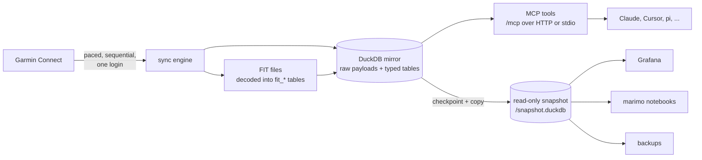

# garmin-mcp

An [MCP](https://modelcontextprotocol.io) server for Garmin Connect that answers from a complete local mirror of your account instead of calling Garmin for every question. A background sync fills a [DuckDB](https://duckdb.org) file with everything Garmin Connect returns for the logged-in user (activities, the original FIT files, every day's wellness data, training metrics, devices, gear, workouts, courses, badges) and keeps it fresh within the limits Garmin tolerates. The 160 tools follow [Taxuspt/garmin_mcp](https://github.com/Taxuspt/garmin_mcp), so existing clients keep working; three more expose the mirror itself as SQL.

## Why a mirror

Garmin Connect has no public API. [python-garminconnect](https://github.com/cyberjunky/python-garminconnect) speaks the private one the Connect app uses, which Garmin rate-limits, changes without notice, and protects with logins that need an MFA code. A stateless MCP server that calls Garmin for every tool call is slow, trips rate limits during a long conversation, and cannot answer questions that span years ("how has my resting heart rate moved since 2021?").

The mirror turns that around:

- **Tools are fast and free.** Most calls read the mirror in milliseconds and cost no Garmin request. Data that can still change is fetched on demand when it is stale for its kind; the stored copy is served, marked stale, when Garmin cannot be asked.
- **Everything is kept, as received.** Every response lands verbatim in `raw_payload` (a new row only when it changed, so it doubles as edit history) and is projected into typed tables with a description and unit on every column. The original FIT files are decoded into per-second records.
- **One login, ever.** You log in once with `garmin-mcp-auth` (email, password, MFA code); the tokens are refreshed in place by the library for months and the server never logs in on its own, so it cannot hammer Garmin's SSO.
- **It is just a DuckDB file.** A read-only snapshot is published next to the mirror and, optionally, over HTTP. Grafana, marimo, pandas, the DuckDB CLI: anything that reads DuckDB reads your data. Three compose profiles ship ready-made dashboards, notebooks and backups.

## What is in the box

| | |
|---|---|
| [Quickstart](quickstart.md) | `docker compose up -d`, one login, connect a client |
| [Configuration](configuration.md) | Every environment variable |
| [Authentication](authentication.md) | Bearer token, or OAuth 2.1 with your own OIDC provider |
| [Clients](clients.md) | Claude Code, Claude Desktop, claude.ai, Cursor, pi |
| [How sync works](sync.md) | Pacing, priorities, the archive model, FIT files, freshness, provenance |
| [Data](data/index.md) | Tables, the snapshot, example SQL, the [schema reference](data/schema.md) |
| [Extras](extras.md) | Grafana, notebooks, backups, or bring your own |
| [Operations](operations.md) | Memory, upgrades, troubleshooting, Garmin's account export |
| [Tools reference](reference/tools.md) | All 160 tools, grouped, with parameters |

## Credits

Tool definitions, descriptions, the workout builders and validators, the FIT analyses, the challenge mappings and the nutrition tools are adapted or vendored from [Taxuspt/garmin_mcp](https://github.com/Taxuspt/garmin_mcp) (MIT). Garmin Connect access goes through [python-garminconnect](https://github.com/cyberjunky/python-garminconnect) (MIT); FIT decoding through Garmin's [FIT SDK](https://developer.garmin.com/fit/). Garmin's API is unofficial and nothing here is endorsed by Garmin. This server is meant for one person's own data.
